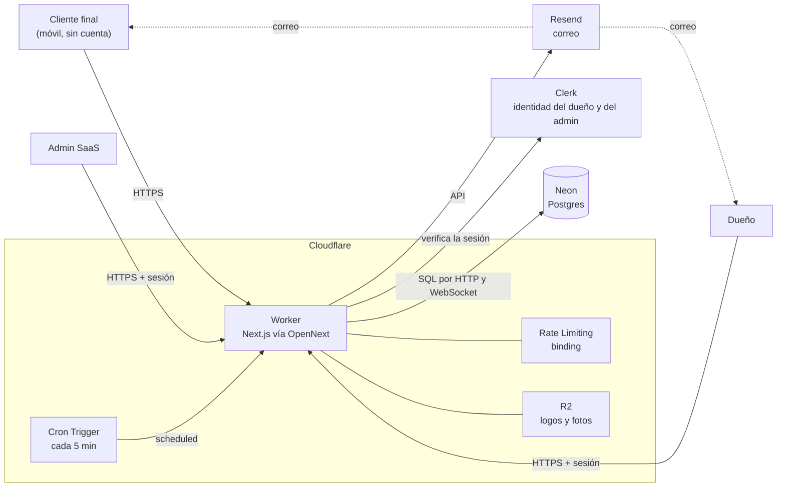
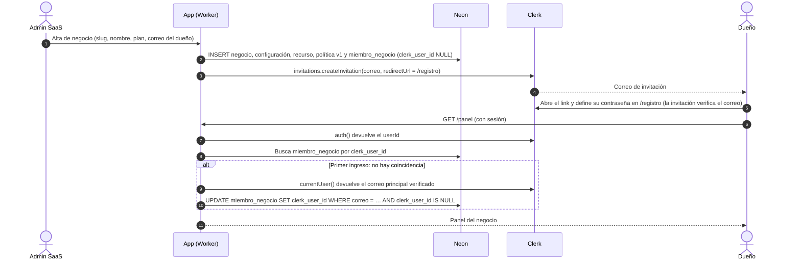
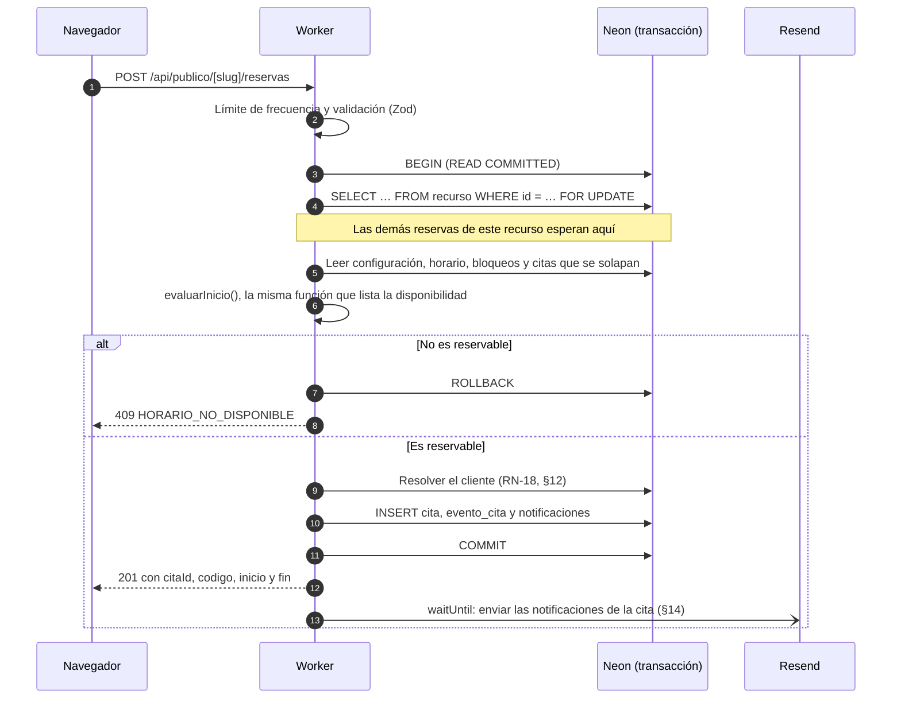
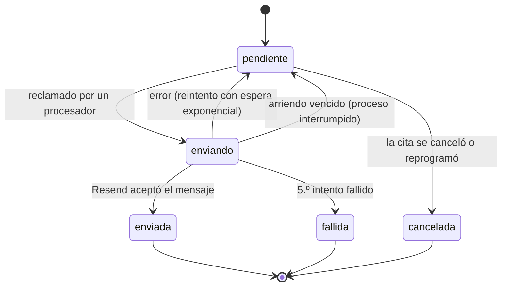
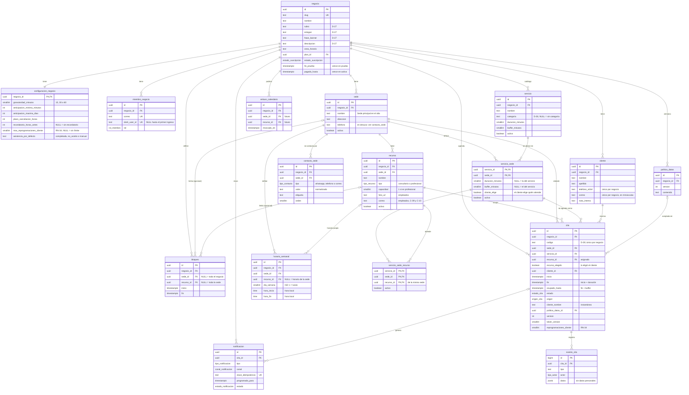
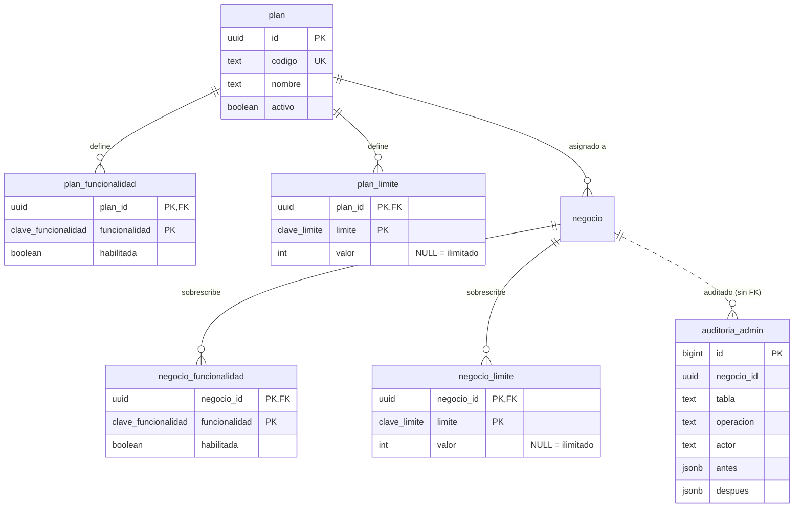

# Agenda de citas (SaaS) — Arquitectura

| | |
|---|---|
| **Versión** | 0.12 (borrador) |
| **Fecha** | 2026-10-20 |
| **Fuentes** | [alcance-y-reglas-de-negocio.md](alcance-y-reglas-de-negocio.md) v0.1 · [PRD.md](PRD.md) v0.9 · [TASKS-04.md](TASKS-04.md) |

> Este documento describe **cómo** se construye el producto del [PRD](PRD.md). Las referencias `RN-xx`, `D-xx`, `S-xx` y `P-xx` remiten a ese documento. Lo marcado como **propuesto** es una decisión de este documento que la fuente dejó abierta y que aún no se ha aceptado. Lo **aceptado** quedó confirmado en el PRD (D-06 a D-23).

### Historial de cambios

| Versión | Fecha | Cambios |
|---|---|---|
| 0.1 | 2026-10-07 | Primera versión. |
| 0.2 | 2026-10-07 | **Ocupación según D-06:** toda cita no cancelada ocupa capacidad, lo que afecta a §10, §11, §18.2 (índice), §18.3, §20 y §24. Las reglas RN-25 a RN-30 pasan al PRD (§16.1 remite allí). Drizzle y los ADR-05, 06, 09, 10 y 11 quedan aceptados (D-07 y D-08). |
| 0.3 | 2026-10-07 | **Suscripción:** nueva columna `negocio.pagado_hasta`, estado efectivo con 3 días de gracia, suspensión automática y panel en solo lectura (§7.6, RN-31, D-13, D-14, ADR-14). **Cita manual:** solo en horas libres del servicio, exenta únicamente de la anticipación (§10, §18.4, D-11). **Franjas independientes** (§10.1, D-12). **Bloqueos:** se rechazan sobre citas confirmadas y toman el bloqueo del recurso (§11.3, §18.4, D-15). Se aceptan los valores por defecto (D-09) y los umbrales (D-10). El código `RESERVAS_SUSPENDIDAS` pasa a llamarse `NEGOCIO_SUSPENDIDO`. |
| 0.4 | 2026-10-07 | **S-16:** nuevos tipos de notificación `dueno_gracia` (C-07) y `dueno_suspension` (C-08), generados por `aplicarVencimientos` y `suspenderNegocio`, con remitente del SaaS (§7.6, §14, §18.2). **S-17:** `editarCliente` y `suprimirCliente` funcionan con el panel en solo lectura (§7.5, §7.6, §18.4). |
| 0.5 | 2026-10-08 | **Sedes (D-16, RN-32, ADR-15):**<br>• Nuevas tablas `sede` y `servicio_sede`.<br>• `sede_id` en `recurso`, `horario_semanal`, `bloqueo` y `cita`.<br>• `servicio` deja de tener `recurso_id`.<br>• `negocio` deja de tener `direccion` y `telefono_contacto`, que pasan a la sede.<br>• Nuevo límite `max_locations`.<br>• La API pública recibe `sedeId`.<br>Afecta a §5, §9, §10, §11, §16, §17, §18, §20, §22 y §24. |
| 0.6 | 2026-10-08 | **Empleados (RN-33, D-17 a D-19, ADR-16):** nueva tabla `servicio_sede_recurso`; `servicio_sede` pierde `recurso_id` y gana `cliente_elige`; `recurso` gana `foto_url`, `descripcion` y `orden`, y un empleado (`profesional`) siempre tiene capacidad 1; `horario_semanal.recurso_id` para el horario propio; `cita.recurso_elegido`; la API pública acepta `recursoId`; el motor con varios recursos y la regla de asignación quedan especificados (§10.3) para cuando se construya el módulo. R2 guarda también las fotos. |
| 0.7 | 2026-10-08 | Cuatro cambios:<br>• **RN-34:** `max_reprogramaciones_cliente` en la configuración y `cita.reprogramaciones_cliente`.<br>• **D-21:** `asistencia_por_defecto` y nueva tarea del cron `aplicarAsistenciaPorDefecto`.<br>• **D-22:** se elimina `revision_cliente`; prevalece el teléfono (§12).<br>• **RN-35:** invitaciones iCalendar (§14.6), enlace de calendario del dueño (§14.7, tabla `enlace_calendario`, ruta `/api/calendario/…`, `RL_CALENDARIO`, `CALENDARIO_SECRET`), `recurso.correo` y tipos `empleado_cita_nueva` y `empleado_cambio`.<br>Nuevo ADR-17. |
| 0.8 | 2026-10-14 | **Ramas de Neon:** se llaman `development` (antes `dev`) y `production` (antes `main`), como quedaron en el proyecto creado (§20, §21.1). |
| 0.9 | 2026-10-16 | **Hallazgos de la Fase 1:**<br>• El middleware es `src/proxy.ts`, sin `createRouteMatcher`, y los `<ClerkProvider>` llevan `afterSignOutUrl="/login"` (§4, §7.3).<br>• El `Request` de `scheduled` lleva el encabezado `host` (§14.5).<br>• Dónde vive cada valor (§21.3).<br>• `npm run deploy` migra `production`, compila, quita los `.env` del bundle y despliega; scripts contra `production` (§21.4).<br>• Riesgos nuevos: el proxy en Workers y Clerk en `http://localhost`; tamaño medido del Worker (§21.4, §23). |
| 0.10 | 2026-10-18 | Dos cambios:<br>• **Workers Paid desde la Fase 3** (Q-17 de TASKS-01): qué ocupa el Worker y el nuevo límite de 10 MiB (§21.4, §23).<br>• **Operaciones de la Fase 2** en §18.4: datos del negocio y logo, consultorio, servicios, bloqueos, configuración, política y acciones del admin (Q-19 de TASKS-02). |
| 0.11 | 2026-10-18 | **Límites de Workers** (Q-36 de TASKS-03): la documentación vigente de Cloudflare no tiene límite comprimido; el tamaño se mide sin comprimir, con 64 MiB en los dos planes. La cuenta sigue en el plan gratuito, y el límite que importa es el de CPU, 10 ms por solicitud. Workers Paid se decide antes del primer cliente (§21.4, §23). |
| 0.12 | 2026-10-20 | **Modelo de D-26 a D-29** (PRD v0.9; Q-38 a Q-41 y Q-46 de TASKS-04):<br>• **D-27:** `negocio.rubro`, `eslogan`, `frase_banner` y `descripcion`.<br>• **D-26:** `servicio.categoria`, sin tabla aparte.<br>• **D-29:** enum `tipo_contacto` y tabla `contacto_sede`. `sede.telefono` deja de usarse, pero no se borra.<br>• **D-28:** `cita.codigo`, único por negocio, y cómo se genera en la reserva (§11.4).<br>• **Contratos:** la reserva responde también `codigo`, y `DATOS_INVALIDOS` puede traer `campos` (§18.5).<br>• **Operaciones:** `listarContactos`, `guardarContactos` y `listarCategorias`; cambian `guardarNegocio`, `guardarServicio` y `altaNegocio` (§18.4).<br>• **Color de marca (Q-42):** el valor por defecto de `negocio.color_primario` pasa de `#0f766e` a `#2b3fd6`, el acento de DESIGN.md, solo para los negocios nuevos.<br>Afecta a §11, §17, §18 y §19.1. |

---

## 1. Objetivos y restricciones de arquitectura

| Restricción | Consecuencia en el diseño |
|---|---|
| Una sola persona desarrolla, en 15 a 20 días | Pocas piezas y servicios gestionados. Sin colas, microservicios ni caché en el MVP. |
| Multi-negocio desde el día 1 (RN-01) | Base de datos compartida con `negocio_id` en todo y claves foráneas compuestas (§6). |
| La agenda debe ser correcta antes que cualquier otra cosa (RN-09 a RN-11) | Motor de disponibilidad puro y probado (§10), y reserva transaccional con bloqueo por recurso (§11). |
| Costo muy por debajo de 80.000 COP/mes | Planes gratuitos o de entrada de Cloudflare, Neon, Clerk y Resend. |
| Módulos futuros sin migrar datos | Puntos de extensión en el modelo (§17.3) y catálogo de funcionalidades (§16). |

## 2. Vista general



| Componente | Responsabilidad |
|---|---|
| **Worker (Next.js + OpenNext)** | Página pública, panel, admin, API pública, casos de uso y envío de correos. Es el único proceso del sistema. |
| **Cron Trigger** | Cada 5 minutos aplica las suspensiones por vencimiento (RN-31) y procesa las notificaciones pendientes, incluidos los recordatorios (RN-21). |
| **Neon Postgres** | Única fuente de verdad. Garantiza las invariantes de la agenda con transacciones y restricciones. |
| **Clerk** | Autenticación del dueño y del admin. **No** guarda nada del negocio ni de sus clientes. |
| **Resend** | Entrega de correos. |
| **Rate Limiting binding** | Límite de frecuencia de la API pública (RN-23). |
| **R2** | Logos de los negocios y fotos de los empleados. |

## 3. Stack

| Capa | Elección | Estado |
|---|---|---|
| App | Next.js (App Router) + TypeScript, desplegado en Cloudflare Workers con `@opennextjs/cloudflare`. Se fija el día 1 la versión de Next soportada por el adaptador. | Decidido |
| Base de datos | Neon (Postgres) con `@neondatabase/serverless`: HTTP para consultas sueltas y WebSocket para transacciones | Decidido |
| ORM | **Drizzle** (ADR-02) | Aceptado (D-07) |
| Autenticación | Clerk (`@clerk/nextjs`, `@clerk/localizations`) | Decidido |
| Correo | Resend + plantillas con React Email | Decidido / propuesto |
| Tareas programadas | Cloudflare Cron Triggers | Decidido |
| Límite de frecuencia | Binding de Rate Limiting de Workers (ADR-10) | Aceptado (D-08). Umbrales en D-10. |
| Archivos | Cloudflare R2 (logos y fotos de empleados) | Propuesto |
| Validación | Zod (en el servidor; los mismos esquemas en los formularios) | Propuesto |
| Fechas | `date-fns` + `@date-fns/tz`; `Intl.DateTimeFormat` para mostrar | Propuesto |
| Teléfonos | `libphonenumber-js` (país por defecto: CO) | Propuesto |
| UI | Tailwind CSS, con variables CSS para la marca de cada negocio | Propuesto |
| Pruebas | Vitest (unitarias e integración); Playwright para una prueba de humo, opcional | Propuesto |

## 4. Estructura del proyecto

```
/
├─ src/
│  ├─ app/
│  │  ├─ (publico)/[slug]/page.tsx                       # Página de reservas (PUB-*)
│  │  ├─ (publico)/[slug]/cita/[citaId]/[token]/page.tsx # Gestión por link (GES-*)
│  │  ├─ (panel)/panel/…                                 # Calendario, citas, clientes, configuración (PAN-*)
│  │  ├─ (admin)/admin/…                                 # Negocios (ADM-*)
│  │  ├─ (auth)/login/[[...rest]]/page.tsx               # <SignIn/> de Clerk
│  │  ├─ (auth)/registro/[[...rest]]/page.tsx            # <SignUp/> de Clerk (solo con invitación)
│  │  └─ api/
│  │     ├─ publico/[slug]/…                             # Contratos HTTP públicos (§18.5)
│  │     └─ interno/cron/route.ts                        # Invocado por el Cron Trigger
│  ├─ dominio/                  # Lógica PURA: sin I/O, sin Next, sin BD. Recibe `ahora` como parámetro.
│  │  ├─ disponibilidad.ts      # RN-07 a RN-10
│  │  ├─ estados-cita.ts        # Máquina de estados (PRD §7)
│  │  ├─ identidad-cliente.ts   # Normalización y decisión de RN-18
│  │  ├─ plazos.ts              # RN-13 y RN-16
│  │  ├─ suscripcion.ts         # Estado efectivo: al día, en gracia o suspendida (RN-31)
│  │  └─ tiempo.ts              # Conversión entre hora local y UTC (RN-03)
│  ├─ servidor/                 # Todo con `import 'server-only'`
│  │  ├─ db/                    # Clientes de Neon, esquema de Drizzle y repositorios (siempre con negocioId)
│  │  ├─ casos-uso/             # reservarCita, reprogramarCita, cancelarCita, crearBloqueo…
│  │  ├─ auth/                  # requireMiembro, requireSuperadmin (§7)
│  │  ├─ notificaciones/        # Bandeja de salida, envío y plantillas (§14)
│  │  ├─ planes/                # Catálogo, tieneFuncionalidad y limite (§16)
│  │  ├─ gestion-cita/          # Firma y verificación de los links (§13)
│  │  └─ rate-limit/            # §15
│  ├─ componentes/
│  └─ proxy.ts                  # Clerk (§7.3). En Next.js 16 reemplaza a middleware.ts
├─ drizzle/                     # Migraciones SQL versionadas (generadas y manuales)
├─ tests/
├─ worker.ts                    # Entrada del Worker: fetch de OpenNext + scheduled (§14.5)
├─ wrangler.jsonc
└─ open-next.config.ts
```

**Reglas de dependencia** (se hacen cumplir con `no-restricted-imports` de ESLint):

- `app/` → `servidor/casos-uso/` → `dominio/` y `servidor/db/`.
- `dominio/` no importa nada del proyecto fuera de sí mismo. Todo lo que depende del reloj recibe `ahora: Date`, así se puede probar sin trucos.
- Las rutas y las Server Actions son adaptadores delgados: validan la entrada con Zod, obtienen el contexto (negocio y actor) y llaman a un caso de uso.

## 5. Rutas y superficies

| Ruta | Usuario | Protección | Descripción |
|---|---|---|---|
| `/{slug}` | Cliente | Pública + límite de frecuencia | Página de reservas |
| `/{slug}/cita/{citaId}/{token}` | Cliente | Token firmado (§13) | Ver, cancelar y reprogramar |
| `/login`, `/registro` | Dueño, admin | Clerk | Ingreso y registro. El registro solo funciona con invitación. |
| `/panel/**` | Dueño | Sesión de Clerk + `requireMiembro` | Panel del negocio |
| `/admin/**` | Admin | Sesión de Clerk + `requireSuperadmin` | Administración interna |
| `/api/publico/{slug}/**` | Cliente | Límite de frecuencia (+ token en la gestión) | Contratos HTTP (§18.5) |
| `/api/interno/cron` | Cron Trigger | `Authorization: Bearer CRON_SECRET` | Procesa notificaciones |
| `/api/calendario/{enlaceId}/{token}` | Calendario del dueño (Google, Outlook…) | Token firmado (§14.7) y límite de frecuencia | Enlace de suscripción iCalendar (RN-35) |

**Sedes (RN-32).** No hay rutas por sede. Cuando exista la interfaz para varias sedes, la sede se elegirá en la misma página `/{slug}`. La API pública ya recibe `sedeId` desde el MVP (§18.5), así que ese cambio no rompe el contrato. Con una sola sede activa, la página la usa sin preguntar.

**Slugs reservados (RN-02).** Están definidos en código (`RESERVADOS`), cubiertos por una prueba y se validan en el alta: `admin`, `api`, `app`, `ayuda`, `blog`, `cita`, `citas`, `contacto`, `legal`, `login`, `logout`, `panel`, `planes`, `precios`, `privacidad`, `registro`, `sin-acceso`, `soporte`, `static`, `status`, `terminos`, `www`. El formato (`^[a-z0-9]+(-[a-z0-9]+)*$`, de 3 a 40 caracteres) ya excluye `_next` y los nombres de archivo.

## 6. Multi-negocio (RN-01)

**Modelo:** una base de datos y un esquema compartidos, con `negocio_id` en todas las tablas del negocio (ADR-01).

**Cómo se resuelve el negocio de cada solicitud:**

| Superficie | Fuente del `negocioId` |
|---|---|
| Página pública y API pública | `slug` de la URL → `negocio.id` |
| Link de gestión | `citaId` del link verificado por la firma, y el slug debe coincidir con el negocio de la cita |
| Panel | Sesión de Clerk → `miembro_negocio.clerk_user_id` → `negocio_id` (§7.4). **Nunca** sale de un parámetro del cliente. |
| Admin | Explícito: el admin elige el negocio |

**Defensas, en capas:**

1. **Repositorios:** toda función de acceso a datos recibe `negocioId` como primer parámetro y lo incluye en el `WHERE`. No existe `buscarCitaPorId(id)`: existe `buscarCita(negocioId, id)`. La sede es un filtro **dentro** del negocio, nunca un sustituto de `negocioId`.
2. **Claves foráneas compuestas:** las relaciones entre tablas de un negocio usan `(id, negocio_id)`. Así es **imposible** guardar, por ejemplo, una cita del negocio A con un servicio del negocio B, aunque el código tenga un error (§18.2).
3. **Respuesta uniforme:** un recurso de otro negocio responde igual que uno inexistente (`NO_ENCONTRADO`).
4. **Prueba de RN-01:** cada caso de uso se ejecuta con identificadores de otro negocio y debe fallar (§20).

**Por qué no Row Level Security (RLS) en el MVP:** exige fijar el negocio en cada conexión (`SET LOCAL` dentro de cada transacción) y suma complejidad con conexiones HTTP sin estado. Con las cuatro defensas anteriores el riesgo es bajo. RLS queda como endurecimiento futuro, compatible con este esquema.

## 7. Autenticación: integración con Clerk

### 7.1 Qué hace Clerk y qué no

| Clerk **sí** | Clerk **no** |
|---|---|
| Correo y contraseña, confirmación del correo, sesiones, recuperación de contraseña y la UI de ingreso | Guardar el negocio, el rol ni la pertenencia: eso vive en `miembro_negocio` (ADR-05) |
| Invitaciones para el alta manual de dueños | Autenticar a los clientes finales: no tienen cuenta (RN-17) |
| Verificar la sesión en el middleware y en el servidor | Organizations: no se usan en el MVP |

Así, los datos de los pacientes nunca pasan por Clerk, y cambiar de proveedor de identidad solo afecta a `clerk_user_id`.

### 7.2 Configuración de la instancia

| Ajuste (Dashboard de Clerk) | Valor | Motivo |
|---|---|---|
| Identificador | Correo electrónico | Panel con correo y contraseña |
| Autenticación | Contraseña | Requisito del alcance |
| Verificación del correo | Obligatoria al registrarse | "Más confirmación de correo" |
| Modo de registro | **Restringido** (solo con invitación) | Alta manual de negocios (ADR-06) |
| Proveedores sociales | Desactivados | Fuera de alcance |
| Rutas | Ingreso: `/login`. Registro: `/registro` | Componentes embebidos y slugs reservados |
| Idioma | `esES` de `@clerk/localizations` en `<ClerkProvider localization={esES}>` | Producto en español |
| Instancias | Desarrollo y producción separadas | Usuarios de prueba aislados |

`<ClerkProvider>` va en los layouts de `(panel)`, `(admin)` y `(auth)`, **no** en la página pública, para no cargar el JavaScript de Clerk donde no hace falta (RNF-01). Si esto da problemas con la versión elegida, se sube al layout raíz.

### 7.3 Middleware

```ts
// src/proxy.ts  (Next.js 16 renombró middleware.ts a proxy.ts)
import { clerkMiddleware } from '@clerk/nextjs/server';

// /panel y /admin, con o sin subrutas (no /panelito)
const RUTA_PRIVADA = /^\/(panel|admin)(\/|$)/;

export default clerkMiddleware(async (auth, req) => {
  if (RUTA_PRIVADA.test(req.nextUrl.pathname)) await auth.protect(); // Sin sesión: redirige a NEXT_PUBLIC_CLERK_SIGN_IN_URL (/login)
});

export const config = {
  // Solo las rutas que usan Clerk, con sus Server Actions (POST a la misma ruta). Ver abajo.
  matcher: ['/panel/:path*', '/admin/:path*', '/login/:path*', '/registro/:path*', '/sin-acceso'],
};
```

- **Solo en las rutas que usan Clerk** (Q-51 de [TASKS-04](TASKS-04.md)): la página pública, su política y la API no pasan por el middleware. Con el patrón general que recomienda Clerk, cada primera visita a `/{slug}` hacía la redirección de *handshake* al dominio de Clerk (tres viajes más), que en la Fase 4 era la mitad del LCP (RNF-01) y contradecía §7.2. Ninguna de esas rutas llama a `auth()`. Una ruta nueva que use Clerk debe agregarse al `matcher`.

El middleware **solo autentica**. La autorización (a qué negocio pertenece el usuario y si es admin) se verifica de nuevo en cada página, Server Action y ruta, porque el middleware no sabe nada del negocio.

- **Sin `createRouteMatcher`:** Clerk 7 lo marca como obsoleto (se quita en la próxima versión mayor y avisa en cada arranque), porque su comparación puede diferir de cómo Next resuelve las rutas. Por eso la ruta se compara con una expresión regular propia. Esa comparación es solo una comodidad: lleva a `/login` a quien llega sin sesión, en lugar del 404 de `requireSuperadmin` en `/admin`. La defensa real son `requireMiembro` y `requireSuperadmin` (§7.5).
- **Runtime:** Next.js 16 ejecuta `proxy.ts` siempre en Node.js (la opción `runtime` no está disponible), y OpenNext lo empaqueta para Workers como función experimental. Ver el riesgo en §23.
- **Cerrar sesión:** los `<ClerkProvider>` de `(auth)`, `(panel)` y `(admin)` (§7.2) llevan `afterSignOutUrl="/login"`. Clerk no lo lee de una variable de entorno, y sin la prop, cerrar sesión desde `<UserButton/>` lleva a la raíz `/`. El botón de `/sin-acceso` hace lo mismo con `<SignOutButton redirectUrl="/login">`.

### 7.4 Vinculación entre el usuario de Clerk y el negocio

El alta (F-11) crea `miembro_negocio` con el correo del dueño y `clerk_user_id = NULL`. La vinculación ocurre **en el primer ingreso**, sin webhooks (ADR-05):



Solo se vincula con el correo **principal y verificado**. Un correo sin verificar nunca da acceso a un negocio.

### 7.5 Autorización en el servidor

```ts
// src/servidor/auth/sesion.ts
import 'server-only';
import { cache } from 'react';
import { auth, currentUser } from '@clerk/nextjs/server';
import { notFound, redirect } from 'next/navigation';

export type ContextoMiembro = {
  negocioId: string;
  miembroId: string;
  rol: 'dueno';
  clerkUserId: string;
  suscripcion: EstadoEfectivo; // al_dia | en_gracia | suspendida (§7.6)
};

/** Primera línea de toda página, Server Action y ruta del panel. Se memoriza por solicitud. */
export const requireMiembro = cache(async (): Promise<ContextoMiembro> => {
  const { userId } = await auth();
  if (!userId) redirect('/login');

  const miembro = (await miembros.porClerkId(userId)) ?? (await vincularPorCorreo(userId));
  if (!miembro) redirect('/sin-acceso'); // Usuario válido, pero sin negocio asignado
  const negocio = await negocios.suscripcion(miembro.negocioId);
  return {
    negocioId: miembro.negocioId,
    miembroId: miembro.id,
    rol: miembro.rol,
    clerkUserId: userId,
    suscripcion: estadoEfectivo(negocio, new Date()),
  };
});

/**
 * Toda Server Action que MODIFICA datos empieza con esto. Con el negocio suspendido el panel es de solo lectura (D-14).
 * Excepción (S-17): editarCliente y suprimirCliente usan requireMiembro, para atender los derechos del titular (Ley 1581).
 */
export async function requireEscritura(): Promise<ContextoMiembro> {
  const ctx = await requireMiembro();
  // El envoltorio de las Server Actions convierte esta excepción en { ok: false, error: 'NEGOCIO_SUSPENDIDO' }
  if (ctx.suscripcion.estado === 'suspendida') throw new ErrorNegocio('NEGOCIO_SUSPENDIDO');
  return ctx;
}

async function vincularPorCorreo(userId: string) {
  const usuario = await currentUser();
  const principal = usuario?.emailAddresses.find((e) => e.id === usuario.primaryEmailAddressId);
  if (principal?.verification?.status !== 'verified') return null;
  return miembros.vincular(principal.emailAddress.toLowerCase(), userId); // UPDATE … RETURNING
}

/** Admin del SaaS: lista de IDs de Clerk en una variable de entorno (ADR-07). */
export async function requireSuperadmin() {
  const { userId } = await auth();
  const permitidos = (process.env.SUPERADMIN_CLERK_USER_IDS ?? '').split(',').map((s) => s.trim());
  if (!userId || !permitidos.includes(userId)) notFound(); // 404: no revela que /admin existe
  return { clerkUserId: userId };
}
```

### 7.6 Suscripción y acceso (RN-04, RN-29, RN-31)

**Estado efectivo.** Lo que decide el comportamiento no es solo la columna `estado_suscripcion`, sino un estado **calculado** en cada solicitud por una función pura (ADR-14):

```ts
// src/dominio/suscripcion.ts
export const DIAS_GRACIA = 3; // D-13

export type EstadoEfectivo =
  | { estado: 'al_dia' }
  | { estado: 'en_gracia'; suspendeEn: Date }
  | { estado: 'suspendida' };

export function estadoEfectivo(
  n: { estadoSuscripcion: 'prueba' | 'activa' | 'suspendida'; finPrueba: Date | null; pagadoHasta: Date | null },
  ahora: Date,
): EstadoEfectivo {
  if (n.estadoSuscripcion === 'suspendida') return { estado: 'suspendida' };
  const vence = (n.estadoSuscripcion === 'prueba' ? n.finPrueba : n.pagadoHasta)!; // El CHECK de §18.2 garantiza que no es NULL
  const suspendeEn = new Date(+vence + DIAS_GRACIA * 24 * 60 * 60 * 1000); // Colombia no tiene horario de verano
  if (ahora < vence) return { estado: 'al_dia' };
  if (ahora < suspendeEn) return { estado: 'en_gracia', suspendeEn };
  return { estado: 'suspendida' };
}
```

**Qué hace cada superficie:**

| Superficie | Al día | En gracia | Suspendida (D-14) |
|---|---|---|---|
| Autenticación | Normal | Normal | Normal: el dueño conserva el acceso (RN-04) |
| Panel: consultar | Normal | Normal, con un aviso que muestra `suspendeEn` (PAN-19) | Permitido |
| Panel: modificar | Normal | Normal | `requireEscritura` devuelve `NEGOCIO_SUSPENDIDO`, salvo para corregir o suprimir datos de clientes (S-17) |
| Página pública y reservas | Normal | Normal | `NEGOCIO_SUSPENDIDO` ("Reservas no disponibles") |
| Link de gestión | Normal | Normal | Muestra la cita y el contacto; las acciones devuelven `NEGOCIO_SUSPENDIDO` |
| Correos de citas (C-01 a C-06, C-09 y C-10) | Normal | Normal | No se envían (§14.3) |
| Enlace de calendario del dueño | Normal | Normal | Sigue funcionando: es una consulta (§14.7) |
| Correos de la cuenta (C-07 y C-08) | — | C-07, una vez por vencimiento | C-08, al suspenderse (S-16) |

Por S-17, `editarCliente` y `suprimirCliente` usan `requireMiembro` en lugar de `requireEscritura`, para atender los derechos del titular aun con el negocio suspendido.

**Persistencia, auditoría y avisos (`aplicarVencimientos`).** Como el estado se calcula en cada solicitud, la suspensión ocurre a tiempo aunque la tarea programada se retrase. Además, el cron (§14.4) hace dos cosas en una transacción:

- **persiste** la suspensión, para que quede auditada con el autor `sistema` (RN-30) y el admin la vea en su lista;
- **encola** los correos C-07 y C-08 del dueño (S-16).

```sql
-- Dentro de enTransaccion(): set_config(…, true) solo vive en la transacción
SELECT set_config('app.actor', 'sistema', true);

-- 1. C-07: una sola vez por vencimiento, a los negocios que están en gracia
INSERT INTO notificacion (negocio_id, tipo, destinatario, datos, clave_idempotencia)
SELECT n.id, 'dueno_gracia', m.correo,
       jsonb_build_object('vence', v.vence, 'suspende_en', v.vence + interval '3 days'),
       'dueno_gracia:' || m.id || ':' || extract(epoch FROM v.vence)::bigint
  FROM negocio n
 CROSS JOIN LATERAL (SELECT CASE n.estado_suscripcion WHEN 'prueba' THEN n.fin_prueba ELSE n.pagado_hasta END AS vence) v
  JOIN miembro_negocio m ON m.negocio_id = n.id AND m.rol = 'dueno'
 WHERE n.estado_suscripcion IN ('prueba', 'activa')
   AND v.vence <= now() AND now() < v.vence + interval '3 days'
ON CONFLICT (clave_idempotencia) DO NOTHING;

-- 2. Suspensión por fin de gracia (RN-31) + C-08 en la misma sentencia
WITH suspendidos AS (
  UPDATE negocio
     SET estado_suscripcion = 'suspendida'
   WHERE estado_suscripcion IN ('prueba', 'activa')
     AND CASE estado_suscripcion WHEN 'prueba' THEN fin_prueba ELSE pagado_hasta END
         + interval '3 days' <= now()
  RETURNING id
)
INSERT INTO notificacion (negocio_id, tipo, destinatario, clave_idempotencia)
SELECT s.id, 'dueno_suspension', m.correo,
       'dueno_suspension:' || m.id || ':' || extract(epoch FROM now())::bigint
  FROM suspendidos s
  JOIN miembro_negocio m ON m.negocio_id = s.id AND m.rol = 'dueno';
```

- La clave de C-07 incluye el vencimiento: si el negocio paga y vuelve a vencer, recibe un aviso nuevo, y si el cron corre varias veces durante la gracia, no se repite.
- C-08 se crea en la misma sentencia que suspende, así que no se duplica: una vez suspendido, el `UPDATE` ya no lo selecciona.
- `suspenderNegocio` (admin, §18.4) hace lo mismo con una suspensión manual.
- Si el cron no corrió durante toda la gracia, no se envía C-07, pero sí C-08.

**Fechas en el admin.** "Pagado hasta" y "fin de prueba" se eligen como **fecha local inclusiva**. Se guardan como las 00:00 locales del día siguiente. Por ejemplo, "pagado hasta el 9 de octubre" se guarda como `2026-10-10T05:00:00Z`.

**Reactivación.** `registrarPago` (§18.4) fija `estado_suscripcion = 'activa'` y el nuevo `pagado_hasta` en una sola sentencia auditada. El efecto es inmediato, porque el estado se calcula en cada solicitud.

### 7.7 Variables de Clerk

| Variable | Tipo | Valor o uso |
|---|---|---|
| `NEXT_PUBLIC_CLERK_PUBLISHABLE_KEY` | Variable de build | Clave pública |
| `CLERK_SECRET_KEY` | Secreto del Worker | API de backend (invitaciones, `currentUser`) |
| `NEXT_PUBLIC_CLERK_SIGN_IN_URL` | Variable de build | `/login` |
| `NEXT_PUBLIC_CLERK_SIGN_UP_URL` | Variable de build | `/registro` |
| `SUPERADMIN_CLERK_USER_IDS` | Variable del Worker | IDs `user_…` separados por comas |

### 7.8 Evolución prevista

- **`multi_user`:** el dueño invita a más miembros con el mismo mecanismo (fila en `miembro_negocio` + invitación de Clerk). Se añaden valores al enum `rol_miembro` y se relaja la unicidad global de `correo` y `clerk_user_id` a `(negocio_id, …)`, con un selector de negocio activo.
- **Webhooks:** si hace falta reaccionar a `user.deleted`, se añade `/api/webhooks/clerk` con `verifyWebhook` de `@clerk/nextjs/webhooks`.

## 8. Acceso a datos: Neon + Drizzle

**Dos clientes con propósitos distintos:**

```ts
// src/servidor/db/cliente.ts
import 'server-only';
import { neon, Pool } from '@neondatabase/serverless';
import { drizzle as drizzleHttp } from 'drizzle-orm/neon-http';
import { drizzle as drizzleWs } from 'drizzle-orm/neon-serverless';
import * as esquema from './esquema';

/** Consultas y escrituras de una sola sentencia: HTTP, sin conexión persistente. */
export const db = () => drizzleHttp(neon(process.env.DATABASE_URL!), { schema: esquema });

/** Transacciones interactivas (RN-11): WebSocket. El Pool vive solo durante la transacción. */
export async function enTransaccion<T>(fn: (tx: Transaccion) => Promise<T>): Promise<T> {
  const pool = new Pool({ connectionString: process.env.DATABASE_URL });
  try {
    return await drizzleWs(pool, { schema: esquema }).transaction(fn, { isolationLevel: 'read committed' });
  } finally {
    await pool.end();
  }
}
```

- En Workers, una conexión WebSocket no puede sobrevivir a la solicitud que la abrió. Por eso el `Pool` se crea y se cierra dentro de cada transacción y nunca se guarda en una variable global.
- El driver HTTP **no** admite transacciones interactivas, que son las que hacen falta para leer, decidir y escribir (RN-11). Por eso existe el cliente WebSocket.
- `DATABASE_URL` apunta al endpoint con *pooler* de Neon. El aislamiento es `READ COMMITTED` a propósito (§11.3).
- **Región de Neon:** `aws-us-east-1` (latencia razonable desde Colombia). Si las transacciones se sienten lentas por los viajes de ida y vuelta, se activa **Smart Placement** en el Worker para ejecutarlo cerca de la base de datos.
- **Migraciones:** `drizzle-kit generate` produce SQL que se revisa y se versiona en `drizzle/`. Lo que Drizzle no expresa (dominios, algunos `CHECK` y triggers) va en migraciones SQL escritas a mano. Se aplican con `drizzle-kit migrate` usando la cadena **directa** (sin *pooler*) **antes** de desplegar el Worker, y siempre de forma compatible hacia atrás.

## 9. Tiempo y zonas horarias (RN-03)

| Dato | Cómo se guarda |
|---|---|
| Instantes (citas, bloqueos y envíos) | `timestamptz`, en UTC |
| Horario semanal | `time` **local** de cada sede, o de cada empleado con horario propio (por ejemplo, `08:00`), interpretado con `negocio.zona_horaria`. Si algún día hay sedes en zonas distintas, la zona pasa a `sede`. |
| Zona del negocio | `negocio.zona_horaria`, por defecto `America/Bogota` |

**Reglas:**

1. La conversión entre hora local y UTC ocurre **solo** en `dominio/tiempo.ts`, y siempre para una fecha concreta. Colombia no tiene horario de verano, pero el código no lo da por hecho.
2. "Las citas del 14 de octubre" significa `[14-oct 00:00 local, 15-oct 00:00 local)` convertido a UTC. En SQL nunca se usa `inicio::date`. Si hace falta, se usa `(inicio AT TIME ZONE zona_horaria)::date`.
3. Para mostrar las horas se usa `Intl.DateTimeFormat('es-CO', { timeZone: negocio.zonaHoraria, … })`, tanto en el servidor como en el navegador. **Nunca** la zona del dispositivo.
4. La API pública intercambia instantes en ISO 8601 UTC (`…Z`) y fechas locales como `YYYY-MM-DD`.
5. Los límites mensuales (§16) se cuentan por mes calendario **local**.

| Hora local (Bogotá, UTC−5) | Valor guardado (UTC) |
|---|---|
| 14-oct-2026, 7:00 a. m. | `2026-10-14T12:00:00Z` |
| 14-oct-2026, 7:00 p. m. | `2026-10-15T00:00:00Z`, **otro día en UTC** (caso de prueba obligatorio) |

## 10. Motor de disponibilidad (RN-07 a RN-10)

Es una función **pura** en `dominio/disponibilidad.ts`, que siempre trabaja sobre **un servicio en una sede**. `servicio_sede` indica la duración, el buffer y si el cliente elige quién atiende; `servicio_sede_recurso`, qué recursos pueden atenderlo; y el horario sale de la sede o del horario propio del empleado (RN-33). La **misma** función decide qué horas se listan y si una reserva es válida dentro de la transacción. Así, lo que no se ofrece tampoco se puede reservar con una solicitud directa.

```ts
export type Intervalo = { inicio: Date; fin: Date }; // Semiabierto: [inicio, fin)  (S-04)

export type ContextoAgenda = {
  zonaHoraria: string;
  ahora: Date;
  servicio: { duracionMin: number; bufferMin: number }; // Los de servicio_sede si la sede los sobrescribe; si no, los del servicio
  capacidad: number;
  config: { granularidadMin: 15 | 30 | 60; anticipacionMinimaMin: number; anticipacionMaximaDias: number };
  franjas: { diaSemana: 1 | 2 | 3 | 4 | 5 | 6 | 7; horaInicio: string; horaFin: string }[]; // De la SEDE. Hora local 'HH:mm'; ISO: 1 = lunes
  bloqueos: Intervalo[];   // Del negocio, de la sede o del recurso, que se solapan con el rango consultado
  ocupacion: Intervalo[];  // Citas NO canceladas del recurso (RN-10, D-06): [inicio, ocupado_hasta)
  actor: 'cliente' | 'dueno'; // El dueño está exento de la anticipación mínima y máxima (D-11)
};

export type MotivoRechazo = 'FUERA_DE_HORARIO' | 'BLOQUEADO' | 'NO_ALINEADO' | 'ANTICIPACION' | 'SIN_CAPACIDAD';

/** Inicios reservables entre dos fechas locales, ambas inclusive. */
export function iniciosDisponibles(ctx: ContextoAgenda, desde: string, hasta: string): Date[];

/** Verificación de un inicio concreto. La usan la reserva, la reprogramación, la cita manual y el movimiento. */
export function evaluarInicio(ctx: ContextoAgenda, inicio: Date): { ok: true } | { ok: false; motivos: MotivoRechazo[] };
```

- **Para el cliente y para el dueño se usa la misma función.** La única diferencia es `actor: 'dueno'`, que omite la condición de anticipación (RN-09.4). El panel muestra al dueño las horas libres de `iniciosDisponibles` y solo acepta una de ellas: no hay advertencias que se puedan confirmar ni sobrecupo (D-01, D-11).
- `evaluarInicio` devuelve **todos** los motivos de rechazo, para que la interfaz explique por qué una hora no está disponible.
- Sin la anticipación, el dueño podría elegir una hora que ya pasó. Por eso, para él, solo se ofrecen inicios `≥ ahora`. Registrar citas en el pasado no es un caso del MVP.

### 10.1 Algoritmo de `iniciosDisponibles`

```
para cada fecha local d en [desde, hasta]:
    franjas del día de la semana de d, cada una por separado (NO se unen las contiguas)   (D-12)
    para cada franja f:
        t ← primer múltiplo de la granularidad, contado desde las 00:00 locales, que sea ≥ f.inicio   (S-02, RN-09.3)
        mientras t + duración + buffer ≤ f.fin:                                 (RN-09.1: cabe en ESTA franja)
            intervalo ← [t, t + duración + buffer), convertido a UTC con la zona del negocio
            si (actor = cliente: ahora + antMin ≤ t ≤ ahora + antMaxDías;
                actor = dueño:   t ≥ ahora)                                     (RN-09.4, D-11)
               y el intervalo no se solapa con ningún bloqueo                   (RN-09.2)
               y maxSimultaneas(ocupación, intervalo) < capacidad              (RN-09.5)
            entonces se agrega t
            t ← t + granularidad
```

### 10.2 Capacidad en **todo** el intervalo (RN-09.5)

Con capacidad mayor que 1, **no basta con contar** las citas que se solapan con el intervalo. Ejemplo: capacidad 2, candidato de 9:00 a 10:00, y citas existentes de 9:00 a 9:30 y de 9:30 a 10:00. Ambas se solapan con el candidato, pero nunca coinciden entre sí: la ocupación máxima es 1 y el candidato **sí** cabe. Contarlas daría 2 y lo rechazaría por error.

Por eso se hace un barrido de eventos:

```ts
function maxSimultaneas(ocupacion: Intervalo[], ventana: Intervalo): number {
  const eventos: [number, 1 | -1][] = [];
  for (const o of ocupacion) {
    const ini = Math.max(+o.inicio, +ventana.inicio);
    const fin = Math.min(+o.fin, +ventana.fin);
    if (ini < fin) eventos.push([ini, +1], [fin, -1]);
  }
  eventos.sort((a, b) => a[0] - b[0] || a[1] - b[1]); // En el mismo instante, primero las salidas (S-04)
  let actual = 0, max = 0;
  for (const [, delta] of eventos) max = Math.max(max, (actual += delta));
  return max;
}
```

Con unas 30 citas al mes, el costo es despreciable. La disponibilidad de una semana carga una sola vez el horario, los bloqueos y la ocupación del rango, y calcula todo en memoria.

### 10.3 Varios recursos por servicio (RN-33; el motor se construye después, D-17)

En el MVP, cada `servicio_sede` tiene un solo recurso en `servicio_sede_recurso` (el consultorio), así que el motor trabaja con uno. Cuando se construya el módulo de empleados, el motor se extiende así, **sin cambiar las tablas**:

| Caso | Horas que se ofrecen | Recurso que queda en la cita |
|---|---|---|
| Por capacidad (un espacio de capacidad N) | Las de ese espacio, como en §10.1 | El espacio |
| Por empleados, el cliente eligió a uno | Las de ese empleado: su horario efectivo, sus bloqueos y su ocupación | El elegido, con `recurso_elegido = true` |
| Por empleados, "Sin preferencia" o sin la marca | La **unión** de las horas de todos los empleados activos de la lista | Uno libre a esa hora, según la regla de asignación, con `recurso_elegido = false` |

- **Horario efectivo de un recurso (D-19):** si tiene filas propias en `horario_semanal`, se usan esas; si no, las de su sede (`recurso_id IS NULL`). Al guardarlo se valida que el horario propio quede dentro del de la sede.
- **Bloqueos que aplican a un recurso:** los del negocio, los de su sede y los suyos.
- **Regla de asignación** (determinista, para poder probarla): entre los empleados libres en el intervalo, se elige el que tenga menos citas activas ese día local; si empatan, el de menor `orden` y luego el de menor `id`. Así se reparte la carga.
- **Transacción:**
  - Si el cliente eligió a alguien, se bloquea solo ese recurso.
  - Con asignación automática, se bloquean **todos** los candidatos con `FOR UPDATE`, ordenados por `id` (§11.3). Luego se evalúa cada uno con `evaluarInicio`, se elige según la regla y se inserta.
  - Si ninguno está libre, la respuesta es `HORARIO_NO_DISPONIBLE`.
- **Reprogramar:** si `recurso_elegido = true`, se ofrecen solo las horas de ese empleado. Si no, se vuelve a asignar.
- **Limitación:** una cita ocupa un solo recurso. No se modela una cita que necesite a la vez un empleado y un espacio.

## 11. Reserva transaccional (RN-11, RN-14, RN-15)

### 11.1 Secuencia



### 11.2 SQL del núcleo

```sql
BEGIN;  -- READ COMMITTED

-- 1. Serializa las escrituras de agenda de ESTE recurso (RN-11). Los demás recursos no esperan.
SELECT capacidad
  FROM recurso
 WHERE id = $recurso_id AND negocio_id = $negocio_id AND activo
   FOR UPDATE;

-- 2. Datos para evaluarInicio(). Se leen DESPUÉS del bloqueo, así que ven todo lo confirmado antes.
SELECT inicio, ocupado_hasta
  FROM cita
 WHERE recurso_id = $recurso_id
   AND estado <> 'cancelada'                                    -- RN-10 (D-06): toda cita no cancelada ocupa
   AND inicio < $ocupado_hasta AND ocupado_hasta > $inicio      -- solapamiento semiabierto
   AND ($cita_excluida::uuid IS NULL OR id <> $cita_excluida);  -- reprogramación (RN-14)

SELECT inicio, fin
  FROM bloqueo
 WHERE negocio_id = $negocio_id
   AND (sede_id IS NULL OR sede_id = $sede_id)          -- NULL = todo el negocio
   AND (recurso_id IS NULL OR recurso_id = $recurso_id) -- NULL = toda la sede
   AND inicio < $ocupado_hasta AND fin > $inicio;
-- (Además se leen configuracion_negocio, el horario_semanal de la sede y servicio_sede.)

-- 3. Cliente (§12), código de reserva (§11.4), cita, evento y notificaciones (§14)
SELECT 1 FROM cita WHERE negocio_id = $negocio_id AND codigo = $codigo;  -- si existe, se genera otro
INSERT INTO cita (…) VALUES (…) RETURNING id;
INSERT INTO evento_cita (…) VALUES (…);
INSERT INTO notificacion (…) VALUES (…), (…), (…);

COMMIT;
```

### 11.3 Por qué funciona y qué no hay que cambiar

- **El bloqueo de fila sobre `recurso`** convierte las reservas concurrentes de un mismo recurso en una fila de espera. La segunda transacción espera en el `FOR UPDATE` hasta que la primera confirma.
- **Tiene que ser `READ COMMITTED`.** En ese nivel, cada sentencia ve lo confirmado hasta su inicio, así que la lectura de citas del paso 2 ve la cita que acaba de entrar. Con `REPEATABLE READ`, la instantánea se tomaría **antes** de esperar el bloqueo y se aceptaría una doble reserva. No se sube el nivel de aislamiento.
- **Solo toman el bloqueo las operaciones que aumentan la ocupación de un horario.** Con D-06 son dos: crear una cita (pública o manual; a futuro, también en `pendiente_pago`) y reprogramarla o moverla. Pasar entre `confirmada`, `completada` y `no_asistio`, o a futuro de `pendiente_pago` a `confirmada`, no cambia la ocupación. Cancelar la reduce. Ninguno de esos cambios necesita el bloqueo, y como una cita cancelada no se reactiva (S-08), no hay otra forma de ocupar capacidad.
- **Crear un bloqueo también toma el bloqueo (D-15).** Sin él, una reserva podría colarse entre la verificación "no hay citas en este rango" y el `INSERT` del bloqueo. `crearBloqueo` bloquea con `FOR UPDATE` los recursos afectados, **ordenados por `id`**: el del bloqueo; si no tiene recurso, todos los de su sede; y si tampoco tiene sede, todos los del negocio. Ordenarlos evita que dos operaciones se esperen mutuamente en orden cruzado. Después busca citas `confirmada` con `ocupado_hasta > now()` en el rango. Si hay alguna, responde `BLOQUEO_CON_CITAS` con la lista. Si no hay, inserta. Como la reserva lee los bloqueos **después** de tomar el mismo bloqueo, siempre ve el bloqueo recién creado.
- **Varios candidatos (RN-33):** cuando el sistema asigna el empleado, la reserva bloquea a todos los candidatos en orden de `id`, igual que `crearBloqueo`. En el MVP siempre hay un solo candidato.
- **Alternativas descartadas (ADR-04):** `EXCLUDE USING gist` solo sirve para capacidad 1. `SERIALIZABLE` funciona, pero obliga a reintentar ante fallos de serialización. Un `pg_advisory_xact_lock` sería equivalente, pero menos explícito.

### 11.4 Código de reserva (D-28)

Cada cita tiene un código legible que el cliente usa para identificarla al hablar con el negocio (Q-41 de [TASKS-04](TASKS-04.md)).

- **Formato:** `AA-0000`, con `CHECK (codigo ~ '^[A-Z]{2}-[0-9]{4,6}$')` y `UNIQUE (negocio_id, codigo)` (§18.2).
- **Prefijo:** dos letras que salen del nombre del negocio al reservar: las iniciales de las dos primeras palabras o, si hay una sola, sus dos primeras letras, sin tildes y en mayúsculas. Sin letras, `XX`. Como se calcula al crear la cita, cambiar el nombre del negocio no cambia los códigos existentes.
- **Generación:** `dominio/codigo-reserva.ts` arma el código con 4 dígitos al azar, y el azar llega como parámetro (§4). Dentro de la transacción de la reserva (§11.2), se comprueba que el código esté libre antes del `INSERT`. Si aun así choca, porque otra reserva de otro recurso tomó el mismo código, se reintenta la transacción, igual que ante un choque por el correo (§12). Después de 5 choques se usan 6 dígitos.
- **No es una credencial:** no da acceso a nada. La gestión por link sigue exigiendo la firma de §13.
- **Migración:** las citas anteriores a la columna se rellenaron con el prefijo de su negocio y un número correlativo.

## 12. Identidad de clientes (RN-18, RN-19)

**Normalización** (`dominio/identidad-cliente.ts`):

- Teléfono: `libphonenumber-js` con país por defecto `CO`, convertido a E.164 (`+573001234567`). Si no es válido, se rechaza con `DATOS_INVALIDOS`.
- Correo: se recortan los espacios y se pasa a minúsculas.

**Decisión** (dentro de la transacción de la reserva):

```
porTelefono ← cliente del negocio con ese telefono_e164
porCorreo   ← cliente del negocio con ese correo

si porTelefono:                                   # RN-18.1 y RN-19
    cliente ← porTelefono
    actualizar nombre y apellido                  # RN-18.3
    si cliente.correo es NULL y nadie más usa ese correo: completar el correo  (S-15)
    # Si porCorreo es OTRO cliente, se ignora: prevalece el teléfono (RN-18.5, D-22)
si no, si porCorreo:                              # RN-18.2
    cliente ← porCorreo
    actualizar nombre y apellido; si cliente.telefono es NULL: completar el teléfono
si no:                                            # RN-18.4
    INSERT … ON CONFLICT (negocio_id, telefono_e164) DO UPDATE SET nombre = EXCLUDED.nombre, …
```

- La cita guarda **una instantánea** del nombre, el apellido, el teléfono y el correo con los que se reservó (RN-18.3, S-15).
- **Concurrencia:** las reservas de un mismo recurso ya están en fila por el bloqueo de §11. Entre recursos distintos, el `ON CONFLICT` y las restricciones únicas evitan duplicados. Ante un choque por el correo, se reintenta una vez.
- **Sin revisión de identidad (D-22):** no hay fusiones ni conflictos pendientes. Si el teléfono coincide con un cliente y el correo con otro, la cita va al del teléfono y el otro queda intacto.

## 13. Links de gestión (RN-13)

El token **no se guarda**: se deriva de la cita con un HMAC (ADR-09).

```
token = base64url( HMAC-SHA256( GESTION_CITA_SECRET, "{citaId}.{token_version}" ) )
URL   = https://tuapp.com/{slug}/cita/{citaId}/{token}
```

- **Impredecible:** sin el secreto no se puede generar. Tiene 256 bits.
- **Reutilizable:** el recordatorio y la reprogramación incluyen el mismo link sin guardar ningún secreto en la base de datos.
- **Verificación:** con `crypto.subtle.verify('HMAC', …)`, que compara en tiempo constante. Un token inválido responde `404 NO_ENCONTRADO`.
- **Revocación:** `token_version = token_version + 1` invalida los links anteriores de esa cita.
- **Rotación del secreto:** durante la transición se aceptan `GESTION_CITA_SECRET` y `GESTION_CITA_SECRET_ANTERIOR`.
- **Encabezados de la página:** `Referrer-Policy: no-referrer`, `X-Robots-Tag: noindex` y `Cache-Control: private, no-store`.
- El link **no caduca**. Lo que se puede hacer con él lo deciden las reglas: el plazo de RN-13, el estado de la cita y la suscripción del negocio (D-14: si está suspendido, solo se puede consultar).

## 14. Notificaciones (RN-20 a RN-22)

### 14.1 Patrón: bandeja de salida (*outbox*) en la base de datos

Las notificaciones se **insertan en la misma transacción** que el cambio de la cita. Si la transacción falla, no hay correo. Si se confirma, el correo saldrá aunque el envío inmediato falle.

| Tipo (`tipo_notificacion`) | Correo del PRD | Clave de idempotencia (única) | `programada_para` |
|---|---|---|---|
| `confirmacion` | C-01 | `confirmacion:{citaId}` | Ahora |
| `recordatorio` | C-02 | `recordatorio:{citaId}:v{version}` | `inicio − recordatorio_horas_antes`. Si ya pasó, no se crea (S-12). |
| `cancelacion` | C-03 | `cancelacion:{citaId}` | Ahora |
| `reprogramacion` | C-04 | `reprogramacion:{citaId}:v{version}` | Ahora |
| `dueno_cita_nueva` | C-05 | `dueno_cita_nueva:{citaId}` | Ahora |
| `dueno_cambio` | C-06 | `dueno_cambio:{citaId}:{eventoId}` | Ahora |
| `dueno_gracia` | C-07 | `dueno_gracia:{miembroId}:{vencimiento}` | Ahora (lo encola `aplicarVencimientos`, §7.6) |
| `dueno_suspension` | C-08 | `dueno_suspension:{miembroId}:{instante de la suspensión}` | Ahora (lo encolan `aplicarVencimientos` y `suspenderNegocio`) |
| `empleado_cita_nueva` | C-09 | `empleado_cita_nueva:{citaId}:{recursoId}` | Ahora (módulo de empleados; solo si el empleado tiene correo) |
| `empleado_cambio` | C-10 | `empleado_cambio:{citaId}:{recursoId}:{eventoId}` | Ahora (módulo de empleados) |

Los tipos `dueno_gracia` y `dueno_suspension` son **correos de la cuenta** (S-16): no tienen `cita_id`, salen con el remitente del SaaS y no cuentan para `max_emails_per_month`.

- La **restricción `UNIQUE (clave_idempotencia)`** impide crear dos veces el mismo mensaje (RN-20).
- **Reprogramar** anula el recordatorio pendiente (`estado = 'cancelada'`) e inserta uno nuevo con la nueva `version`.
- **Cancelar** anula el recordatorio pendiente.
- **Cambiar `recordatorio_horas_antes`** recalcula `programada_para` de los recordatorios pendientes de citas futuras.
- **Acciones del dueño:** no generan `dueno_*` (S-06).
- **Citas sin correo** (manuales, S-05): no generan notificaciones al cliente.

### 14.2 Ciclo de vida de un envío



### 14.3 Reclamar y enviar

```sql
-- Reclamar un lote: seguro con varios procesadores en paralelo (cron + envío inmediato)
UPDATE notificacion
   SET estado = 'enviando', intentos = intentos + 1, bloqueada_hasta = now() + interval '2 minutes'
 WHERE id IN (
         SELECT id FROM notificacion
          WHERE (estado = 'pendiente' AND programada_para <= now())
             OR (estado = 'enviando'  AND bloqueada_hasta < now())   -- arriendo vencido
          ORDER BY programada_para
          LIMIT 25
            FOR UPDATE SKIP LOCKED)
RETURNING *;
```

Para cada notificación reclamada:

1. **Revalidar:** se marca `cancelada` y no se envía si se cumple cualquiera de estas condiciones:
   - es un correo de citas (C-01 a C-06, C-09 o C-10) y el negocio está suspendido según `estadoEfectivo()` (D-14), en cuyo caso se registra `ultimo_error = 'NEGOCIO_SUSPENDIDO'`;
   - es un `recordatorio` y la cita ya no está `confirmada`, o su `version` no coincide;
   - es `dueno_gracia` y el negocio ya no está `en_gracia` (pagó o ya fue suspendido);
   - es `dueno_suspension` y el negocio ya no está suspendido (se reactivó antes del envío).

   Las notificaciones aún no vencidas siguen `pendiente`. Si el negocio se reactiva antes de su hora, salen con normalidad.
2. **Comprobar el límite** `max_emails_per_month` (§16), solo para los correos de citas. Si se superó, se marca `fallida` con el error `LIMITE_PLAN`.
3. **Renderizar** la plantilla (React Email) con los datos actuales y la zona del negocio.
4. **Enviar** con Resend, pasando `clave_idempotencia` como clave de idempotencia de la API. Si el proceso muere después de enviar y antes de marcar, el reintento no duplica el correo.
5. **Marcar:** si sale bien, `enviada`, con `proveedor_mensaje_id` y `enviada_en`. Si falla, vuelve a `pendiente` con `programada_para = now() + 2^intentos minutos`, y pasa a `fallida` en el 5.º intento.

**Remitente:**

- Correos de citas: `"{nombre del negocio}" <citas@tuapp.com>`, con `reply_to` igual al correo de contacto del negocio.
- Correos de la cuenta (C-07 y C-08): `"{nombre del producto}" <cuenta@tuapp.com>`, con `reply_to` igual a `CORREO_SOPORTE`. Las instrucciones de pago (transferencia o Nequi) son texto fijo de la plantilla.

El dominio se verifica en Resend con SPF, DKIM y DMARC.

### 14.4 Envío inmediato y envío programado

- **Inmediato:** tras el `COMMIT`, el caso de uso llama a `getCloudflareContext().ctx.waitUntil(procesarNotificaciones({ citaId }))`. La confirmación llega en segundos y la respuesta HTTP no espera al correo.
- **Programado:** el Cron Trigger corre cada 5 minutos y hace tres tareas, en este orden:
  1. `aplicarVencimientos`: persiste las suspensiones por fin de gracia (§7.6, RN-31). Va primero, para que los pasos siguientes ya vean el estado actualizado.
  2. `aplicarAsistenciaPorDefecto` (D-21): marca las citas `confirmada` que ya terminaron y que el dueño no marcó (ver abajo).
  3. `procesarNotificaciones`: procesa todo lo vencido, es decir, recordatorios, reintentos y arriendos vencidos (RN-21).

```sql
-- aplicarAsistenciaPorDefecto (D-21): una sola sentencia, con su evento de auditoría
WITH marcadas AS (
  UPDATE cita c
     SET estado = cfg.asistencia_por_defecto::estado_cita, actualizado_en = now()
    FROM configuracion_negocio cfg
    JOIN negocio n ON n.id = cfg.negocio_id
   WHERE cfg.negocio_id = c.negocio_id
     AND c.estado = 'confirmada' AND c.fin <= now()
     AND cfg.asistencia_por_defecto <> 'manual'
     AND n.estado_suscripcion <> 'suspendida'          -- D-14; se aplica al reactivarse
  RETURNING c.id, c.negocio_id, c.estado
)
INSERT INTO evento_cita (negocio_id, cita_id, tipo, actor, datos)
SELECT negocio_id, id, estado::text, 'sistema', '{"automatica": true}' FROM marcadas;
```

### 14.5 Entrada del Worker con `scheduled`

OpenNext genera el manejador `fetch`. Para añadir el Cron Trigger se usa una entrada propia:

```ts
// worker.ts
// @ts-ignore: generado por `opennextjs-cloudflare build`
import { default as handler } from './.open-next/worker.js';

export default {
  fetch: handler.fetch,
  async scheduled(_evento, env, ctx) {
    // Se invoca la ruta interna dentro del mismo Worker, sin pasar por la red pública
    const url = new URL('/api/interno/cron', env.APP_URL);
    const solicitud = new Request(url, {
      method: 'POST',
      headers: {
        host: url.host, // Imprescindible: ver abajo
        authorization: `Bearer ${env.CRON_SECRET}`,
      },
    });
    ctx.waitUntil(
      (handler.fetch(solicitud, env, ctx) as Promise<Response>).then((respuesta) =>
        // Workers Logs: el cron corrió y con qué respuesta (§21.4)
        console.log(JSON.stringify({ evento: 'cron', ruta: '/api/interno/cron', estado: respuesta.status })),
      ),
    );
  },
} satisfies ExportedHandler<CloudflareEnv>;

// Si la configuración de OpenNext usa Durable Objects (caché y colas), también se reexportan desde aquí.
```

**El encabezado `host` es obligatorio.** `isExternal` de `@opennextjs/aws` compara el host de la URL con ese encabezado. Sin él, toma la URL absoluta como externa y la reenvía por la red hacia `APP_URL`, es decir, al propio `*.workers.dev` a través de Internet. Con `host`, la atiende el mismo Worker. Se comprobó con `wrangler dev --test-scheduled` y `APP_URL` apuntando a un host inexistente: la ruta respondió 204 igual.

### 14.6 Invitaciones de calendario (RN-35)

C-01, C-03 y C-04 (y, con el módulo de empleados, C-09 y C-10) llevan una invitación **iCalendar** (RFC 5545). Se genera al enviar el correo y se adjunta como `invitacion.ics`. Si Resend lo permite, también va como parte `text/calendar; method=…`, que es lo que hace que Gmail y Outlook muestren sus botones; esto se verifica el día que se implemente.

| Campo | Valor |
|---|---|
| `UID` | `{citaId}@tuapp.com`. Es estable, así que cada actualización **reemplaza** el evento en lugar de duplicarlo. |
| `SEQUENCE` | `cita.version`, que sube con cada cambio de hora. En la cancelación, `version + 1`. |
| `METHOD` / `STATUS` | `REQUEST` / `CONFIRMED` en C-01, C-04 y C-09; `CANCEL` / `CANCELLED` en C-03, y en C-10 cuando la cita se cancela o se le quita al empleado. |
| `DTSTART` / `DTEND` | `inicio` y `fin` en UTC (`…Z`). Cada calendario los muestra en la zona de su usuario, así que no hace falta `VTIMEZONE`. |
| `SUMMARY` | Cliente: `{servicio} — {negocio}`. Empleado: `{servicio} — {nombre del cliente}`. |
| `LOCATION` | Dirección de la sede. |
| `DESCRIPTION` | Cliente: link de gestión. Empleado: enlace al panel. Nunca teléfonos ni correos de terceros. |
| `ORGANIZER` | `citas@tuapp.com`, con el nombre del negocio. Las respuestas "Aceptar" o "Rechazar" que lleguen a ese buzón se descartan. |

- C-02 (recordatorio) **no** lleva invitación, para no duplicar el evento.
- **Reasignación** a otro empleado (módulo posterior): el anterior recibe C-10 con `CANCEL` y el nuevo recibe C-09 con `REQUEST`, con el mismo `UID`.
- No se usan enlaces del tipo "Agregar a Google Calendar", porque crean eventos que después no se actualizan ni se cancelan.

### 14.7 Enlace de calendario del dueño (RN-35)

- **Ruta:** `GET /api/calendario/{enlaceId}/{token}`. En el panel se ofrece como `webcal://…` para Outlook y Apple, y como URL `https://…` para "Desde URL" en Google.
- **Respuesta:** `text/calendar`, sin `METHOD`, con un `VEVENT` por cita **no cancelada** del alcance, desde hace 30 días hasta dentro de 365 días. Usa los mismos `UID` y `SEQUENCE` que §14.6.
- **Token:** `base64url(HMAC-SHA256(CALENDARIO_SECRET, "cal." + enlaceId))`. Igual que en §13, no se guarda: se puede volver a mostrar en el panel cuando se quiera.
- **Regenerar:** se marca `revocado_en` en la fila vigente y se crea otra. El enlace anterior responde 404.
- **Contenido mínimo:** servicio, nombre del cliente, sede y, con empleados, quién atiende. Sin teléfonos ni correos (RN-24).
- **Encabezados:** `Cache-Control: private, max-age=300` y `X-Robots-Tag: noindex`. Tiene límite de frecuencia `RL_CALENDARIO` (§15).
- **Acceso:** `ultimo_acceso_en` se actualiza como máximo una vez por hora.
- **Negocio suspendido:** el enlace se sigue sirviendo, porque es una consulta (D-14).
- **Retraso:** lo decide cada calendario. Google consulta los calendarios suscritos cada varias horas (puede llegar a un día); Outlook lo hace con más frecuencia. Por eso el panel sigue siendo la referencia del día.
- **MVP:** un enlace por negocio. La tabla admite `sede_id` y `recurso_id` para enlaces por sede o por empleado en el futuro.

## 15. Límite de frecuencia y antiabuso (RN-23)

Se usa el **binding de Rate Limiting de Workers**: no requiere servicios adicionales (ADR-10).

| Binding | Clave | Límite (D-10) | Aplica a |
|---|---|---|---|
| `RL_DISPONIBILIDAD` | `ip` | 60 por 60 s | `GET …/disponibilidad` |
| `RL_RESERVAS` | `slug:ip` | 5 por 60 s | `POST …/reservas` |
| `RL_GESTION` | `ip` | 10 por 60 s | Ver, cancelar y reprogramar por link |
| `RL_CALENDARIO` | `ip` | 60 por 60 s | Enlace de calendario (§14.7) |

```ts
const { env } = getCloudflareContext();
const ip = req.headers.get('cf-connecting-ip') ?? 'desconocida';
const { success } = await env.RL_RESERVAS.limit({ key: `${slug}:${ip}` });
if (!success) return error(429, 'DEMASIADAS_SOLICITUDES');
```

- Es un límite **aproximado**: se cuenta por ubicación de Cloudflare y con consistencia eventual. Basta para frenar reservas basura, pero no sirve para contabilidad.
- La IP **solo** se usa en memoria como clave y no se guarda (RN-24).
- **Trampa para bots:** el formulario incluye un campo oculto `sitioWeb` que debe llegar vacío.
- **Si aparece abuso real**, se escala a Cloudflare Turnstile en el formulario y, si hiciera falta, a un tope de citas futuras por teléfono. Ese tope sería una regla de negocio nueva y requiere aprobación.

## 16. Planes, funcionalidades y límites

Este es el diseño técnico de la sección 8 de la fuente.

### 16.1 Reglas

El texto y los criterios de aceptación de RN-25 a RN-30 están en el [PRD §8.8](PRD.md#88-planes-funcionalidades-y-límites). Este es el mecanismo de cada una:

| Regla | En pocas palabras | Mecanismo |
|---|---|---|
| RN-25 | Todo pasa por la función de acceso; los límites se validan en el servidor | `tieneFuncionalidad`, `limite` y `exigirCupo` (§16.3), con lint que impide leer las tablas de planes fuera de `servidor/planes/` |
| RN-26 | Todo negocio tiene un plan; existe el plan interno `ilimitado` | `negocio.plan_id NOT NULL` y semilla (§18.2) |
| RN-27 | El primer cliente usa `ilimitado`, sin excepciones | Datos del alta, sin filas en `negocio_*` |
| RN-28 | Reducir un límite no borra nada; solo impide crear más | `exigirCupo` se llama solo al crear o reactivar |
| RN-29 | La suspensión manda sobre funcionalidades y límites | Igual que RN-04 (§7.6) |
| RN-30 | Los cambios de plan y de excepciones quedan registrados | Triggers de auditoría (§16.4) |

### 16.2 Catálogo en código: la fuente de verdad

```ts
// src/servidor/planes/catalogo.ts
export const FUNCIONALIDADES = {
  online_payments:        { modulo: 'Cobro en línea',                  porDefecto: false },
  custom_booking_fields:  { modulo: 'Formularios extra por servicio',  porDefecto: false },
  multi_user:             { modulo: 'Varios usuarios y permisos',      porDefecto: false },
  resource_per_service:   { modulo: 'Profesionales por servicio',      porDefecto: false },
  whatsapp_notifications: { modulo: 'WhatsApp',                        porDefecto: false },
  reports:                { modulo: 'Reportes',                        porDefecto: false },
} as const;

export const LIMITES = {
  max_resources:              { descripcion: 'Recursos o profesionales', porDefecto: 0 },
  max_users:                  { descripcion: 'Miembros del negocio',     porDefecto: 0 },
  max_services:               { descripcion: 'Servicios activos',        porDefecto: 0 },
  max_appointments_per_month: { descripcion: 'Citas por mes',            porDefecto: 0 },
  max_emails_per_month:       { descripcion: 'Correos por mes',          porDefecto: 0 },
  max_locations:              { descripcion: 'Sedes activas',            porDefecto: 1 }, // 1: todo negocio tiene al menos una sede (D-16)
} as const;

export type Funcionalidad = keyof typeof FUNCIONALIDADES;
export type Limite = keyof typeof LIMITES;
```

Los dominios `clave_funcionalidad` y `clave_limite` de la base de datos (§18.2) replican estas claves. Una prueba (§20) falla si difieren.

### 16.3 Función de acceso (RN-25)

```ts
// src/servidor/planes/acceso.ts — el ÚNICO módulo que lee las tablas de planes
export async function tieneFuncionalidad(negocioId: string, clave: Funcionalidad): Promise<boolean>;
export async function limite(negocioId: string, clave: Limite): Promise<number | null>; // null = ilimitado
/** Lanza LIMITE_PLAN si usoActual >= limite. Solo se llama al CREAR (RN-28). */
export async function exigirCupo(negocioId: string, clave: Limite, usoActual: number): Promise<void>;
```

La resolución sigue este orden: excepción del negocio, luego el plan y, por último, el catálogo. Como `NULL` significa **ilimitado**, no se puede usar `COALESCE`: hay que distinguir entre "la fila no existe" y "la fila existe con `NULL`".

```sql
SELECT nl.negocio_id IS NOT NULL AS hay_excepcion, nl.valor AS valor_negocio,
       pl.plan_id    IS NOT NULL AS hay_plan,      pl.valor AS valor_plan
  FROM negocio n
  LEFT JOIN negocio_limite nl ON nl.negocio_id = n.id      AND nl.limite = $2
  LEFT JOIN plan_limite    pl ON pl.plan_id    = n.plan_id AND pl.limite = $2
 WHERE n.id = $1;
-- valor = hay_excepcion ? valor_negocio : hay_plan ? valor_plan : LIMITES[clave].porDefecto
```

**Cómo se mide cada límite:**

| Límite | Uso actual |
|---|---|
| `max_resources` | Recursos activos (espacios y empleados), sumando todas las sedes |
| `max_locations` | Sedes activas. Se valida al crear o activar una sede. El alta no lo valida, porque la sede principal siempre existe. |
| `max_users` | Miembros del negocio |
| `max_services` | Servicios activos. Se valida al crear o activar un servicio. |
| `max_appointments_per_month` | Citas creadas en el mes calendario local. Si cuentan o no las canceladas se define con D-04. |
| `max_emails_per_month` | Notificaciones `enviada` del canal correo en el mes calendario local, sin contar las de la cuenta (C-07 y C-08) |

### 16.4 Auditoría (RN-30)

Como los planes se cambian "con una herramienta interna o directamente en la base de datos", la auditoría se hace con **triggers** (§18.2). Así cubre también los cambios hechos con SQL directo. La herramienta interna identifica al autor con `SELECT set_config('app.actor', '<clerk_user_id>', true)` dentro de su transacción. Si el cambio llega por SQL directo, el autor registrado es el rol de base de datos.

## 17. Modelo de datos

### 17.1 Núcleo de agenda



### 17.2 Planes y auditoría



### 17.3 Diccionario

| Tabla | Propósito | Notas clave |
|---|---|---|
| `negocio` | Cliente del SaaS | `slug` único (RN-02), plan, estado de suscripción y vencimiento (`fin_prueba` o `pagado_hasta`; RN-04, RN-31), zona horaria (RN-03) y marca: nombre, logo, colores, rubro, eslogan, frase del banner y descripción (PAN-11, D-27). Los textos de marca son texto plano, sin Markdown. |
| `configuracion_negocio` | Reglas de reserva y de operación | 1:1 con el negocio. Valores por defecto en D-09, más el límite de reprogramaciones (D-20) y la asistencia por defecto (D-21). |
| `politica_datos` | Versiones de la política de tratamiento (D-05) | **Inmutable**: editar crea una versión nueva. La vigente es la de mayor `version`. |
| `miembro_negocio` | Usuarios del panel y su rol | Une a Clerk con el negocio (§7.4) |
| `sede` | Lugar físico del negocio (RN-32) | Dirección. Siempre hay al menos una activa; la "Sede principal" se crea en el alta. Se desactiva, no se borra. `telefono` está en desuso desde la v0.12: sus valores pasaron a `contacto_sede`, y la columna se conserva para que la migración sea compatible hacia atrás (§8). |
| `contacto_sede` | Contactos de la sede: WhatsApp, teléfono y correo (D-29) | Lista ordenada de hasta 6 contactos por sede, con el máximo validado en código. El valor se guarda normalizado: E.164 para WhatsApp y teléfono (§12), y minúsculas para el correo. Se reemplaza completa al guardar (Q-40 de [TASKS-04](TASKS-04.md)). |
| `recurso` | Lo que una cita ocupa en una sede: un espacio con capacidad N o un empleado (`profesional`, capacidad 1) | Los empleados tienen nombre, foto y descripción; no son usuarios (RN-33). `capacidad ≥ 1` (RN-06). Se desactiva, no se borra. |
| `servicio` | Catálogo de lo que se reserva, a nivel de negocio | Duración y buffer por defecto (RN-05) y categoría opcional (D-26), sin tabla aparte: con unos 8 servicios basta, y el panel sugiere las existentes para evitar variantes. Se desactiva, no se borra. |
| `servicio_sede` | Qué servicios ofrece cada sede y cómo se atienden | Puede sobrescribir la duración y el buffer. `cliente_elige` activa la elección de empleado (RN-33). Una fila por servicio y sede. Se desactiva, no se borra, porque las citas la referencian. |
| `servicio_sede_recurso` | Quién puede atender cada servicio en cada sede (RN-33) | En el MVP, una fila con el consultorio. Con empleados, una fila por empleado. Se desactiva, no se borra. |
| `horario_semanal` | Franjas de atención de cada sede o, con `recurso_id`, de un empleado (D-19) | Hora **local**. Las franjas no se solapan; se valida en código y se guarda la semana completa en una transacción. |
| `bloqueo` | Excepciones puntuales | Intervalo UTC `[inicio, fin)`. Un día completo es de medianoche a medianoche locales. El alcance es el negocio, una sede o un recurso. En el MVP se guarda con la sede principal, no con `NULL`, para que no afecte a sedes futuras. |
| `cliente` | Paciente del negocio | Identidad por teléfono y correo (RN-18) |
| `cita` | La reserva | Código de reserva (D-28, §11.4), instantánea del cliente y del servicio, recurso asignado y si lo eligió el cliente, consentimiento y versiones (§18.2) |
| `evento_cita` | Historial de cambios | Base de PAN-03, de C-06 y de los futuros reportes |
| `enlace_calendario` | Enlaces de suscripción de calendario (RN-35) | Uno vigente por alcance. El token se deriva con HMAC y no se guarda (§14.7). |
| `notificacion` | Bandeja de salida (RN-20) | §14 |
| `plan`, `plan_*`, `negocio_funcionalidad`, `negocio_limite` | §16 | Claves validadas por dominios |
| `auditoria_admin` | RN-30 | Sin FK, para que el registro sobreviva al negocio |

### 17.4 Extensiones previstas

Activar una funcionalidad **no** requiere migraciones (§16). Construir el módulo correspondiente sí añade tablas, siempre de forma aditiva:

| Módulo | Ya existe en el MVP | Se añadirá |
|---|---|---|
| Cobro en línea | Estado `pendiente_pago` en `estado_cita`. Ya ocupa capacidad por D-06, y crearla toma el bloqueo de §11. | `pago` (cita, monto, proveedor, estado) y vencimiento automático de `pendiente_pago` a `cancelada` para liberar el cupo |
| Formularios por servicio | — | `campo_servicio` (definición) y `respuesta_campo` (por cita) |
| Varios usuarios | `miembro_negocio.rol` | Valores nuevos de `rol_miembro`; unicidad por negocio (§7.8) |
| Profesionales (RN-33) | Todo el modelo: `recurso` de tipo `profesional` con foto, `servicio_sede.cliente_elige`, `servicio_sede_recurso`, `horario_semanal.recurso_id`, `bloqueo.recurso_id`, `cita.recurso_elegido` y `recursoId` en la API pública | El motor con varios recursos y la asignación (§10.3), la gestión de empleados con foto, la configuración del servicio, las tarjetas en la página pública y el calendario por empleado (D-17) |
| Varias sedes (interfaz) | Todo el modelo (RN-32), el límite `max_locations` y `sedeId` en la API pública | Gestión de sedes en el panel, elección de sede en la página pública, filtro por sede en el calendario y configuración de `servicio_sede` por sede (D-16) |
| WhatsApp | `notificacion.canal` | Valor de canal en uso, plantillas y proveedor |
| Reportes | `cita` y `evento_cita` | Solo consultas |
| Prueba gratis | `negocio.fin_prueba`, con gracia y suspensión automática (RN-31) | Alta en autoservicio con prueba |

## 18. Contratos de la base de datos

### 18.1 Convenciones

- Nombres en español y `snake_case`, en singular. Claves `uuid` (`gen_random_uuid()`), salvo en los registros de solo inserción (`bigint` *identity*).
- Instantes en `timestamptz`. Intervalos **semiabiertos** `[inicio, fin)` en todo el sistema.
- Las relaciones dentro de un negocio usan **FK compuestas** `(x_id, negocio_id) → x(id, negocio_id)`. Por eso cada tabla referenciada declara `UNIQUE (id, negocio_id)`.
- Toda tabla con `negocio_id` (salvo `auditoria_admin`) tiene además una FK **directa** a `negocio` con `ON DELETE CASCADE`. Así, borrar un negocio elimina todas sus filas en el primer nivel de la cascada. Si una tabla solo se borrara en cascada de segundo nivel, Postgres comprobaría antes sus FK `NO ACTION` y el borrado fallaría (se comprobó con `servicio_sede_recurso`).
- No hay borrado físico de servicios, recursos ni citas. Se desactivan o cambian de estado. Los clientes se anonimizan (S-14).
- `actualizado_en` lo mantiene el ORM (`$onUpdate` de Drizzle).

### 18.2 DDL de referencia

El esquema de Drizzle (`src/servidor/db/esquema.ts`) debe producir exactamente esto. Lo que Drizzle no expresa va en migraciones SQL manuales.

```sql
-- ============================================================
-- Tipos y dominios
-- ============================================================
CREATE TYPE estado_suscripcion  AS ENUM ('prueba', 'activa', 'suspendida');
CREATE TYPE rol_miembro         AS ENUM ('dueno');
CREATE TYPE tipo_recurso        AS ENUM ('consultorio', 'profesional');
CREATE TYPE estado_cita         AS ENUM ('pendiente_pago', 'confirmada', 'completada', 'cancelada', 'no_asistio');
CREATE TYPE origen_cita         AS ENUM ('publico', 'panel');
CREATE TYPE tipo_actor          AS ENUM ('cliente', 'dueno', 'sistema');
CREATE TYPE canal_notificacion  AS ENUM ('correo', 'whatsapp');
CREATE TYPE tipo_notificacion   AS ENUM ('confirmacion', 'recordatorio', 'cancelacion', 'reprogramacion',
                                         'dueno_cita_nueva', 'dueno_cambio',
                                         'dueno_gracia', 'dueno_suspension',   -- correos de la cuenta (S-16)
                                         'empleado_cita_nueva', 'empleado_cambio');  -- módulo de empleados (RN-35)
CREATE TYPE estado_notificacion AS ENUM ('pendiente', 'enviando', 'enviada', 'fallida', 'cancelada');
CREATE TYPE tipo_contacto       AS ENUM ('whatsapp', 'telefono', 'correo');  -- D-29

-- Claves del catálogo de §16.2 (una prueba verifica que coincidan con el código)
CREATE DOMAIN clave_funcionalidad AS text CHECK (VALUE IN (
  'online_payments', 'custom_booking_fields', 'multi_user',
  'resource_per_service', 'whatsapp_notifications', 'reports'));
CREATE DOMAIN clave_limite AS text CHECK (VALUE IN (
  'max_resources', 'max_users', 'max_services',
  'max_appointments_per_month', 'max_emails_per_month', 'max_locations'));

-- ============================================================
-- Planes
-- ============================================================
CREATE TABLE plan (
  id      uuid PRIMARY KEY DEFAULT gen_random_uuid(),
  codigo  text NOT NULL UNIQUE,
  nombre  text NOT NULL,
  activo  boolean NOT NULL DEFAULT true
);

CREATE TABLE plan_funcionalidad (
  plan_id       uuid NOT NULL REFERENCES plan (id) ON DELETE CASCADE,
  funcionalidad clave_funcionalidad NOT NULL,
  habilitada    boolean NOT NULL,
  PRIMARY KEY (plan_id, funcionalidad)
);

CREATE TABLE plan_limite (
  plan_id uuid NOT NULL REFERENCES plan (id) ON DELETE CASCADE,
  limite  clave_limite NOT NULL,
  valor   integer CHECK (valor IS NULL OR valor >= 0),        -- NULL = ilimitado
  PRIMARY KEY (plan_id, limite)
);

-- ============================================================
-- Negocio
-- ============================================================
CREATE TABLE negocio (
  id                 uuid PRIMARY KEY DEFAULT gen_random_uuid(),
  slug               text NOT NULL UNIQUE
                       CHECK (slug ~ '^[a-z0-9]+(-[a-z0-9]+)*$' AND char_length(slug) BETWEEN 3 AND 40),
  nombre             text NOT NULL,
  logo_url           text,
  color_primario     text NOT NULL DEFAULT '#2b3fd6' CHECK (color_primario ~ '^#[0-9a-f]{6}$'),  -- acento de DESIGN.md (Q-42)
  color_secundario   text CHECK (color_secundario ~ '^#[0-9a-f]{6}$'),
  correo_contacto    text,                                    -- dirección y contactos van en la sede (RN-32, D-29)
  rubro              text CHECK (char_length(rubro) <= 60),         -- D-27: línea corta junto al nombre
  eslogan            text CHECK (char_length(eslogan) <= 120),      -- D-27
  frase_banner       text CHECK (char_length(frase_banner) <= 120), -- D-27: título del banner (si falta, el nombre)
  descripcion        text CHECK (char_length(descripcion) <= 600),  -- D-27
  zona_horaria       text NOT NULL DEFAULT 'America/Bogota',  -- validada en código contra la base IANA
  plan_id            uuid NOT NULL REFERENCES plan (id),       -- RN-26
  estado_suscripcion estado_suscripcion NOT NULL DEFAULT 'prueba',
  fin_prueba         timestamptz,                             -- vencimiento en 'prueba' (RN-31)
  pagado_hasta       timestamptz,                             -- vencimiento en 'activa' (RN-31)
  creado_en          timestamptz NOT NULL DEFAULT now(),
  actualizado_en     timestamptz NOT NULL DEFAULT now(),
  CHECK (estado_suscripcion <> 'prueba' OR fin_prueba IS NOT NULL),
  CHECK (estado_suscripcion <> 'activa' OR pagado_hasta IS NOT NULL)
);

CREATE TABLE negocio_funcionalidad (
  negocio_id    uuid NOT NULL REFERENCES negocio (id) ON DELETE CASCADE,
  funcionalidad clave_funcionalidad NOT NULL,
  habilitada    boolean NOT NULL,
  PRIMARY KEY (negocio_id, funcionalidad)
);

CREATE TABLE negocio_limite (
  negocio_id uuid NOT NULL REFERENCES negocio (id) ON DELETE CASCADE,
  limite     clave_limite NOT NULL,
  valor      integer CHECK (valor IS NULL OR valor >= 0),     -- NULL = ilimitado
  PRIMARY KEY (negocio_id, limite)
);

CREATE TABLE configuracion_negocio (
  negocio_id                  uuid PRIMARY KEY REFERENCES negocio (id) ON DELETE CASCADE,
  granularidad_minutos        smallint NOT NULL DEFAULT 30  CHECK (granularidad_minutos IN (15, 30, 60)),  -- RN-08
  anticipacion_minima_minutos integer  NOT NULL DEFAULT 120 CHECK (anticipacion_minima_minutos >= 0),
  anticipacion_maxima_dias    integer  NOT NULL DEFAULT 60  CHECK (anticipacion_maxima_dias BETWEEN 1 AND 365),
  plazo_cancelacion_horas     integer  NOT NULL DEFAULT 24  CHECK (plazo_cancelacion_horas >= 0),         -- RN-13
  recordatorio_horas_antes    integer           DEFAULT 24  CHECK (recordatorio_horas_antes > 0),         -- RN-21; NULL = sin recordatorio
  max_reprogramaciones_cliente smallint         DEFAULT 3   CHECK (max_reprogramaciones_cliente >= 0),   -- RN-34; NULL = sin límite; 0 = no se permite
  asistencia_por_defecto      text     NOT NULL DEFAULT 'completada'                                    -- D-21; 'manual' = siempre decide el dueño
                                CHECK (asistencia_por_defecto IN ('completada', 'no_asistio', 'manual'))
);

CREATE TABLE politica_datos (
  id           uuid PRIMARY KEY DEFAULT gen_random_uuid(),
  negocio_id   uuid NOT NULL REFERENCES negocio (id) ON DELETE CASCADE,
  version      integer NOT NULL CHECK (version > 0),
  contenido    text NOT NULL,                                 -- Markdown basado en la plantilla del SaaS
  publicada_en timestamptz NOT NULL DEFAULT now(),
  UNIQUE (negocio_id, version),
  UNIQUE (id, negocio_id)
);

CREATE TABLE miembro_negocio (
  id            uuid PRIMARY KEY DEFAULT gen_random_uuid(),
  negocio_id    uuid NOT NULL REFERENCES negocio (id) ON DELETE CASCADE,
  correo        text NOT NULL UNIQUE CHECK (correo = lower(correo)),  -- MVP: una persona, un negocio (§7.8)
  clerk_user_id text UNIQUE,                                 -- NULL hasta el primer ingreso (§7.4)
  rol           rol_miembro NOT NULL DEFAULT 'dueno',
  vinculado_en  timestamptz,
  creado_en     timestamptz NOT NULL DEFAULT now()
);

-- ============================================================
-- Agenda
-- ============================================================
CREATE TABLE sede (
  id         uuid PRIMARY KEY DEFAULT gen_random_uuid(),
  negocio_id uuid NOT NULL REFERENCES negocio (id) ON DELETE CASCADE,
  nombre     text NOT NULL,                     -- 'Sede principal' en el alta
  direccion  text,
  telefono   text,                              -- en desuso desde la v0.12: ver contacto_sede (D-29)
  activa     boolean NOT NULL DEFAULT true,     -- siempre al menos una activa (código, RN-32)
  orden      smallint NOT NULL DEFAULT 0,
  creado_en  timestamptz NOT NULL DEFAULT now(),
  UNIQUE (id, negocio_id),
  UNIQUE (negocio_id, nombre)
);

-- Contactos de la sede (D-29): WhatsApp, teléfono y correo, en orden. Hasta 6 por sede (código).
CREATE TABLE contacto_sede (
  id         uuid PRIMARY KEY DEFAULT gen_random_uuid(),
  negocio_id uuid NOT NULL REFERENCES negocio (id) ON DELETE CASCADE,
  sede_id    uuid NOT NULL,
  tipo       tipo_contacto NOT NULL,
  valor      text NOT NULL,                                     -- E.164 (whatsapp, telefono) o correo en minúsculas
  etiqueta   text CHECK (char_length(etiqueta) <= 40),          -- opcional, p. ej. "Recepción"
  orden      smallint NOT NULL DEFAULT 0,
  CHECK (tipo = 'correo' OR valor ~ '^\+[1-9][0-9]{6,14}$'),
  CHECK (tipo <> 'correo' OR valor = lower(valor)),
  FOREIGN KEY (sede_id, negocio_id) REFERENCES sede (id, negocio_id) ON DELETE CASCADE
);
CREATE INDEX contacto_sede_idx ON contacto_sede (sede_id, orden);

CREATE TABLE recurso (
  id         uuid PRIMARY KEY DEFAULT gen_random_uuid(),
  negocio_id uuid NOT NULL REFERENCES negocio (id) ON DELETE CASCADE,
  sede_id    uuid NOT NULL,
  nombre     text NOT NULL,
  tipo       tipo_recurso NOT NULL DEFAULT 'consultorio',
  capacidad  smallint NOT NULL DEFAULT 1 CHECK (capacidad >= 1),     -- RN-06
  foto_url   text,                                                   -- empleados (RN-33); archivo en R2
  descripcion text,                                                  -- empleados: p. ej. "Colorista"
  correo     text CHECK (correo = lower(correo)),                    -- empleados: C-09 y C-10 con invitación (RN-35)
  orden      smallint NOT NULL DEFAULT 0,                            -- orden en la página y desempate al asignar
  activo     boolean NOT NULL DEFAULT true,
  creado_en  timestamptz NOT NULL DEFAULT now(),
  CHECK (tipo <> 'profesional' OR capacidad = 1),                    -- un empleado atiende una cita a la vez (RN-33)
  UNIQUE (id, negocio_id),
  UNIQUE (id, sede_id),                                              -- para FK (recurso, sede)
  FOREIGN KEY (sede_id, negocio_id) REFERENCES sede (id, negocio_id)
);

CREATE TABLE servicio (
  id               uuid PRIMARY KEY DEFAULT gen_random_uuid(),
  negocio_id       uuid NOT NULL REFERENCES negocio (id) ON DELETE CASCADE,
  nombre           text NOT NULL,
  descripcion      text,
  categoria        text CHECK (char_length(categoria) BETWEEN 1 AND 40),            -- D-26; NULL = sin categoría
  duracion_minutos smallint NOT NULL CHECK (duracion_minutos BETWEEN 5 AND 720),   -- RN-05
  buffer_minutos   smallint NOT NULL DEFAULT 0 CHECK (buffer_minutos BETWEEN 0 AND 240),  -- D-02
  activo           boolean NOT NULL DEFAULT true,
  orden            smallint NOT NULL DEFAULT 0,
  creado_en        timestamptz NOT NULL DEFAULT now(),
  actualizado_en   timestamptz NOT NULL DEFAULT now(),
  UNIQUE (id, negocio_id)
);

-- Qué servicios del catálogo ofrece cada sede, con qué sobrescrituras (RN-32) y cómo se atienden (RN-33)
CREATE TABLE servicio_sede (
  negocio_id       uuid NOT NULL REFERENCES negocio (id) ON DELETE CASCADE,
  servicio_id      uuid NOT NULL,
  sede_id          uuid NOT NULL,
  duracion_minutos smallint CHECK (duracion_minutos BETWEEN 5 AND 720),      -- NULL = la del servicio
  buffer_minutos   smallint CHECK (buffer_minutos BETWEEN 0 AND 240),        -- NULL = el del servicio
  cliente_elige    boolean NOT NULL DEFAULT false,                           -- "el cliente elige quién lo atiende" (RN-33)
  activo           boolean NOT NULL DEFAULT true,
  PRIMARY KEY (servicio_id, sede_id),
  UNIQUE (servicio_id, sede_id, negocio_id),                                 -- para FK desde servicio_sede_recurso
  FOREIGN KEY (servicio_id, negocio_id) REFERENCES servicio (id, negocio_id),
  FOREIGN KEY (sede_id, negocio_id)     REFERENCES sede (id, negocio_id)
);

-- Quién puede atender cada servicio en cada sede (RN-33). En el MVP: una fila con el consultorio.
CREATE TABLE servicio_sede_recurso (
  negocio_id  uuid NOT NULL REFERENCES negocio (id) ON DELETE CASCADE,  -- directa: borrar el negocio la elimina en el primer nivel de cascada
  servicio_id uuid NOT NULL,
  sede_id     uuid NOT NULL,
  recurso_id  uuid NOT NULL,
  activo      boolean NOT NULL DEFAULT true,
  PRIMARY KEY (servicio_id, sede_id, recurso_id),
  FOREIGN KEY (servicio_id, sede_id, negocio_id) REFERENCES servicio_sede (servicio_id, sede_id, negocio_id) ON DELETE CASCADE,
  FOREIGN KEY (recurso_id, sede_id)              REFERENCES recurso (id, sede_id)  -- el recurso pertenece a la sede
);
CREATE INDEX servicio_sede_recurso_recurso_idx ON servicio_sede_recurso (recurso_id);

CREATE TABLE horario_semanal (
  id          uuid PRIMARY KEY DEFAULT gen_random_uuid(),
  negocio_id  uuid NOT NULL REFERENCES negocio (id) ON DELETE CASCADE,
  sede_id     uuid NOT NULL,
  recurso_id  uuid,                                                  -- NULL = horario de la sede; si no, horario propio del empleado (D-19)
  dia_semana  smallint NOT NULL CHECK (dia_semana BETWEEN 1 AND 7),  -- ISO: 1 = lunes
  hora_inicio time NOT NULL,                                         -- hora LOCAL de la sede
  hora_fin    time NOT NULL,
  CHECK (hora_fin > hora_inicio),
  FOREIGN KEY (sede_id, negocio_id) REFERENCES sede (id, negocio_id) ON DELETE CASCADE,
  FOREIGN KEY (recurso_id, sede_id) REFERENCES recurso (id, sede_id) ON DELETE CASCADE
);
CREATE INDEX horario_sede_idx ON horario_semanal (sede_id, dia_semana);

CREATE TABLE bloqueo (
  id         uuid PRIMARY KEY DEFAULT gen_random_uuid(),
  negocio_id uuid NOT NULL REFERENCES negocio (id) ON DELETE CASCADE,
  sede_id    uuid,                                           -- NULL = todo el negocio (en el MVP: la sede principal)
  recurso_id uuid,                                           -- NULL = toda la sede
  inicio     timestamptz NOT NULL,
  fin        timestamptz NOT NULL,
  motivo     text,
  creado_en  timestamptz NOT NULL DEFAULT now(),
  CHECK (fin > inicio),
  CHECK (recurso_id IS NULL OR sede_id IS NOT NULL),         -- un bloqueo de recurso indica su sede
  FOREIGN KEY (sede_id, negocio_id) REFERENCES sede (id, negocio_id) ON DELETE CASCADE,
  FOREIGN KEY (recurso_id, sede_id) REFERENCES recurso (id, sede_id) ON DELETE CASCADE
);

-- ============================================================
-- Clientes y citas
-- ============================================================
CREATE TABLE cliente (
  id             uuid PRIMARY KEY DEFAULT gen_random_uuid(),
  negocio_id     uuid NOT NULL REFERENCES negocio (id) ON DELETE CASCADE,
  nombre         text NOT NULL,
  apellido       text NOT NULL,
  telefono_e164  text CHECK (telefono_e164 ~ '^\+[1-9][0-9]{6,14}$'),  -- RN-18.1
  correo         text CHECK (correo = lower(correo)),                  -- RN-18.2
  nota_interna   text,                                                 -- sin información clínica (RN-24)
  anonimizado_en timestamptz,                                          -- S-14
  creado_en      timestamptz NOT NULL DEFAULT now(),
  actualizado_en timestamptz NOT NULL DEFAULT now(),
  UNIQUE (id, negocio_id),
  UNIQUE (negocio_id, telefono_e164),                                  -- RN-19
  CHECK (anonimizado_en IS NOT NULL OR telefono_e164 IS NOT NULL OR correo IS NOT NULL)
);
CREATE UNIQUE INDEX cliente_correo_uq ON cliente (negocio_id, correo) WHERE correo IS NOT NULL;

CREATE TABLE cita (
  id                   uuid PRIMARY KEY DEFAULT gen_random_uuid(),
  negocio_id           uuid NOT NULL REFERENCES negocio (id) ON DELETE CASCADE,
  codigo               text NOT NULL CHECK (codigo ~ '^[A-Z]{2}-[0-9]{4,6}$'),  -- código de reserva (D-28, §11.4)
  sede_id              uuid NOT NULL,           -- RN-32
  servicio_id          uuid NOT NULL,
  recurso_id           uuid NOT NULL,           -- asignado: elegido por el cliente o por el sistema (RN-33)
  recurso_elegido      boolean NOT NULL DEFAULT false,  -- true si el cliente eligió a este empleado
  cliente_id           uuid NOT NULL,
  inicio               timestamptz NOT NULL,
  fin                  timestamptz NOT NULL,    -- inicio + duración
  ocupado_hasta        timestamptz NOT NULL,    -- fin + buffer (RN-10)
  estado               estado_cita NOT NULL DEFAULT 'confirmada',   -- RN-12
  origen               origen_cita NOT NULL,
  -- Instantánea de la reserva (RN-18.3)
  servicio_nombre      text NOT NULL,
  cliente_nombre       text NOT NULL,
  cliente_apellido     text NOT NULL,
  cliente_telefono     text,
  cliente_correo       text,
  -- Consentimiento (RN-17)
  politica_datos_id    uuid,
  politica_aceptada_en timestamptz,
  -- Control
  version              integer  NOT NULL DEFAULT 1,  -- +1 en cada reprogramación; control optimista
  token_version        smallint NOT NULL DEFAULT 1,  -- +1 revoca los links (§13)
  reprogramaciones_cliente smallint NOT NULL DEFAULT 0 CHECK (reprogramaciones_cliente >= 0),  -- RN-34: solo las del cliente
  cancelada_en         timestamptz,
  cancelada_por        tipo_actor,
  creado_en            timestamptz NOT NULL DEFAULT now(),
  actualizado_en       timestamptz NOT NULL DEFAULT now(),
  UNIQUE (id, negocio_id),
  UNIQUE (negocio_id, codigo),                  -- D-28
  CHECK (inicio < fin AND fin <= ocupado_hasta),
  CHECK ((estado = 'cancelada') = (cancelada_en IS NOT NULL)),
  CHECK ((estado = 'cancelada') = (cancelada_por IS NOT NULL)),
  CHECK (origen = 'panel' OR (politica_datos_id IS NOT NULL AND politica_aceptada_en IS NOT NULL)),
  FOREIGN KEY (sede_id, negocio_id)           REFERENCES sede (id, negocio_id),
  FOREIGN KEY (servicio_id, negocio_id)       REFERENCES servicio (id, negocio_id),
  FOREIGN KEY (servicio_id, sede_id)          REFERENCES servicio_sede (servicio_id, sede_id),  -- ofrecido en esa sede
  FOREIGN KEY (recurso_id, sede_id)           REFERENCES recurso (id, sede_id),                 -- recurso de esa sede
  FOREIGN KEY (cliente_id, negocio_id)        REFERENCES cliente (id, negocio_id),
  FOREIGN KEY (politica_datos_id, negocio_id) REFERENCES politica_datos (id, negocio_id)
);
CREATE INDEX cita_ocupacion_idx ON cita (recurso_id, inicio) INCLUDE (ocupado_hasta) WHERE estado <> 'cancelada';  -- D-06
CREATE INDEX cita_agenda_idx    ON cita (negocio_id, inicio);
CREATE INDEX cita_sede_idx      ON cita (sede_id, inicio);
CREATE INDEX cita_cliente_idx   ON cita (cliente_id, inicio DESC);

CREATE TABLE evento_cita (
  id         bigint GENERATED ALWAYS AS IDENTITY PRIMARY KEY,
  negocio_id uuid NOT NULL REFERENCES negocio (id) ON DELETE CASCADE,
  cita_id    uuid NOT NULL,
  tipo       text NOT NULL CHECK (tipo IN ('creada', 'reprogramada', 'cancelada',
                                           'completada', 'no_asistio', 'estado_corregido')),
  actor      tipo_actor NOT NULL,
  actor_id   text,                              -- clerk_user_id cuando el actor es el dueño
  datos      jsonb NOT NULL DEFAULT '{}',       -- p. ej. {"inicio_anterior": "…", "inicio_nuevo": "…"}; NUNCA datos personales
  creado_en  timestamptz NOT NULL DEFAULT now(),
  FOREIGN KEY (cita_id, negocio_id) REFERENCES cita (id, negocio_id) ON DELETE CASCADE
);
CREATE INDEX evento_cita_idx ON evento_cita (cita_id, creado_en);

-- ============================================================
-- Notificaciones (RN-20)
-- ============================================================
CREATE TABLE notificacion (
  id                   uuid PRIMARY KEY DEFAULT gen_random_uuid(),
  negocio_id           uuid NOT NULL REFERENCES negocio (id) ON DELETE CASCADE,
  cita_id              uuid,
  tipo                 tipo_notificacion NOT NULL,
  canal                canal_notificacion NOT NULL DEFAULT 'correo',
  destinatario         text NOT NULL,
  datos                jsonb NOT NULL DEFAULT '{}',  -- p. ej. {"version": 2, "inicio_anterior": "…"}
  clave_idempotencia   text NOT NULL UNIQUE,
  programada_para      timestamptz NOT NULL DEFAULT now(),
  estado               estado_notificacion NOT NULL DEFAULT 'pendiente',
  intentos             smallint NOT NULL DEFAULT 0,
  bloqueada_hasta      timestamptz,                  -- arriendo del procesador (§14.3)
  proveedor_mensaje_id text,
  ultimo_error         text,
  enviada_en           timestamptz,
  creado_en            timestamptz NOT NULL DEFAULT now(),
  CHECK ((estado = 'enviada') = (enviada_en IS NOT NULL)),
  CHECK ((tipo IN ('dueno_gracia', 'dueno_suspension')) = (cita_id IS NULL)),  -- los de la cuenta no tienen cita
  FOREIGN KEY (cita_id, negocio_id) REFERENCES cita (id, negocio_id) ON DELETE CASCADE
);
CREATE INDEX notificacion_cola_idx ON notificacion (programada_para) WHERE estado IN ('pendiente', 'enviando');
CREATE INDEX notificacion_cita_idx ON notificacion (cita_id);

-- ============================================================
-- Enlaces de calendario (RN-35)
-- ============================================================
CREATE TABLE enlace_calendario (
  id               uuid PRIMARY KEY DEFAULT gen_random_uuid(),   -- el token es HMAC(CALENDARIO_SECRET, "cal." + id)
  negocio_id       uuid NOT NULL REFERENCES negocio (id) ON DELETE CASCADE,
  sede_id          uuid,                                         -- futuro: solo una sede (NULL = todo el negocio)
  recurso_id       uuid,                                         -- futuro: solo un empleado
  creado_por       text NOT NULL,                                -- clerk_user_id
  creado_en        timestamptz NOT NULL DEFAULT now(),
  revocado_en      timestamptz,                                  -- al regenerar se revoca el vigente
  ultimo_acceso_en timestamptz,
  CHECK (recurso_id IS NULL OR sede_id IS NOT NULL),
  FOREIGN KEY (sede_id, negocio_id) REFERENCES sede (id, negocio_id) ON DELETE CASCADE,
  FOREIGN KEY (recurso_id, sede_id) REFERENCES recurso (id, sede_id) ON DELETE CASCADE
);
-- Un solo enlace vigente por alcance (negocio, sede, empleado)
CREATE UNIQUE INDEX enlace_calendario_vigente_uq ON enlace_calendario (negocio_id, sede_id, recurso_id)
  NULLS NOT DISTINCT WHERE revocado_en IS NULL;

-- ============================================================
-- Auditoría de planes y suscripción (RN-30)
-- ============================================================
CREATE TABLE auditoria_admin (
  id         bigint GENERATED ALWAYS AS IDENTITY PRIMARY KEY,
  negocio_id uuid,                -- sin FK: el registro sobrevive al negocio
  tabla      text NOT NULL,
  operacion  text NOT NULL,       -- INSERT | UPDATE | DELETE
  actor      text NOT NULL,       -- app.actor (clerk_user_id) o el rol de BD si fue SQL directo
  antes      jsonb,
  despues    jsonb,
  creado_en  timestamptz NOT NULL DEFAULT now()
);

CREATE FUNCTION auditar_cambio() RETURNS trigger LANGUAGE plpgsql AS $$
DECLARE
  v_antes   jsonb := CASE WHEN TG_OP <> 'INSERT' THEN to_jsonb(OLD) END;
  v_despues jsonb := CASE WHEN TG_OP <> 'DELETE' THEN to_jsonb(NEW) END;
  v_fila    jsonb := coalesce(v_despues, v_antes);
BEGIN
  INSERT INTO auditoria_admin (negocio_id, tabla, operacion, actor, antes, despues)
  VALUES (
    CASE WHEN TG_TABLE_NAME = 'negocio' THEN v_fila ->> 'id' ELSE v_fila ->> 'negocio_id' END::uuid,
    TG_TABLE_NAME, TG_OP,
    coalesce(nullif(current_setting('app.actor', true), ''), session_user),
    v_antes, v_despues);
  RETURN NULL;
END $$;

CREATE TRIGGER auditar_alta_negocio AFTER INSERT ON negocio
  FOR EACH ROW EXECUTE FUNCTION auditar_cambio();
CREATE TRIGGER auditar_plan_negocio AFTER UPDATE OF plan_id, estado_suscripcion, fin_prueba, pagado_hasta ON negocio
  FOR EACH ROW
  WHEN (OLD.plan_id IS DISTINCT FROM NEW.plan_id
     OR OLD.estado_suscripcion IS DISTINCT FROM NEW.estado_suscripcion
     OR OLD.fin_prueba IS DISTINCT FROM NEW.fin_prueba
     OR OLD.pagado_hasta IS DISTINCT FROM NEW.pagado_hasta)
  EXECUTE FUNCTION auditar_cambio();
CREATE TRIGGER auditar_negocio_funcionalidad AFTER INSERT OR UPDATE OR DELETE ON negocio_funcionalidad
  FOR EACH ROW EXECUTE FUNCTION auditar_cambio();
CREATE TRIGGER auditar_negocio_limite AFTER INSERT OR UPDATE OR DELETE ON negocio_limite
  FOR EACH ROW EXECUTE FUNCTION auditar_cambio();
CREATE TRIGGER auditar_plan_funcionalidad AFTER INSERT OR UPDATE OR DELETE ON plan_funcionalidad
  FOR EACH ROW EXECUTE FUNCTION auditar_cambio();
CREATE TRIGGER auditar_plan_limite AFTER INSERT OR UPDATE OR DELETE ON plan_limite
  FOR EACH ROW EXECUTE FUNCTION auditar_cambio();

-- ============================================================
-- Semilla (RN-26, RN-27). En la práctica la genera un script desde el catálogo.
-- ============================================================
INSERT INTO plan (codigo, nombre) VALUES ('ilimitado', 'Ilimitado (interno)');

INSERT INTO plan_funcionalidad (plan_id, funcionalidad, habilitada)
SELECT p.id, f, true
  FROM plan p
 CROSS JOIN unnest(ARRAY['online_payments', 'custom_booking_fields', 'multi_user',
                         'resource_per_service', 'whatsapp_notifications', 'reports']) AS f
 WHERE p.codigo = 'ilimitado';

INSERT INTO plan_limite (plan_id, limite, valor)
SELECT p.id, l, NULL
  FROM plan p
 CROSS JOIN unnest(ARRAY['max_resources', 'max_users', 'max_services',
                         'max_appointments_per_month', 'max_emails_per_month', 'max_locations']) AS l
 WHERE p.codigo = 'ilimitado';
```

### 18.3 Invariantes y dónde se garantizan

| Invariante | Base de datos | Código |
|---|---|---|
| Ningún dato cruza negocios (RN-01) | FK compuestas `(id, negocio_id)` | Repositorios con `negocioId` y prueba de RN-01 |
| Recursos, horarios, bloqueos, ofertas de servicio y citas son coherentes con su sede (RN-32) | FK compuestas `(sede_id, negocio_id)` y `(recurso_id, sede_id)`; la cita referencia `servicio_sede` | — |
| Un empleado atiende una cita a la vez (RN-33, O-2) | `CHECK (tipo <> 'profesional' OR capacidad = 1)` y el bloqueo `FOR UPDATE` por recurso | — |
| Quien atiende un servicio en una sede es un recurso de esa sede (RN-33) | FK `(recurso_id, sede_id)` en `servicio_sede_recurso` y en `horario_semanal` | — |
| La cita queda con un recurso que puede atender ese servicio en esa sede (RN-33) | — | Validación en la transacción contra `servicio_sede_recurso` activo. No hay FK, para que desactivar a un empleado no rompa el historial. |
| `cliente_elige` solo con empleados; horario propio dentro del de la sede (RN-33, D-19) | — | `ofrecerServicioEnSede` y `guardarEmpleado` |
| Todo negocio tiene al menos una sede activa (RN-32) | — | El alta crea la principal; `guardarSede` impide desactivar la última |
| Sedes activas ≤ `max_locations` | — | `exigirCupo` al crear o activar una sede |
| Slug único, válido y no reservado (RN-02) | `UNIQUE` y `CHECK` de formato | Lista `RESERVADOS` |
| Nunca hay más citas activas (no canceladas) simultáneas que la capacidad (RN-09.5, RN-10, RN-11) | Bloqueo `FOR UPDATE` del recurso | `evaluarInicio()` dentro de la transacción |
| Duración y buffer coherentes (RN-10) | `CHECK (inicio < fin AND fin <= ocupado_hasta)` | Cálculo a partir del servicio |
| Granularidad válida (RN-08) | `CHECK IN (15, 30, 60)` | — |
| Capacidad ≥ 1 (RN-06) | `CHECK` | — |
| Cita pública con consentimiento (RN-17) | `CHECK origen = 'panel' OR politica…` | La política debe pertenecer al negocio (FK compuesta) |
| Cancelación coherente | `CHECK` sobre `cancelada_en` y `cancelada_por` | Máquina de estados |
| Transiciones de estado válidas (PRD §7) | — | `dominio/estados-cita.ts` y `UPDATE … WHERE estado = <esperado>` |
| Asistencia solo después del inicio (RN-16) | — | `dominio/plazos.ts` |
| Un cliente por teléfono y uno por correo en cada negocio (RN-18, RN-19) | `UNIQUE (negocio_id, telefono_e164)` e índice único parcial por correo | Normalización |
| El código de reserva no se repite dentro del negocio (D-28) | `UNIQUE (negocio_id, codigo)` y `CHECK` de formato | Comprobación antes del `INSERT` y reintento de la transacción (§11.4) |
| Los contactos pertenecen a una sede del mismo negocio y están normalizados (D-29) | FK compuesta `(sede_id, negocio_id)` y `CHECK` de E.164 y de minúsculas | `dominio/contactos.ts`; hasta 6 por sede |
| Cada mensaje se envía una sola vez (RN-20) | `UNIQUE (clave_idempotencia)` y `SKIP LOCKED` | Clave de idempotencia en Resend |
| Claves de planes válidas | Dominios `clave_funcionalidad` y `clave_limite` | Catálogo y prueba de sincronía |
| Límites no negativos | `CHECK (valor IS NULL OR valor >= 0)` | — |
| Cambios de plan, de suscripción y de vencimiento auditados (RN-30) | Triggers `auditar_*`, incluido `pagado_hasta` | `set_config('app.actor', …)`, con `sistema` en el cron |
| Todo negocio en `prueba` o `activa` tiene vencimiento (RN-31) | `CHECK` sobre `fin_prueba` y `pagado_hasta` | — |
| Suspensión a tiempo aunque el cron se retrase (RN-31) | — | `estadoEfectivo()` en cada solicitud (§7.6) |
| Panel en solo lectura con el negocio suspendido (D-14) | — | `requireEscritura` en cada operación que modifica datos, salvo `editarCliente` y `suprimirCliente` (S-17) |
| Solo los correos de la cuenta van sin cita | `CHECK` sobre `tipo` y `cita_id` | — |
| Un C-07 por vencimiento y un C-08 por suspensión (S-16) | `UNIQUE (clave_idempotencia)` | `aplicarVencimientos` y `suspenderNegocio` |
| No hay bloqueos sobre citas confirmadas pendientes (D-15) | Bloqueo `FOR UPDATE` de los recursos afectados | Verificación en `crearBloqueo` dentro de la transacción |
| El cliente no reprograma una cita más veces que el límite (RN-34) | `CHECK (reprogramaciones_cliente >= 0)` | `reprogramarCita` compara con el límite y suma 1 dentro de la transacción; `moverCita` no lo toca |
| Una cita terminada no queda `confirmada` si el negocio eligió un valor por defecto (D-21) | — | `aplicarAsistenciaPorDefecto` en el cron, a más tardar 5 minutos después de `fin` |
| Un solo enlace de calendario vigente por alcance (RN-35) | Índice único parcial `NULLS NOT DISTINCT` | `generarEnlaceCalendario` revoca y crea en una transacción |
| Una cita cabe en una sola franja (D-12) | — | `iniciosDisponibles()` y `evaluarInicio()` |
| La política aceptada no cambia | — | Solo `INSERT` en `politica_datos`; el repositorio no expone `UPDATE` |

### 18.4 Operaciones (casos de uso)

Todas devuelven `Resultado<T, CodigoError>` (`{ ok: true, valor } | { ok: false, error }`) en lugar de lanzar excepciones por errores de negocio.

```ts
type EntradaReserva = {
  slug: string;
  sedeId: string;
  recursoId?: string | null; // RN-33: empleado elegido; null u omitido = "Sin preferencia" o servicio sin elección
  servicioId: string;
  inicio: string;           // ISO 8601 UTC
  cliente: { nombre: string; apellido: string; telefono: string; correo: string };
  politicaDatosId: string;  // la versión que vio el cliente
};

reservarCita(e: EntradaReserva, ahora: Date): Promise<Resultado<{ citaId: string; codigo: string; inicio: string; fin: string },
  'NO_ENCONTRADO' | 'NEGOCIO_SUSPENDIDO' | 'HORARIO_NO_DISPONIBLE' | 'LIMITE_PLAN' | 'DATOS_INVALIDOS'>>;
```

**Regla común:** todas las operaciones del dueño que **modifican** datos empiezan con `requireEscritura` (§7.5), así que con el negocio suspendido devuelven `NEGOCIO_SUSPENDIDO` (D-14). La excepción son `editarCliente` y `suprimirCliente` (S-17). Las operaciones públicas comprueban el estado efectivo (§7.6) antes de hacer nada.

| Operación | Actor | Toma el bloqueo del recurso | Precondiciones | Efectos (en una transacción) | Errores |
|---|---|---|---|---|---|
| `reservarCita` | Cliente | Sí: el recurso elegido o todos los candidatos, ordenados por `id` (§10.3) | Negocio no suspendido; servicio, sede y recurso activos; si viene `recursoId`, debe estar en `servicio_sede_recurso` y el servicio debe tener `cliente_elige`; política del negocio; `evaluarInicio` sin motivos; `max_appointments_per_month` | Cliente (§12); cita `confirmada` con el recurso elegido o asignado y su código de reserva (§11.4); evento `creada`; notificaciones C-01, C-02 y C-05 | `NO_ENCONTRADO`, `NEGOCIO_SUSPENDIDO`, `HORARIO_NO_DISPONIBLE`, `LIMITE_PLAN` |
| `crearCitaManual` | Dueño | Sí | Servicio activo; `evaluarInicio` con `actor: 'dueno'` sin motivos (RN-09 sin la anticipación, D-11) | Igual, con `origen = 'panel'` y sin consentimiento. C-01 y C-02 si hay correo. Sin C-05 (S-06). | `HORARIO_NO_DISPONIBLE` (con los motivos), `NEGOCIO_SUSPENDIDO` |
| `reprogramarCita` | Cliente (token) | Sí | Token válido; estado `confirmada`; `ahora ≤ inicio − plazo`; `reprogramaciones_cliente < max_reprogramaciones_cliente`, o límite `NULL` (RN-34); negocio no suspendido (D-14); `evaluarInicio` excluyendo la propia cita | `inicio`, `fin` y `ocupado_hasta` nuevos; `version + 1`; `reprogramaciones_cliente + 1`; recordatorio anulado y creado de nuevo; evento `reprogramada`; C-04 (con la invitación actualizada) y C-06 | `NO_ENCONTRADO`, `NEGOCIO_SUSPENDIDO`, `FUERA_DE_PLAZO`, `LIMITE_REPROGRAMACIONES`, `ESTADO_INVALIDO`, `HORARIO_NO_DISPONIBLE` |
| `moverCita` | Dueño | Sí | `version` esperada (control optimista); `evaluarInicio` con `actor: 'dueno'`, excluyendo la propia cita (D-11) | Igual que reprogramar, pero **sin** sumar `reprogramaciones_cliente` (D-20); C-04 | `CONFLICTO_VERSION`, `HORARIO_NO_DISPONIBLE`, `NEGOCIO_SUSPENDIDO` |
| `cancelarCita` | Cliente (token) o dueño | No | Estado `confirmada`; negocio no suspendido (D-14); el cliente además debe estar dentro del plazo | `estado = 'cancelada'`, `cancelada_en` y `cancelada_por`; recordatorio anulado; evento; C-03 (y C-06 si canceló el cliente) | `NEGOCIO_SUSPENDIDO`, `FUERA_DE_PLAZO`, `ESTADO_INVALIDO` |
| `marcarAsistencia` | Dueño | No | `ahora ≥ inicio`; estado `confirmada`, `completada` o `no_asistio` (S-09) | Estado nuevo; evento | `ANTES_DEL_INICIO`, `ESTADO_INVALIDO`, `NEGOCIO_SUSPENDIDO` |
| `crearBloqueo` | Dueño | **Sí**, todos los recursos afectados (del recurso, de la sede o del negocio), ordenados por `id` (§11.3) | `fin > inicio`; ninguna cita `confirmada` con `ocupado_hasta > now()` en el rango (D-15) | Bloqueo | `BLOQUEO_CON_CITAS` (con la lista de citas), `NEGOCIO_SUSPENDIDO` |
| `guardarHorarioSemanal` | Dueño | No | Franjas sin solape en cada día | Reemplaza la semana completa | `FRANJAS_SOLAPADAS` |
| `guardarServicio` | Dueño | No | `max_services` al crear o activar; categoría de 1 a 40 caracteres o vacía (D-26) | Servicio en el catálogo, con su categoría (vacía = `NULL`). En el MVP crea también su `servicio_sede` en la sede principal (sin `cliente_elige`) y su `servicio_sede_recurso` con el consultorio. | `LIMITE_PLAN` |
| `guardarSede` | Dueño (interfaz posterior, D-16) | No | `max_locations` al crear o activar; no desactivar la última sede activa | Sede | `LIMITE_PLAN`, `ESTADO_INVALIDO` |
| `ofrecerServicioEnSede` | Dueño (interfaz posterior, D-16 y D-17) | No | Recursos de esa sede; sobrescrituras válidas; con `cliente_elige` o con empleados en la lista, la funcionalidad `resource_per_service`; `cliente_elige` exige que todos sean empleados | Crea o actualiza `servicio_sede` y su lista en `servicio_sede_recurso` | `DATOS_INVALIDOS`, `LIMITE_PLAN` |
| `guardarEmpleado` | Dueño (interfaz posterior, D-17) | No | `resource_per_service`; `max_resources` al crear o activar; foto válida (§19.2); horario propio dentro del de la sede | Recurso `profesional` (capacidad 1) con nombre, foto, descripción y horario propio opcional | `LIMITE_PLAN`, `DATOS_INVALIDOS` |
| `editarCliente` | Dueño | No | Teléfono y correo normalizados y no usados por otro cliente | Actualiza los datos y la nota interna. Funciona aunque el negocio esté suspendido (S-17). | `DATOS_INVALIDOS` |
| `suprimirCliente` | Dueño | No | — | Anonimiza el cliente, las instantáneas de sus citas y los `destinatario` de sus notificaciones (S-14). Funciona aunque el negocio esté suspendido (S-17). | — |
| `procesarNotificaciones` | Sistema | No | — | §14.3 | — |
| `aplicarVencimientos` | Sistema (cron) | No | — | Encola C-07 a los negocios en gracia. Pasa a `suspendida` los negocios cuya gracia terminó y encola C-08, con `app.actor = 'sistema'` (§7.6, RN-31, S-16). | — |
| `aplicarAsistenciaPorDefecto` | Sistema (cron) | No | — | Marca con el valor por defecto las citas `confirmada` cuyo `fin` ya pasó, salvo `manual` o negocio suspendido; evento con actor `sistema` (§14.4, D-21) | — |
| `generarEnlaceCalendario` | Dueño | No | — | Revoca el enlace vigente del alcance y crea otro; devuelve la URL (§14.7) | `NEGOCIO_SUSPENDIDO` |
| `servirCalendario` | Calendario externo (token) | No | Enlace existente, no revocado y con firma válida | Genera el iCalendar (§14.7) | `NO_ENCONTRADO` |
| `altaNegocio` | Admin | No | Slug válido y no reservado; plan existente; `fin_prueba` si el estado es `prueba`, o `pagado_hasta` si es `activa` | Negocio, configuración con los valores de D-09, "Sede principal" con su dirección y, si se indica, su teléfono como contacto `telefono` (D-29), recurso "Consultorio" (capacidad 1) en esa sede, política v1 y miembro pendiente; invitación de Clerk **después** del `COMMIT` | `SLUG_NO_DISPONIBLE`, `DATOS_INVALIDOS` |
| `suspenderNegocio` | Admin | No | Negocio no suspendido | `estado_suscripcion = 'suspendida'` y C-08, en la misma transacción, auditada con el admin como autor | `ESTADO_INVALIDO` |
| `registrarPago` | Admin | No | `pagado_hasta` nuevo, mayor que el actual | `estado_suscripcion = 'activa'` y `pagado_hasta` en una sola sentencia, auditada con el admin como autor (RN-30, RN-31) | `DATOS_INVALIDOS` |
| `cambiarFinPrueba` | Admin | No | Negocio en `prueba` (Q-25 de TASKS-02) | Nuevo `fin_prueba`, auditado con el admin como autor (ADM-03, RN-30) | `ESTADO_INVALIDO`, `DATOS_INVALIDOS`, `NO_ENCONTRADO` |
| `detalleNegocioAdmin` | Admin | No | — | Datos y estado efectivo de la suscripción de un negocio (ADM-01, ADM-03) | — |
| `guardarNegocio` | Dueño | No | Nombre no vacío; colores `#rrggbb`; textos de marca dentro de su longitud (D-27) | Nombre, colores, rubro, eslogan, frase del banner y descripción del negocio (vacío = `NULL`), y dirección de la sede principal, en una transacción (PAN-11). Desde la v0.12 no escribe `sede.telefono`. | `DATOS_INVALIDOS` |
| `listarContactos` y `guardarContactos` | Dueño | No | Lista válida según `dominio/contactos.ts`: tipo, valor normalizable y hasta 6 (D-29) | Lee o reemplaza, en una transacción, la lista ordenada de contactos de la sede principal (PAN-11) | `DATOS_INVALIDOS`, `NEGOCIO_SUSPENDIDO` |
| `listarCategorias` | Dueño | No | — | Las categorías distintas de los servicios del negocio, para sugerirlas en el formulario (PAN-12, D-26) | — |
| `subirLogo` y `quitarLogo` | Dueño | No | PNG, JPEG o WebP de hasta 512 KB (§19.2) | Guarda el logo en R2 con nombre aleatorio y actualiza `negocio.logo_url`; el anterior se borra (PAN-11; Q-21 de TASKS-02) | `DATOS_INVALIDOS` |
| `guardarConsultorio` | Dueño | No | Capacidad entera ≥ 1 (RN-06) | Nombre y capacidad del consultorio de la sede principal (PAN-13) | `DATOS_INVALIDOS` |
| `activarServicio` y `desactivarServicio` | Dueño | No | Servicio del negocio; `max_services` al activar (RN-28) | Cambia `servicio.activo`; desactivar no toca las citas (PAN-12, RN-05) | `NO_ENCONTRADO`, `LIMITE_PLAN` |
| `listarBloqueos` y `eliminarBloqueo` | Dueño | No | Al eliminar, un bloqueo del negocio | Lista los bloqueos vigentes y futuros de la sede principal; elimina uno (PAN-08) | `NO_ENCONTRADO` |
| `guardarReglasReserva` y `guardarRecordatorio` | Dueño | No | Valores dentro de los `CHECK` de `configuracion_negocio` (§18.2) | Actualiza la configuración (PAN-15, PAN-16). El recálculo de los recordatorios pendientes va con las notificaciones (Q-23 de TASKS-02). | `DATOS_INVALIDOS` |
| `publicarPolitica` | Dueño | No | Texto no vacío | Crea la versión siguiente de `politica_datos`; las anteriores no cambian (PAN-17) | `DATOS_INVALIDOS` |
| `leerConfiguracion`, `leerHorarioSemanal`, `listarPoliticas` y `estadoConfiguracion` | Dueño | No | — | Solo leen. Funcionan con el negocio suspendido (D-14). | — |

Las operaciones de las filas de `cambiarFinPrueba` en adelante se agregaron al implementar la Fase 2 (Q-19 de [TASKS-02](TASKS-02.md)). Las del dueño en el MVP actúan sobre la sede principal y su consultorio (Q-20). `listarContactos`, `guardarContactos` y `listarCategorias` se agregaron con la Fase 4 (Q-39 y Q-40 de [TASKS-04](TASKS-04.md)).

Las transiciones de estado se escriben como `UPDATE cita SET estado = $nuevo … WHERE id = $id AND negocio_id = $n AND estado = $esperado`. Si no afecta ninguna fila, la operación devuelve `ESTADO_INVALIDO`. Esto hace idempotentes los dobles clics y los reintentos.

### 18.5 Contratos HTTP públicos

Errores con el formato `{ "error": { "codigo": "HORARIO_NO_DISPONIBLE", "mensaje": "Esa hora se acaba de ocupar." } }`.

`DATOS_INVALIDOS` de la reserva puede traer además `campos`, con los nombres de los campos del cuerpo que fallaron, nunca sus valores (Q-46 de [TASKS-04](TASKS-04.md)):

```json
{ "error": { "codigo": "DATOS_INVALIDOS", "mensaje": "Revisa los datos e intenta de nuevo.", "campos": ["telefono"] } }
```

Los campos posibles son `nombre`, `apellido`, `telefono`, `correo` y `aceptaPolitica`. Un teléfono que no se puede normalizar sale como `telefono`. La trampa para bots (`sitioWeb`, §15) responde `DATOS_INVALIDOS` sin `campos`, para no delatarla. Es un cambio aditivo: un cliente que no conoce `campos` sigue funcionando.

**Disponibilidad**

```http
GET /api/publico/{slug}/disponibilidad?sedeId={uuid}&servicioId={uuid}&recursoId={uuid}&desde=2026-10-14&hasta=2026-10-20
```
```json
{
  "zonaHoraria": "America/Bogota",
  "dias": [
    { "fecha": "2026-10-14", "inicios": ["2026-10-14T13:00:00.000Z", "2026-10-14T13:30:00.000Z"] },
    { "fecha": "2026-10-15", "inicios": [] }
  ]
}
```
El rango máximo es de 31 días, y siempre se recorta a la anticipación máxima. `sedeId` es obligatorio desde el MVP: con una sola sede, la página envía la principal. Si el servicio no se ofrece en esa sede, la respuesta es `NO_ENCONTRADO`. `recursoId` es opcional (RN-33): sin él, se devuelven las horas en que algún recurso de la lista está libre ("Sin preferencia"). En el MVP siempre se omite.

**Reserva**

```http
POST /api/publico/{slug}/reservas
Content-Type: application/json
```
```json
{
  "sedeId": "…",
  "servicioId": "…",
  "recursoId": null,
  "inicio": "2026-10-14T13:00:00.000Z",
  "nombre": "Ana",
  "apellido": "Pérez",
  "telefono": "300 123 4567",
  "correo": "ana@mail.com",
  "politicaDatosId": "…",
  "aceptaPolitica": true,
  "sitioWeb": ""
}
```
Respuesta `201`: `{ "citaId": "…", "codigo": "OV-4821", "inicio": "…", "fin": "…" }`. `codigo` es el código de reserva (§11.4), que la confirmación muestra. El link de gestión llega por correo.

**Gestión por link** (el token va en el cuerpo, nunca en la URL de la API)

```http
POST /api/publico/{slug}/citas/{citaId}/disponibilidad   { "token": "…", "desde": "…", "hasta": "…" }
POST /api/publico/{slug}/citas/{citaId}/reprogramar      { "token": "…", "inicio": "…" }
POST /api/publico/{slug}/citas/{citaId}/cancelar         { "token": "…" }
```

**Enlace de calendario del dueño** (RN-35)

```http
GET /api/calendario/{enlaceId}/{token}     → 200 text/calendar (§14.7) · 404 si no existe, está revocado o la firma no coincide
```

| Código | HTTP | Cuándo |
|---|---|---|
| `DATOS_INVALIDOS` | 422 | Falla la validación de Zod (incluido un teléfono no normalizable o la trampa para bots llena). En la reserva, con `campos` opcional. |
| `NO_ENCONTRADO` | 404 | Slug, servicio o cita inexistentes, de otro negocio o con un token inválido |
| `NEGOCIO_SUSPENDIDO` | 403 | RN-04 y D-14: reservas, acciones por link y cambios en el panel de un negocio suspendido |
| `BLOQUEO_CON_CITAS` | 409 | D-15 (solo en el panel) |
| `LIMITE_PLAN` | 403 | RN-25 |
| `HORARIO_NO_DISPONIBLE` | 409 | RN-09 o RN-11 |
| `FUERA_DE_PLAZO` | 409 | RN-13 |
| `LIMITE_REPROGRAMACIONES` | 409 | RN-34: el cliente alcanzó el máximo de reprogramaciones de esa cita |
| `ESTADO_INVALIDO` | 409 | Transición no permitida |
| `DEMASIADAS_SOLICITUDES` | 429 | RN-23 |

El panel usa **Server Actions** con los mismos casos de uso y los mismos códigos de error.

## 19. Seguridad y privacidad

### 19.1 Inventario de datos personales (RN-24)

| Dato | Dónde | Para qué | Notas |
|---|---|---|---|
| Nombre, apellido, teléfono y correo del cliente | `cliente` e instantánea en `cita` | Identificar y contactar | Lo mínimo que exige RN-17 |
| Nota interna | `cliente.nota_interna` | Contexto operativo | La UI advierte que no es para información clínica |
| Aceptación de la política | `cita.politica_datos_id` y `politica_aceptada_en` | Prueba de la autorización (Ley 1581) | La versión es inmutable |
| Correo de envío | `notificacion.destinatario` | Entrega y trazabilidad | Se anonimiza al suprimir al cliente |
| Nombre, foto y descripción de empleados | `recurso` y R2 | Mostrar quién atiende (RN-33) | Públicos en la página. El negocio debe tener la autorización de cada empleado. Al desactivar a un empleado, su foto se borra de R2. |
| Correo de empleados | `recurso.correo` | Enviar C-09 y C-10 con invitación de calendario (RN-35) | Opcional. El negocio debe tener la autorización del empleado. |
| Citas en el enlace de calendario | Respuesta de `/api/calendario/…` | Mostrar la agenda en el calendario del dueño | Solo servicio, nombre del cliente, sede y empleado. El enlace es privado y revocable. |
| Correo y contraseña del dueño | Clerk (y el correo también en `miembro_negocio`) | Autenticación | La contraseña nunca llega a nuestra base de datos |
| Contactos del negocio | `contacto_sede` | Que el cliente se comunique con el negocio (PUB-01, PUB-07, GES-04; D-29) | Públicos en la página. Si uno es el teléfono o el correo personal del dueño, lo publica el propio negocio. |
| IP del visitante | Solo en memoria | Límite de frecuencia | No se guarda |

### 19.2 Controles

- **Autenticación y autorización:** Clerk, más `requireMiembro` o `requireSuperadmin` en cada punto de entrada (§7).
- **Multi-negocio:** las cuatro capas de §6.
- **Links de gestión:** HMAC, verificación en tiempo constante y encabezados de §13.
- **Enlace de calendario:** firmado con su propio secreto (`CALENDARIO_SECRET`), revocable desde el panel y sin datos de contacto (§14.7).
- **CSRF:** las Server Actions verifican el origen. La API pública solo acepta `application/json`, que un formulario de otro sitio no puede enviar sin una petición previa de CORS.
- **XSS:** React escapa por defecto. La política (Markdown) se renderiza sin HTML crudo.
- **Archivos:** logos y fotos de empleados solo en PNG, JPEG o WebP, de hasta 512 KB, con el tipo verificado en el servidor. **Sin SVG**, porque puede contener scripts. Se guardan en R2 con nombre aleatorio.
- **Encabezados:** HSTS, `X-Content-Type-Options: nosniff`, `Referrer-Policy: strict-origin-when-cross-origin` (`no-referrer` en la gestión) y una CSP básica.
- **Registros (logs):** JSON estructurado con identificadores (`negocioId`, `citaId`, `codigo`). **Nunca** nombres, teléfonos, correos ni tokens.
- **Secretos:** en secretos del Worker. Nada en el repositorio.

### 19.3 Ley 1581 de 2012

- El **negocio** es el **responsable** del tratamiento. El SaaS actúa como **encargado**. Se recomienda firmar con cada negocio un contrato de transmisión de datos.
- La plantilla de la política (D-05) debe revisarla un abogado. Cubre la finalidad, los derechos del titular, el carácter sensible de los datos de salud y el canal de atención.
- Los proveedores (Cloudflare, Neon, Clerk y Resend) procesan datos fuera de Colombia, y la política debe informarlo.
- Los derechos de **conocer, actualizar y suprimir** los atiende el dueño desde el panel: edición del cliente y `suprimirCliente` (S-14).
- **Pendiente:** definir con el negocio el plazo de conservación de las citas y los clientes inactivos.

## 20. Pruebas

| Suite | Tipo | Qué cubre |
|---|---|---|
| `dominio/disponibilidad` | Unitaria, por tabla de casos | RN-07 a RN-10; S-02 y S-04; bordes exactos de la anticipación; buffer al final de la franja; bloqueos de día completo; **una cita no cruza de una franja contigua a otra** (D-12); **el dueño ve horas dentro de la anticipación mínima, pero nunca fuera del horario, sobre un bloqueo ni sin cupo** (D-11); **capacidad 2 con citas escalonadas** (§10.2); **cita a las 7:00 p. m. local, que cae en otro día en UTC** (§9) |
| `dominio/suscripcion` | Unitaria | RN-31: al día, en gracia y suspendida en los instantes exactos (vencimiento y vencimiento + 3 días), tanto para `prueba` como para `activa` |
| Suscripción | Integración | `aplicarVencimientos` suspende y audita con el autor `sistema`. Al correrlo varias veces, sale un solo C-07 por vencimiento y un solo C-08 por suspensión. Un C-07 pendiente se cancela si el negocio paga antes de que salga. `registrarPago` reactiva. Con el negocio suspendido, toda operación que modifica datos devuelve `NEGOCIO_SUSPENDIDO`, salvo `editarCliente` y `suprimirCliente` (S-17); se puede consultar; y los correos de citas se cancelan al reclamarse. |
| Sedes (RN-32) | Integración | El alta crea la sede principal. Las FK rechazan un recurso de otra sede en `servicio_sede` y una cita con un servicio que la sede no ofrece. Un bloqueo de una sede no afecta a otra. Las sobrescrituras de duración cambian las horas ofrecidas. `max_locations` limita las sedes activas. |
| Modelo de empleados (MVP) | Integración | Un empleado no admite capacidad distinta de 1. Las FK rechazan un empleado de otra sede en `servicio_sede_recurso` y un horario propio de un recurso de otra sede. |
| Asistencia por defecto (D-21) | Integración | Con `completada`, una cita terminada y no marcada cambia de estado en la siguiente corrida del cron, con evento `sistema`. Con `manual`, no cambia. Con el negocio suspendido, no cambia hasta reactivarlo. `moverCita` no suma reprogramaciones del cliente. |
| Calendario (RN-35) | Unitaria e integración | Comparación con un `.ics` de referencia: `UID` estable, `SEQUENCE` que sube al reprogramar, `CANCEL` al cancelar y horas en UTC. Enlace del dueño: incluye las citas creadas en el panel, excluye las canceladas, no tiene teléfonos ni correos, y responde 404 si está revocado o la firma no coincide. Prueba manual de importación en Google Calendar y Outlook antes de salir a producción. |
| Empleados (RN-33; cuando se construya el módulo) | Unitaria e integración | Los casos de aceptación de RN-33: elección, "Sin preferencia", la regla de asignación, el horario propio, los bloqueos por empleado, la reprogramación que mantiene al empleado elegido y la concurrencia de dos asignaciones automáticas al mismo tiempo. |
| Bloqueos (D-15) | Integración | Rechazo con `BLOQUEO_CON_CITAS`; un bloqueo y una reserva simultáneos sobre el mismo rango: entra solo uno de los dos |
| Ocupación (D-06) | Integración | Una cita `completada` o `no_asistio` en curso sigue bloqueando su intervalo; una `cancelada` lo libera; la consulta de §11.2 usa el índice `cita_ocupacion_idx` |
| `dominio/estados-cita` | Unitaria | Todas las transiciones válidas e inválidas del PRD §7 |
| `dominio/identidad-cliente` | Unitaria | Normalización y los casos de RN-18, incluido el 5: si teléfono y correo coinciden con clientes distintos, la cita va al del teléfono y no se crea nada más (D-22) |
| `dominio/plazos` | Unitaria | RN-13 y RN-16 en el instante exacto del borde. RN-34: con límite 3, la cuarta reprogramación se rechaza; con 0, ninguna; con `NULL`, sin límite |
| Concurrencia | Integración con Neon (rama efímera) | RN-11: 10 reservas en paralelo por el último cupo. Con capacidad 1 entra 1; con capacidad 2, entran 2. Lo mismo al reprogramar contra una reserva. |
| Multi-negocio | Integración | RN-01: cada caso de uso con identificadores de otro negocio devuelve `NO_ENCONTRADO` |
| Notificaciones | Integración | RN-20: dos procesadores en paralelo no duplican envíos. El recordatorio se anula al cancelar y se rehace al reprogramar. |
| Planes | Integración | Las claves de los dominios coinciden con el catálogo. Orden de resolución de §16.3, incluido `NULL` = ilimitado. Los triggers de auditoría registran los cambios. |
| Humo E2E (opcional) | Playwright, viewport móvil | Reservar y luego cancelar con el link |

Se usa un **reloj inyectado** (`ahora`) en el dominio y los casos de uso, sin depender de la hora real. Las pruebas de integración crean una rama de Neon a partir de `development`, aplican las migraciones y la eliminan al terminar.

## 21. Despliegue, entornos y operación

### 21.1 Entornos

| | Local | Producción |
|---|---|---|
| App | `next dev` (con `initOpenNextCloudflareForDev()` para los bindings) y `opennextjs-cloudflare preview` | Worker con dominio propio (`tuapp.com`) |
| Base de datos | Rama `development` de Neon | Rama `production` de Neon |
| Clerk | Instancia de desarrollo | Instancia de producción |
| Resend | Clave de prueba | Dominio verificado (SPF, DKIM y DMARC) |

### 21.2 `wrangler.jsonc` (esqueleto)

```jsonc
{
  "name": "agenda-citas",
  "main": "worker.ts",                         // §14.5
  "compatibility_date": "2026-10-01",
  "compatibility_flags": ["nodejs_compat"],
  "assets": { "directory": ".open-next/assets", "binding": "ASSETS" },
  "triggers": { "crons": ["*/5 * * * *"] },    // RN-21
  "r2_buckets": [{ "binding": "MEDIA", "bucket_name": "agenda-media" }],
  "ratelimits": [                              // §15 (verificar la sintaxis con la versión de wrangler)
    { "name": "RL_DISPONIBILIDAD", "namespace_id": "1001", "simple": { "limit": 60, "period": 60 } },
    { "name": "RL_RESERVAS",       "namespace_id": "1002", "simple": { "limit": 5,  "period": 60 } },
    { "name": "RL_GESTION",        "namespace_id": "1003", "simple": { "limit": 10, "period": 60 } },
    { "name": "RL_CALENDARIO",     "namespace_id": "1004", "simple": { "limit": 60, "period": 60 } }
  ],
  "observability": { "enabled": true }
}
```

### 21.3 Secretos y variables

| Nombre | Tipo | Uso |
|---|---|---|
| `DATABASE_URL` | Secreto | Neon, endpoint con *pooler* |
| `DATABASE_URL_DIRECTA` | Solo local y CI | Migraciones y semilla (§21.4) |
| `CLERK_SECRET_KEY` | Secreto | Clerk (§7.7) |
| `NEXT_PUBLIC_CLERK_*` | Variable de build | Clerk (§7.7) |
| `RESEND_API_KEY` | Secreto | Correo |
| `GESTION_CITA_SECRET` (y `_ANTERIOR`) | Secreto | Firma de los links (§13) |
| `CALENDARIO_SECRET` | Secreto | Firma de los enlaces de calendario (§14.7) |
| `CRON_SECRET` | Secreto | Ruta interna del cron |
| `SUPERADMIN_CLERK_USER_IDS` | Variable | Acceso a `/admin` |
| `APP_URL` | Variable | Links absolutos en los correos |
| `CORREO_REMITENTE` | Variable | `citas@tuapp.com` (correos de citas) |
| `CORREO_CUENTA` | Variable | `cuenta@tuapp.com` (C-07 y C-08) |
| `CORREO_SOPORTE` | Variable | Destino de las respuestas a C-07 y C-08 |

**Dónde vive cada valor** (ningún archivo con valores se versiona; RNF-04):

| Valores | Desarrollo | Producción |
|---|---|---|
| Secretos y variables del Worker | `.env.local` (`next dev` y scripts) y `.dev.vars` (`npm run preview`) | Secretos del Worker (`wrangler secret put`) y `vars` de `wrangler.jsonc` |
| Variables de build (`NEXT_PUBLIC_*`) | `.env.local` | `.env.production.local`, en la máquina que despliega |
| `DATABASE_URL_DIRECTA` | `.env.local` (rama `development`) | `.env.production.local` (rama `production`; Q-07 de [TASKS-01](TASKS-01.md)) |

### 21.4 Operación

- **Despliegue:** `npm run deploy` hace todo, en orden, y se detiene en el primer paso que falle:
  1. `npm run db:migrate:prod`: aplica en `production` las migraciones pendientes (§8);
  2. `opennextjs-cloudflare build`;
  3. `node scripts/limpiar-env-del-bundle.mjs`: quita los `.env` del bundle (ver abajo);
  4. `opennextjs-cloudflare deploy`.
- **Los `.env` no viajan en el bundle:** al compilar, OpenNext copia los valores de `.env`, `.env.production`, `.env.local` y `.env.production.local` en `.open-next/cloudflare/next-env.mjs`, dentro del bundle, y el Worker los usa como respaldo de `process.env`. Desde la máquina de desarrollo, eso subiría a Cloudflare los secretos de `.env.local` (la base `development`, `NEON_API_KEY`, `CLERK_SECRET_KEY`…) y la cadena directa de `production`, y un secreto que faltara en el Worker tomaría en silencio el valor de desarrollo. `scripts/limpiar-env-del-bundle.mjs` deja en ese archivo solo las `NEXT_PUBLIC_*`, que Next ya incrusta en el JavaScript del navegador, y falla si el archivo no existe o si queda cualquier otra variable. Todo lo demás llega por los secretos y los `vars` del Worker (§21.3). `npm run preview` no lo ejecuta, porque es local y necesita `.env.local`.
- **Scripts contra `production`:** `npm run db:migrate:prod` y `npm run db:semilla:prod` cargan `.env.production.local` con `node --env-file=.env.production.local` (fallan si el archivo no existe) y usan su `DATABASE_URL_DIRECTA` (Q-07). `drizzle.config.ts` y `scripts/semilla.ts` cargan después los `.env` con `@next/env` en modo desarrollo, que lee `.env.local` y nunca `.env.production.local`, y no reemplaza lo que ya está en `process.env`. Así, `db:migrate` y `db:semilla` nunca apuntan a `production` por accidente. La semilla muestra el host al que se conecta.
- **Copias de seguridad:** restauración a un punto en el tiempo de Neon, con la ventana que dé el plan. Además, un `pg_dump` cifrado semanal (recomendado, porque hay datos de salud).
- **Observabilidad:** Workers Logs. El panel de `/admin` (ADM-05) muestra las notificaciones `fallida` y las `pendiente` con más de 15 minutos de atraso. Esta última es la señal de que el cron no está corriendo.
- **Costo:** Workers en el plan gratuito (Q-36 de [TASKS-03](TASKS-03.md)). Workers Paid (≈ USD 5/mes) se decide antes del primer cliente real, según el CPU que se mida en cada despliegue. Neon, Clerk y Resend caben en sus planes gratuitos con este volumen. Los límites vigentes se verifican en la documentación de Cloudflare antes de cada decisión.
- **Tamaño del Worker:** la documentación vigente de Cloudflare (consultada el 2026-10-18) mide el tamaño sin comprimir: 64 MiB en los dos planes, sin límite comprimido. El `gzip` que informa `wrangler` es solo de referencia. T3.21 informó 15.629 KiB (3429 KiB comprimidos). Casi todo es el runtime de Next.js y de React: el servidor pesa unos 1460 KiB comprimidos, y el proxy (§7.3), que se empaqueta aparte con su propia copia del runtime y de Clerk, unos 675 KiB. Además, cada ruta de `/api/publico/…` lleva su propia copia del driver de Neon, Drizzle y los casos de uso, unos 690 KiB sin comprimir cada una. Un Worker más grande tarda más en arrancar, y el arranque tiene un límite de 1 s. Cada despliegue sigue anotando en su commit el tamaño que informa `wrangler` (§23).
- **CPU por solicitud:** el plan gratuito permite 10 ms de CPU por solicitud (Paid: 30 s por defecto); la espera de la base de datos no cuenta. Cada isolate tolera pasarse de vez en cuando, pero si el Worker pasa el límite de forma constante, Cloudflare corta la ejecución con el error 1102. El motor (§10) convierte una vez por franja y día, no en cada hora candidata, y gasta menos de 1 ms en una semana (T3.32 de TASKS-03). T3.33 midió el CPU real con `wrangler tail`: 12 a 44 ms en la consulta de una semana con el isolate caliente, de 200 a 480 ms en un arranque en frío, y unos 80 ms en la página raíz. Casi todo es Next.js, OpenNext y el proxy de Clerk, no el código propio. Es decir, el Worker pasa los 10 ms del plan gratuito en cada solicitud; por ahora Cloudflare no rechazó ninguna (Q-36). Cada despliegue mide el CPU de la consulta y de la reserva.

## 22. Decisiones de diseño (ADR)

| ID | Decisión | Alternativas descartadas | Motivo | Estado |
|---|---|---|---|---|
| ADR-01 | Multi-negocio con un esquema compartido, `negocio_id` y FK compuestas. Sin RLS en el MVP. | Un esquema o una base por negocio; RLS desde el día 1 | Simplicidad para una persona. Las FK compuestas garantizan RN-01 en la propia base. RLS sigue siendo posible después. | Propuesta |
| ADR-02 | **Drizzle** como ORM | Prisma | Más liviano en Workers, soporte directo para `neon-http` y `neon-serverless`, SQL explícito para `FOR UPDATE` y `SKIP LOCKED`, y migraciones SQL legibles | Aceptada (D-07) |
| ADR-03 | Driver de Neon: HTTP para consultas sueltas y WebSocket para transacciones, con el `Pool` creado por transacción | Solo WebSocket; Hyperdrive | HTTP es más rápido para una sola consulta. Las transacciones interactivas necesitan WebSocket (RN-11). | Propuesta |
| ADR-04 | Concurrencia con `SELECT … FOR UPDATE` sobre el recurso y `READ COMMITTED` | `EXCLUDE` (solo sirve para capacidad 1); `SERIALIZABLE` con reintentos; *advisory locks* | Funciona con cualquier capacidad, es determinista, no necesita reintentos y es compatible con el *pooler* | Propuesta |
| ADR-05 | Clerk solo para la identidad. La pertenencia y el rol viven en `miembro_negocio`. La vinculación se hace en el primer ingreso, sin webhooks. Sin Organizations. | Clerk Organizations; webhook `user.created` | Una sola fuente de verdad junto a los datos (RN-01, `max_users`) y menos piezas que mantener | Aceptada (D-08) |
| ADR-06 | Registro restringido a invitaciones | Registro público con aprobación | El alta de negocios es manual. Nadie puede registrarse por su cuenta. | Aceptada (D-08) |
| ADR-07 | El admin del SaaS se identifica con una lista de IDs de Clerk en una variable de entorno | `publicMetadata.role` en Clerk; una tabla de admins | Hay un solo admin. Solo se cambia con un despliegue. | Propuesta |
| ADR-08 | Notificaciones con bandeja de salida en Postgres, envío inmediato con `waitUntil`, cron cada 5 minutos y clave de idempotencia | Cola externa; envío directo sin registro | Cumple RN-20 sin infraestructura adicional y sobrevive a fallos de Resend | Propuesta |
| ADR-09 | Link de gestión con HMAC derivado de `citaId` y `token_version`, sin guardar el token | Token aleatorio guardado (en claro o con hash) | Ningún secreto en la base de datos, link reutilizable en cada correo y revocable por cita | Aceptada (D-08) |
| ADR-10 | Binding de Rate Limiting de Workers | Upstash Redis; contador en Postgres | Cero servicios adicionales. La precisión aproximada basta para RN-23. | Aceptada (D-08) |
| ADR-11 | Catálogo de planes en código, valores en tablas, claves validadas con dominios y auditoría con triggers | JSON por negocio; auditoría solo en la aplicación | Lo pide la fuente (§8). Los triggers cubren también los cambios hechos con SQL directo (RN-30). | Aceptada (D-08) |
| ADR-12 | Instantes en UTC; horario semanal en hora local, junto con la zona del negocio | Horario semanal en UTC | Una franja "8:00 a 12:00" es un concepto local. Guardarla en UTC rompe con los cambios de horario de verano de otros países. | Propuesta |
| ADR-13 | Instantánea del cliente y del servicio en la cita | Leer siempre del cliente o del servicio | RN-18.3 lo exige. Además, el historial no cambia si se renombra un servicio. | Propuesta |
| ADR-14 | Estado de suscripción **efectivo**, calculado en cada solicitud con `estadoEfectivo()` y persistido por el cron para la auditoría | Solo el cron cambia el estado; solo el cálculo, sin persistir | El cálculo garantiza la suspensión a tiempo aunque el cron se retrase. La persistencia deja la auditoría (RN-30) y la lista del admin coherentes. | Propuesta |
| ADR-15 | **Sedes** en el modelo desde el MVP: `sede` con su horario, bloqueos y recursos; catálogo de servicios del negocio con `servicio_sede` por sede; límite `max_locations` | Añadir las sedes cuando se necesiten (migración posterior); una sede como un recurso más; un catálogo de servicios por sede | Evita migrar horarios, bloqueos, servicios y el motor con datos reales. El catálogo único permite ofrecer el mismo servicio en varias sedes sin duplicarlo. | Aceptada (D-16) |
| ADR-16 | **Empleados como recursos** de tipo `profesional` y capacidad 1. Lista de quién atiende en `servicio_sede_recurso`, con la marca `cliente_elige`. Asignación automática determinista, por menor carga del día. | Tabla de empleados separada de los recursos; un espacio con capacidad y empleados a la vez; asignación aleatoria | Un solo concepto de ocupación (el recurso) para el motor y el bloqueo de concurrencia. La capacidad anónima sigue siendo un recurso de capacidad N. Una asignación determinista se puede probar. | Aceptada (D-17 a D-19) |
| ADR-17 | **Calendarios sin conectar cuentas:** invitaciones iCalendar con `UID` estable en los correos y enlace de suscripción firmado para el dueño | API de Google Calendar o Microsoft Graph con OAuth; enlaces "Agregar a Google" | Funciona con cualquier calendario, sin permisos ni la verificación de Google, y actualiza o cancela el mismo evento. El costo es el retraso de actualización de los calendarios suscritos y que no hay sincronización en doble vía. | Aceptada (D-23) |

## 23. Riesgos técnicos

| Riesgo | Impacto | Mitigación |
|---|---|---|
| Incompatibilidades entre Next.js, OpenNext y Clerk | Bloqueo en los días 1 y 2 | Desplegar el día 1 un esqueleto con Clerk y Neon funcionando (ya está en el plan). Fijar las versiones. |
| `src/proxy.ts` en Workers: Next.js 16 lo ejecuta siempre en Node.js, y `@opennextjs/cloudflare` 1.20.9 lo empaqueta para Workers solo como función experimental ("Node.js middleware support is experimental") | Si deja de funcionar al actualizar Next u OpenNext, `/panel` y `/admin` pierden la redirección a `/login` y Clerk puede dejar de leer la sesión en el servidor | Funciona desplegado (T1.57). Versiones fijadas; después de actualizar, comprobar con `npm run preview` que `/panel` y `/admin` redirigen sin sesión. Si falla, la alternativa es `middleware.ts` (obsoleto en Next.js 16) con runtime Edge (§7.3). |
| Las solicitudes superan el CPU del plan gratuito de Workers (10 ms) | Error 1102: la consulta, la reserva o el panel fallan | T3.33 midió de 12 a 44 ms por solicitud con el isolate caliente, casi todo del framework (§21.4). Cada despliegue mide el CPU real; la cuenta pasa a Workers Paid (30 s) antes del primer cliente (Q-36 de [TASKS-03](TASKS-03.md)), o antes si aparece un error 1102. |
| El Worker crece hasta afectar el arranque (1 s) o pasa los 64 MiB sin comprimir | El despliegue se rechaza | T3.21 midió 15.629 KiB sin comprimir (§21.4), y cada despliegue sigue anotando su tamaño. |
| Clerk en `http://localhost`: las cookies del *handshake* llegan con `SameSite=None` sin `Secure`, Chrome las descarta y Clerk registra "Refreshing the session token resulted in an infinite redirect loop" | Solo en desarrollo: el servidor trata la solicitud como sin sesión y el Clerk del navegador devuelve al usuario pasando por `/login`. En https (`*.workers.dev`) no ocurre. | Si aparece, probar los flujos con sesión en el Worker desplegado. Solución posible: `next dev --experimental-https`, que sirve la app local en https con un certificado autofirmado. |
| Errores de zona horaria | Citas en la hora o el día equivocados | §9; pruebas obligatorias del caso de las 7:00 p. m.; formato siempre con la zona del negocio |
| Arranque en frío de Neon (escala a cero) | La primera consulta tarda cientos de milisegundos | Aceptable con este volumen. En producción se puede desactivar la suspensión automática. |
| Latencia entre Workers y Neon en transacciones con varias consultas | Reservas lentas | Región `us-east-1`, pocas consultas por transacción y Smart Placement (§8) |
| Correos que llegan a spam | Recordatorios no leídos | Dominio verificado con SPF, DKIM y DMARC, y remitente consistente |
| El cron se detiene | No salen los recordatorios | Envío inmediato de lo urgente y alerta de atraso en `/admin` (§21.4) |
| Un solo desarrollador | Conocimiento concentrado | Estos documentos y las pruebas del motor como especificación viva |

## 24. Trazabilidad de las reglas

| Regla | Mecanismo | Sección |
|---|---|---|
| RN-01 | `negocio_id`, FK compuestas, repositorios y prueba | §6, §18.3 |
| RN-02 | `UNIQUE`, `CHECK` de formato y `RESERVADOS` | §5, §18.2 |
| RN-03 | `timestamptz` en UTC, horario local y `Intl` con la zona del negocio | §9 |
| RN-04 | `estadoEfectivo()` en los casos de uso públicos, `requireEscritura` en el panel y cancelación de notificaciones (D-14) | §7.5, §7.6, §14.3 |
| RN-05 | Tabla `servicio` y sobrescrituras en `servicio_sede` | §18.2 |
| RN-06 | `recurso.capacidad` (1 para empleados) y `servicio_sede_recurso` con FK `(recurso_id, sede_id)` | §18.2 |
| RN-07 | `horario_semanal` (franjas independientes, D-12) y `bloqueo` (no se crea sobre citas, D-15) | §10, §11.3, §18.2 |
| RN-08 | `CHECK IN (15, 30, 60)` y alineación en el motor | §10.1 |
| RN-09 | `evaluarInicio()` e `iniciosDisponibles()` | §10 |
| RN-10 | `ocupado_hasta` y filtro `estado <> 'cancelada'` (D-06) | §10.2, §11.2, §18.2 |
| RN-11 | Transacción con `FOR UPDATE` en `READ COMMITTED` | §11 |
| RN-12 | Enum `estado_cita` y máquina de estados | §18.2, PRD §7 |
| RN-13 | Link HMAC y `dominio/plazos.ts` | §13, §18.4 |
| RN-14 | `reprogramarCita` (misma fila, `version + 1`, exclusión de sí misma) | §11.2, §18.4 |
| RN-15 | `crearCitaManual` y `moverCita` con `actor: 'dueno'`: RN-09 sin la anticipación (D-11) | §10, §18.4 |
| RN-16 | `marcarAsistencia` con `ahora ≥ inicio`, y `aplicarAsistenciaPorDefecto` en el cron (D-21) | §14.4, §18.4 |
| RN-17 | Formulario, `CHECK` de consentimiento y `politica_datos` inmutable | §18.2 |
| RN-18 | `dominio/identidad-cliente.ts` e instantánea en la cita; prevalece el teléfono (D-22) | §12 |
| RN-19 | `UNIQUE (negocio_id, telefono_e164)` | §12, §18.2 |
| RN-20 | `notificacion.clave_idempotencia` única, `SKIP LOCKED` e idempotencia en Resend | §14 |
| RN-21 | `recordatorio_horas_antes`, `programada_para` y Cron Trigger | §14 |
| RN-22 | Tipos `dueno_cita_nueva` y `dueno_cambio` | §14.1 |
| RN-23 | Binding de Rate Limiting y trampa para bots | §15 |
| RN-24 | Datos mínimos, logs sin PII, anonimización y derechos del titular aun con el negocio suspendido (S-17) | §7.6, §19 |
| RN-25 | `tieneFuncionalidad`, `limite` y `exigirCupo` | §16.3 |
| RN-26 | `negocio.plan_id NOT NULL` y semilla `ilimitado` | §18.2 |
| RN-27 | Plan `ilimitado` sin excepciones | §18.2 |
| RN-28 | `exigirCupo` solo al crear | §16.3 |
| RN-29 | Igual que RN-04 | §7.6 |
| RN-30 | Triggers `auditar_*` y `app.actor` | §16.4, §18.2 |
| RN-31 | `pagado_hasta` y `fin_prueba` con `CHECK`, `estadoEfectivo()`, y `aplicarVencimientos` en el cron con los avisos C-07 y C-08 (S-16) | §7.6, §14, §18.2 |
| RN-32 | `sede`, `servicio_sede` y `sede_id` con FK compuestas; `max_locations` | §5, §17, §18.2 |
| RN-33 | `recurso` `profesional` con capacidad 1, `servicio_sede.cliente_elige`, `servicio_sede_recurso`, `horario_semanal.recurso_id`, `cita.recurso_elegido`; motor y asignación en §10.3 | §10.3, §11.3, §18.2, §18.4 |
| RN-34 | `max_reprogramaciones_cliente`, `cita.reprogramaciones_cliente` y `reprogramarCita` | §18.2, §18.4 |
| RN-35 | Invitaciones iCalendar, `enlace_calendario`, `recurso.correo` y tipos `empleado_*` | §14.6, §14.7, §18.2 |
