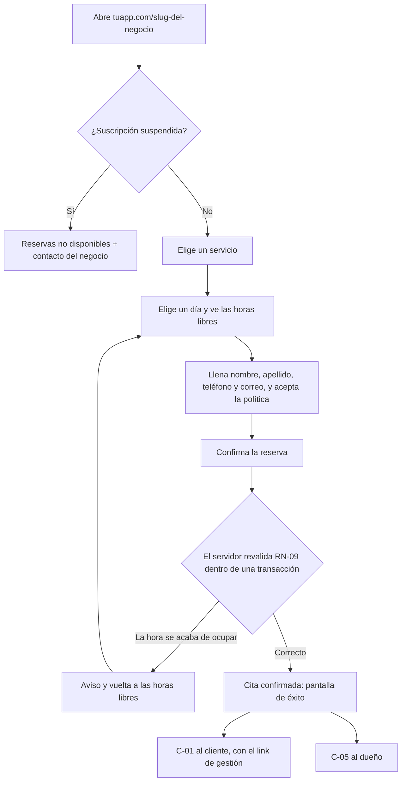
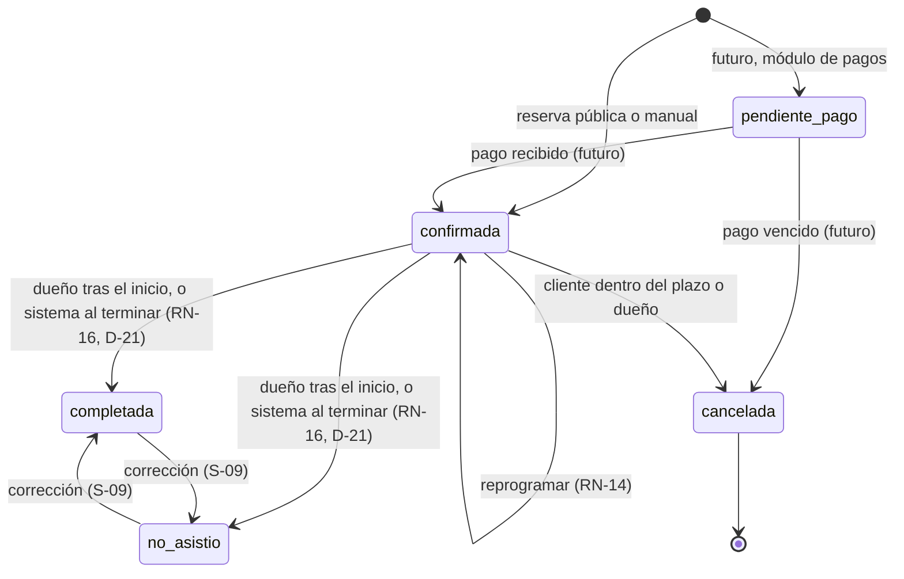

# Agenda de citas (SaaS) — PRD

| | |
|---|---|
| **Versión** | 0.7 (borrador) |
| **Fecha** | 2026-10-08 |
| **Fuente** | [alcance-y-reglas-de-negocio.md](alcance-y-reglas-de-negocio.md) v0.1 (RN-10 actualizada por D-06) |
| **Documento técnico** | [ARCHITECTURE.md](ARCHITECTURE.md) |

> Este documento describe **qué** se construye y **por qué**. El **cómo** está en [ARCHITECTURE.md](ARCHITECTURE.md).
> Este PRD es la referencia de las 35 reglas de negocio (RN-01 a RN-35, §8) y de las decisiones tomadas después de la entrevista (§10). Si difiere de la fuente, **prevalece este PRD**. El diseño técnico de los planes está en [ARCHITECTURE.md §16](ARCHITECTURE.md#16-planes-funcionalidades-y-límites).

### Historial de cambios

| Versión | Fecha | Cambios |
|---|---|---|
| 0.1 | 2026-10-07 | Primera versión, a partir de la fuente. |
| 0.2 | 2026-10-07 | Se incorporan RN-25 a RN-30 (§8.8). **RN-10 cambia por D-06:** solo las citas canceladas liberan capacidad (antes, solo las confirmadas la ocupaban). Se confirman S-01 y S-06. Se resuelven P-01 (D-06) y P-02 (D-07). Se aceptan las decisiones de arquitectura (D-08). |
| 0.3 | 2026-10-07 | Se aceptan los valores por defecto (D-09) y los umbrales del límite de frecuencia (D-10). D-04 sigue pendiente. Se validan los supuestos: la cita manual solo usa horas libres (D-11), una cita no cruza de una franja a otra (D-12), hay 3 días de gracia antes de la suspensión automática (D-13, nueva **RN-31**), se define qué se apaga al suspender (D-14) y no se permiten bloqueos sobre citas (D-15). Nuevos supuestos S-16 y S-17. |
| 0.4 | 2026-10-07 | Se confirman S-16 (correos C-07 y C-08 al dueño, sobre el vencimiento de su suscripción) y S-17 (con el panel en solo lectura, el dueño puede corregir o suprimir los datos de un cliente). Se precisan RN-04, D-14, F-12 y PAN-19. |
| 0.5 | 2026-10-08 | **Sedes (D-16, nueva RN-32):** el modelo admite varias sedes por negocio desde el MVP, cada una con su dirección, horario, bloqueos y recursos. El catálogo de servicios es del negocio y cada sede define cuáles ofrece. Todo negocio nace con una "Sede principal". La interfaz para gestionar varias sedes queda para después. Nuevo límite de plan `max_locations`. Se precisan RN-05, RN-06, RN-07 y RN-09. |
| 0.6 | 2026-10-08 | **Quién atiende (nueva RN-33):** dos formas de atender un servicio, por capacidad anónima o por empleados con nombre y foto. Con empleados, el cliente puede elegir quién lo atiende o tomar "Sin preferencia" (D-18), y cada empleado puede tener horario propio (D-19). En el MVP solo entra el modelo (D-17). Cambian O-2, RN-06 y C-01; nuevo flujo F-13. |
| 0.7 | 2026-10-08 | Se agregan cuatro cambios: • **Límite de reprogramaciones** del cliente (nueva **RN-34**, D-20). • **Asistencia por defecto:** la cita se marca sola al terminar, según la configuración del negocio (D-21, precisa RN-16). • **Identidad:** prevalece el teléfono y desaparece la revisión de conflictos (D-22; cambia RN-18.5 y se eliminan F-10 y PAN-10). • **Calendarios:** invitaciones en los correos al cliente, enlace de suscripción para el dueño y, con el módulo de empleados, correo e invitaciones para cada empleado (nueva **RN-35**, D-23). |

---

## 1. Resumen

SaaS de agendamiento de citas, multi-negocio por diseño. Cada negocio tiene una o más **sedes** (RN-32) y:

- una **página pública de reservas** con su marca (`tuapp.com/{slug}`), pensada primero para móvil;
- un **panel** para ver y gestionar su agenda, incluidas las citas que llegan por otros canales (por ejemplo, WhatsApp);
- **correos automáticos** de confirmación, recordatorio, cancelación y reprogramación.

El primer cliente es una **optometría** con un solo consultorio, sin elección de especialista, que paga 80.000 COP/mes. Volumen esperado: unas 30 citas/mes. Mercado inicial: Colombia (español, `America/Bogota`).

## 2. Objetivos

| ID | Objetivo |
|---|---|
| O-1 | Que los clientes del negocio reserven solos, a cualquier hora y desde el celular. |
| O-2 | Que nunca se acepten más citas de las que el negocio puede atender: ni más citas simultáneas que la capacidad de un recurso, ni dos citas a la vez con el mismo empleado (cero dobles reservas). |
| O-3 | Reducir las inasistencias con recordatorios automáticos. |
| O-4 | Que el dueño tenga toda su agenda en un solo lugar, incluidas las citas que toma a mano. |
| O-5 | Dejar la base multi-negocio lista para sumar clientes sin rehacer el producto. |

### No objetivos del MVP

Historia clínica, cobros en línea, WhatsApp, varios usuarios por negocio, elección de profesional, registro de negocios en autoservicio y reportes. Ver §4.2.

### Métricas de éxito (propuestas)

| Métrica | Meta inicial |
|---|---|
| Dobles reservas | 0 |
| Primer cliente operando en producción | Día 18 del plan |
| Recordatorios enviados a tiempo (de las citas a las que aplica) | ≥ 99 % |
| Porcentaje de citas reservadas desde la página pública | Medir la línea base el primer mes |
| Tasa de inasistencia (`no_asistio` / citas pasadas) | Medir la línea base el primer mes. Si la asistencia por defecto es "asistió" (D-21), el dato solo es fiable cuando el dueño marca las inasistencias. |

## 3. Usuarios

| Usuario | Quién es | Cómo accede | Qué necesita |
|---|---|---|---|
| **Cliente final** | Paciente de la optometría | Página pública, sin cuenta | Reservar rápido desde el celular, recibir confirmación y poder cancelar o reprogramar sin llamar. |
| **Dueño del negocio** | Quien atiende y administra la agenda | Panel, con correo y contraseña | Ver la agenda, registrar citas de WhatsApp, bloquear horarios, conocer a sus clientes y configurar su negocio. |
| **Administrador del SaaS** | El desarrollador y operador del producto | Panel interno `/admin` | Dar de alta negocios, cambiar su plan y su estado de suscripción, y vigilar la operación. |

## 4. Alcance

### 4.1 Dentro del MVP

- **Página pública de reservas:** elegir servicio, día y hora; dar los datos; aceptar la política de datos; recibir confirmación.
- **Gestión de la cita por link**, sin login: cancelar o reprogramar dentro del plazo.
- **Panel del dueño:** calendario (día, semana y mes), citas manuales, estados, bloqueos, clientes y configuración.
- **Sedes (solo el modelo):** todo negocio tiene al menos una sede, la "Sede principal", con su dirección, horario, bloqueos y recursos. El sistema ya funciona por sede, pero en el MVP el dueño no ve el concepto: configura "su" horario y "su" dirección, que son los de la sede principal (D-16).
- **Empleados (solo el modelo):** la base de datos admite empleados con nombre y foto y servicios atendidos "por empleados" (RN-33). En el MVP cada servicio se atiende por capacidad con el consultorio, y las pantallas y la asignación de empleados se construyen después (D-17).
- **Correos** al cliente y al dueño (único canal del MVP).
- **Administración interna:** alta manual de negocios, plan, estado de suscripción y fecha de vencimiento, con 3 días de gracia y suspensión automática (RN-31). El cobro de la suscripción es manual (transferencia o Nequi) y ocurre fuera de la aplicación. El administrador registra cada pago.

### 4.2 Fuera del MVP (con el diseño preparado)

| Módulo | Cómo queda preparado |
|---|---|
| Cobro en línea (anticipo o total) y cobro automático de la suscripción | Estado de cita `pendiente_pago` reservado en el modelo |
| Formularios extra por servicio | Se añadirá una tabla de definición de campos por servicio |
| Varios usuarios y permisos | Tabla `miembro_negocio` con rol; hoy solo existe `dueno` |
| Profesionales por servicio (RN-33) | El modelo está en el MVP: empleados como recursos `profesional`, lista de empleados por servicio y sede, marca "el cliente elige", horario propio y asignación guardada en la cita. Faltan la gestión de empleados con foto, la configuración del servicio, la elección en la página pública, la asignación automática y el calendario por empleado (D-17). Se habilita con la funcionalidad `resource_per_service`. |
| WhatsApp | Notificaciones por canal; el correo es el primero |
| Reportes | Datos guardados por cita, estado y evento |
| Planes públicos y diferenciación comercial | Resuelto técnicamente (ARCHITECTURE §16); comercialmente pendiente (D-04) |
| Registro de negocios en autoservicio | Alta manual por ahora |
| Prueba gratis | `fin_prueba` por negocio, con gracia y suspensión automática (RN-31). Falta el alta en autoservicio. |
| Varias sedes (interfaz) | El modelo ya está en el MVP (RN-32) y el límite `max_locations` en el catálogo. Faltan la gestión de sedes en el panel, la elección de sede en la página pública, el filtro por sede en el calendario y la configuración de servicios por sede (D-16). |

### 4.3 Qué se recorta primero si el plazo aprieta

1. Vista **mensual** del calendario.
2. **Lista de clientes** (queda solo el historial por cita).

## 5. Funcionalidades

### 5.1 Página pública de reservas (`tuapp.com/{slug}`)

| ID | Funcionalidad | Reglas |
|---|---|---|
| PUB-01 | Encabezado con la marca del negocio (logo, nombre y colores) y el teléfono y la dirección de la sede. | RN-32 |
| PUB-02 | Lista de servicios activos con nombre, descripción y duración. | RN-05 |
| PUB-03 | Selector de día dentro de la anticipación máxima. Los días sin cupo aparecen deshabilitados. | RN-09 |
| PUB-04 | Horas libres del día elegido, siempre en hora de Colombia, sin importar la zona del dispositivo. | RN-03, RN-09 |
| PUB-05 | Formulario: nombre, apellido, teléfono (con `+57` por defecto), correo y casilla obligatoria de aceptación de la política de datos, con enlace a la versión vigente. | RN-17 |
| PUB-06 | Pantalla de confirmación y correo con el link de gestión. | RN-12, RN-13 |
| PUB-07 | Si el negocio está suspendido, mensaje "Reservas no disponibles" con el contacto del negocio. Durante la gracia todo funciona normal. | RN-04, RN-31 |
| PUB-08 | Límite de frecuencia de solicitudes. | RN-23 |

### 5.2 Gestión de la cita por link (sin login)

| ID | Funcionalidad | Reglas |
|---|---|---|
| GES-01 | Ver el detalle y el estado de la cita. | RN-13 |
| GES-02 | Cancelar, si aún está dentro del plazo. | RN-13 |
| GES-03 | Reprogramar a otro día u hora del mismo servicio, si aún está dentro del plazo y no se alcanzó el límite de reprogramaciones. | RN-13, RN-14, RN-34 |
| GES-04 | Fuera del plazo, o con el límite de reprogramaciones alcanzado, las acciones correspondientes se deshabilitan y se muestra el contacto del negocio. | RN-13, RN-34 |
| GES-05 | Con el negocio suspendido, el link muestra la cita y el contacto del negocio, sin acciones. | RN-04, D-14 |

### 5.3 Panel del dueño

| ID | Funcionalidad | Reglas |
|---|---|---|
| PAN-01 | Ingreso con correo y contraseña, con correo confirmado. Cierre de sesión y cambio de contraseña. | — |
| PAN-02 | Calendario en vistas de día, semana y mes. La de mes es recortable. | RN-03 |
| PAN-03 | Detalle de cita: cliente, contacto, servicio, estado e historial de cambios. | RN-12 |
| PAN-04 | Crear una cita manual (por ejemplo, una que llegó por WhatsApp) de un servicio, con un cliente existente o nuevo. Solo se ofrecen las horas libres de ese servicio. | RN-15, D-01, D-11 |
| PAN-05 | Mover una cita a otra hora libre del mismo servicio. | RN-14, RN-15, D-11 |
| PAN-06 | Cancelar una cita. | RN-15 |
| PAN-07 | Marcar una cita como `completada` o `no_asistio`. | RN-16 |
| PAN-08 | Bloqueos puntuales (una hora, un día o un rango): crear, ver y eliminar. No se pueden crear sobre citas confirmadas. | RN-07, D-15 |
| PAN-09 | Clientes: lista con búsqueda, y detalle con contacto, historial de citas y nota interna. Es recortable. | RN-17 a RN-19 |
| PAN-10 | ~~Revisión de identidad.~~ Eliminada en v0.7: prevalece el teléfono (D-22). | — |
| PAN-11 | Configuración del negocio y su marca: nombre, logo y colores. Teléfono y dirección de la sede principal. | RN-32 |
| PAN-12 | Configuración de servicios: crear, editar y activar o desactivar. En el MVP, cada servicio nuevo se ofrece en la sede principal con su consultorio. | RN-05, RN-06, RN-32 |
| PAN-13 | Configuración del recurso de la sede principal: nombre y capacidad. | RN-06 |
| PAN-14 | Configuración del horario semanal de la sede principal, con varias franjas por día. | RN-07, RN-32 |
| PAN-15 | Configuración de las reglas de reserva: granularidad, anticipación mínima y máxima, plazo de cancelación, **límite de reprogramaciones del cliente** y **asistencia por defecto** ("asistió", "no asistió" o "siempre decido yo"). | RN-08, RN-09, RN-13, RN-16, RN-34 |
| PAN-16 | Configuración de recordatorios: momento del envío (o ninguno). | RN-21 |
| PAN-17 | Política de tratamiento de datos: plantilla del SaaS, edición y versiones. | D-05, RN-17 |
| PAN-18 | Enlace a la página pública y aviso mientras falte configuración (servicios u horario). | — |
| PAN-19 | Estado de la suscripción. Durante la gracia, un aviso con la fecha límite de pago. Suspendido, el panel queda en **solo lectura** con un aviso para renovar; solo se pueden corregir o suprimir datos de clientes (S-17). | RN-04, RN-31, D-14 |
| PAN-20 | "Agregar mi agenda a mi calendario": enlace privado de suscripción con instrucciones para Google Calendar y Outlook, y botón para regenerarlo (el enlace anterior deja de funcionar). | RN-35 |

### 5.4 Correos

| ID | Correo | Destinatario | Se envía cuando | Contenido mínimo |
|---|---|---|---|---|
| C-01 | Confirmación | Cliente | Se crea una cita (pública, o manual con correo) | Negocio, servicio, fecha y hora local, dirección de la sede, empleado que atiende (si el servicio es por empleados), link de gestión, enlace a la política e **invitación de calendario** |
| C-02 | Recordatorio | Cliente | Llega el momento configurado antes del inicio | Igual que C-01 |
| C-03 | Cancelación | Cliente | La cita se cancela (por el cliente o por el dueño) | Servicio, fecha cancelada, enlace para reservar de nuevo y **cancelación del evento de calendario** |
| C-04 | Reprogramación | Cliente | La cita cambia de hora (por el cliente o por el dueño) | Hora anterior, hora nueva, link de gestión y **actualización del evento de calendario** |
| C-05 | Cita nueva | Dueño | El cliente crea una cita | Cliente, contacto, servicio, fecha y enlace al panel |
| C-06 | Cambio de cita | Dueño | El cliente cancela o reprograma | Qué cambió (antes y después) y enlace al panel |
| C-07 | Suscripción vencida (gracia) | Dueño | El negocio entra en el período de gracia (una vez por vencimiento) | Fecha de vencimiento, fecha límite para renovar (vencimiento + 3 días), instrucciones de pago y contacto de soporte |
| C-08 | Suscripción suspendida | Dueño | El negocio queda suspendido (automática o manualmente) | Qué dejó de funcionar (D-14), que los datos se conservan, instrucciones de pago y contacto de soporte |
| C-09 | Cita asignada (módulo de empleados) | Empleado con correo | Se le asigna una cita, al crearla o al reasignarla | Servicio, fecha y hora, sede, cliente, e invitación de calendario |
| C-10 | Cambio de cita (módulo de empleados) | Empleado con correo | Su cita se reprograma, se cancela o pasa a otro empleado | Qué cambió, y actualización o cancelación del evento de calendario |

C-01 a C-06, C-09 y C-10 son **correos del negocio**: muestran la hora en la zona del negocio, salen a su nombre y las respuestas llegan a su contacto. C-07 y C-08 son **correos del SaaS** (S-16): salen a nombre del producto, las respuestas llegan a soporte y no cuentan para el límite `max_emails_per_month` del negocio.

**Calendario (RN-35):**
- C-01, C-03, C-04, C-09 y C-10 llevan una **invitación de calendario**: crean, actualizan o cancelan **el mismo evento**.
- C-02 no la lleva, para no duplicar el evento.
- C-05 y C-06 tampoco la llevan, porque el dueño ve todas las citas por su enlace de suscripción (PAN-20).

### 5.5 Administración del SaaS (interna)

| ID | Funcionalidad | Reglas |
|---|---|---|
| ADM-01 | Lista de negocios con slug, plan, estado de suscripción, vencimiento (fin de prueba o pagado hasta) y si está en gracia. | RN-04, RN-31 |
| ADM-02 | Alta de un negocio: slug, nombre, plan, estado, vencimiento y correo del dueño. Envía la invitación al dueño. | RN-02, RN-26, RN-31 |
| ADM-03 | Registrar un pago manual: fija la nueva fecha de "pagado hasta" y deja el negocio `activa`, incluso si estaba suspendido. También se puede suspender a mano o cambiar el fin de la prueba. | RN-04, RN-29, RN-30, RN-31 |
| ADM-04 | Cambiar el plan o las excepciones de un negocio. Sin pantalla en el MVP: se hace con una herramienta interna o en la base de datos, y siempre queda auditado. | RN-30 |
| ADM-05 | (Recomendado) Vista de notificaciones fallidas o atrasadas. | RN-20 |

## 6. Flujos de usuario

### F-01. Reservar una cita (cliente)

**Casos límite**

- **No hay horas libres en el día elegido:** se ofrece el siguiente día con cupo.
- **Dos personas eligen la misma última hora:** solo una reserva entra (RN-11). La otra recibe el aviso de G1 sin perder los datos que llenó.
- **Demasiadas solicitudes desde el mismo origen:** mensaje de "intenta en un minuto" (RN-23).
- **El dueño cambia la política mientras el cliente llena el formulario:** se guarda la versión que el cliente vio y aceptó.

### F-02. Cancelar desde el link (cliente)

1. El cliente abre el link del correo (C-01, C-02 o C-04).
2. Ve el servicio, la fecha, la hora y el estado de la cita.
3. **Si está dentro del plazo** (`ahora ≤ inicio − plazo de cancelación`), toca "Cancelar" y confirma.
4. La cita pasa a `cancelada` y libera el cupo. El cliente recibe C-03 y el dueño, C-06. El recordatorio pendiente se anula.
5. **Si está fuera del plazo**, ve el mensaje "Para cambios, comunícate con el negocio", con el teléfono o WhatsApp del negocio.
6. Si la cita ya pasó o ya estaba cancelada, solo se muestra su estado.
7. Si el negocio está suspendido, se muestran la cita y el contacto del negocio, sin acciones (D-14).

### F-03. Reprogramar desde el link (cliente)

1. Igual que F-02 hasta el paso 3, pero toca "Reprogramar". Si ya alcanzó el límite de reprogramaciones (RN-34), el botón no aparece y se muestra el contacto del negocio; cancelar sigue disponible dentro del plazo.
2. Elige un nuevo día y hora del **mismo servicio**. La disponibilidad no cuenta su propia cita como ocupada.
3. Confirma. El servidor vuelve a aplicar RN-09 dentro de una transacción (RN-11).
4. Se actualiza **la misma cita** (RN-14) y se suma una reprogramación del cliente (RN-34). El cliente recibe C-04, que mueve el evento en su calendario. El dueño recibe C-06 y el recordatorio se recalcula.

### F-04. Recordatorio automático (sistema)

1. Al crear o reprogramar una cita, se programa su recordatorio para `inicio − momento configurado`.
2. Una tarea programada revisa cada 5 minutos los envíos pendientes cuya hora ya llegó.
3. Antes de enviar, comprueba que la cita siga `confirmada` y en la misma hora, y que el negocio no esté suspendido (D-14). Si algo no se cumple, anula el envío.
4. Envía C-02 y lo registra para que no se repita (RN-20).

### F-05. Primer ingreso del dueño

1. El administrador da de alta el negocio (F-11). El dueño recibe una invitación por correo.
2. El dueño abre la invitación y define su contraseña. El correo queda confirmado.
3. Entra al panel de su negocio. Una lista de verificación muestra lo que falta: marca, servicios, horario, reglas de reserva, recordatorio y política de datos.
4. Mientras no haya al menos un servicio activo y un horario, la página pública muestra "Aún no hay horarios disponibles".

### F-06. Crear una cita manual (dueño)

1. Desde el calendario (clic en un espacio libre) o con el botón "Nueva cita".
2. Busca un cliente por teléfono o nombre, o escribe los datos de uno nuevo. El correo es opcional en las citas manuales (ver S-05).
3. Elige el **servicio** (por ejemplo, "Examen visual" o "Hidratación de pelo"). La duración y el buffer salen del servicio: el dueño agenda una cita, no un bloque de tiempo.
4. El panel muestra solo las **horas libres de ese servicio**, con las mismas reglas que la página pública (horario, bloqueos, granularidad y cupo). La única diferencia es que el dueño no tiene la anticipación mínima ni la máxima (D-11). Elige una.
5. Guarda. Si la hora se ocupó mientras tanto, ve el error "Esa hora ya no está disponible" y la lista de horas se actualiza. No hay sobrecupo (D-01).
6. Si el cliente tiene correo, recibe C-01.

### F-07. Mover o cancelar una cita (dueño)

- **Mover:** se elige una de las horas libres del mismo servicio en el detalle de la cita (o arrastrándola en el calendario, si da el tiempo, solo hacia horas libres). Aplican las mismas reglas de F-06 y el cliente recibe C-04.
- **Cancelar:** se confirma la acción y el cliente recibe C-03.
- El plazo de RN-13 no aplica al dueño.

### F-08. Marcar la asistencia (dueño y sistema)

1. Una vez pasada la hora de inicio, el detalle de la cita muestra "Asistió" y "No asistió".
2. Si el dueño la marca, la cita pasa a `completada` o a `no_asistio`.
3. Si no la marca, **al terminar la cita** el sistema aplica la asistencia por defecto del negocio (D-21). Por defecto es "asistió". Si el negocio eligió "siempre decido yo", la cita queda pendiente hasta que el dueño la marque.
4. En el historial, las citas marcadas por el sistema dicen "marcada automáticamente". El dueño puede corregir entre `completada` y `no_asistio` (S-09).
5. El cliente no recibe correo.

### F-09. Bloquear un horario (dueño)

1. Elige el tipo: una hora (rango dentro de un día), un día completo o un rango de días. Puede añadir un motivo opcional.
2. Si en ese rango hay citas confirmadas que aún no terminan, el bloqueo **no se crea**. El panel lista esas citas para que el dueño las mueva o las cancele primero (D-15).
3. Si no hay citas en el rango, se guarda. Esas horas dejan de ofrecerse en la página pública y en el panel.

### F-10. (Eliminado en v0.7)

La revisión de conflictos de identidad desaparece: si el teléfono y el correo coinciden con clientes distintos, prevalece el teléfono (D-22, RN-18.5).

### F-11. Dar de alta un negocio (administrador)

1. En `/admin`, ingresa el slug, el nombre, el plan (por ahora `ilimitado`), el estado y su vencimiento, y el correo del dueño. Si el estado es `prueba`, el vencimiento es el fin de la prueba; si es `activa`, es la fecha de "pagado hasta" (RN-31).
2. El sistema valida que el slug sea único y no esté reservado (RN-02).
3. Se crean:
   - el negocio y su configuración con los valores por defecto (D-09);
   - la **"Sede principal"**, con la dirección y el teléfono indicados;
   - en esa sede, el recurso "Consultorio" con capacidad 1;
   - la política de datos v1, desde la plantilla.

   El dueño queda registrado como miembro pendiente.
4. Se envía la invitación al correo del dueño (continúa en F-05).

### F-12. Vencimiento, gracia y suspensión (sistema y administrador)

1. **Al día:** hasta el vencimiento (fin de la prueba o "pagado hasta"), todo funciona.
2. **En gracia:** durante los 3 días siguientes al vencimiento, todo sigue funcionando y el panel muestra el aviso "Tu suscripción venció. Renueva antes del {fecha} para no perder el servicio" (PAN-19). El dueño recibe C-07 una vez. Si paga antes de que salga, no se envía.
3. **Suspendido:** si se cumplen los 3 días sin pago, el negocio queda suspendido automáticamente (RN-31). Entonces:
   - la página pública no acepta reservas;
   - los links de gestión muestran la cita y el contacto del negocio, sin acciones;
   - no se envían los correos de citas (C-01 a C-06);
   - el dueño recibe C-08;
   - el dueño entra al panel en **solo lectura**, salvo para corregir o suprimir datos de clientes (D-14, S-17).
4. **Reactivación:** el administrador registra el pago (ADM-03). El negocio vuelve a `activa` con su nueva fecha de "pagado hasta" y todo funciona de inmediato. Los recordatorios cuya hora ya pasó durante la suspensión no se envían.
5. El administrador también puede suspender a mano en cualquier momento.

Todos los cambios de estado quedan auditados (RN-30). Los automáticos se registran con el autor "sistema".

### F-13. Reservar eligiendo quién atiende (cliente; módulo posterior, RN-33)

1. El cliente elige un servicio con la marca "el cliente elige quién lo atiende".
2. Ve tarjetas con la foto y el nombre de cada empleado que atiende ese servicio en la sede, más la tarjeta **"Sin preferencia"**.
3. **Si elige un empleado,** ve solo las horas libres de esa persona, según su horario propio o el de la sede, sus bloqueos y sus citas.
4. **Si elige "Sin preferencia",** ve las horas en que al menos un empleado de la lista está libre.
5. Sigue igual que F-01: datos, política y confirmación. Al confirmar, la cita ocupa solo al empleado elegido. Con "Sin preferencia", el sistema asigna uno libre a esa hora.
6. La confirmación (C-01) dice quién lo atenderá.

Si el servicio **no** tiene la marca, el flujo es F-01, sin tarjetas, y el sistema asigna el empleado.

## 7. Ciclo de vida de una cita

| Transición | Quién | Condición | Correos |
|---|---|---|---|
| (nueva) → `confirmada` | Cliente | RN-09 | C-01 y C-05 |
| (nueva) → `confirmada` | Dueño | RN-09 sin la anticipación (D-11) | C-01 si hay correo |
| `confirmada` → `confirmada` (nueva hora) | Cliente | Dentro del plazo de RN-13, y RN-09 | C-04 y C-06 |
| `confirmada` → `confirmada` (nueva hora) | Dueño | RN-09 sin la anticipación (D-11) | C-04 |
| `confirmada` → `cancelada` | Cliente | Dentro del plazo de RN-13 | C-03 y C-06 |
| `confirmada` → `cancelada` | Dueño | Ninguna | C-03 |
| `confirmada` → `completada` o `no_asistio` | Dueño | `ahora ≥ inicio` | Ninguno |
| `confirmada` → valor por defecto | Sistema | Terminó la cita (`fin`), el dueño no la marcó, el valor por defecto no es "siempre decido yo" y el negocio no está suspendido (D-21) | Ninguno |
| `cancelada` → cualquier estado | — | No permitido: se crea una cita nueva (S-08) | — |

**Ocupación:** todos los estados ocupan capacidad, excepto `cancelada` (RN-10, D-06). Por eso solo crear, reprogramar y mover pueden aumentar la ocupación de un horario. Cancelar es lo único que la libera.

**Negocio suspendido:** no se permite ninguna transición de citas. El panel está en solo lectura y los links no tienen acciones (D-14).

## 8. Reglas de negocio

Cada regla incluye su **criterio de aceptación**: la prueba que demuestra que se cumple. Los valores numéricos marcados como *propuestos* se ajustan en la implementación.

### 8.1 Negocio y multi-negocio

**RN-01.** Toda la información pertenece a un negocio (`negocio_id`). Ninguna consulta cruza negocios.
- *Aceptación:* con dos negocios A y B, un usuario de A que manipule identificadores en las solicitudes (citas, clientes, servicios de B) recibe "no encontrado" y no ve ni modifica nada de B.

**RN-02.** Cada negocio tiene un `slug` único para su URL pública. Se reservan los slugs del sistema (`admin`, `api`, `login`, etc.).
- *Aceptación:* el alta falla con un slug repetido, con uno reservado o con un formato inválido (solo `a-z`, `0-9` y guiones; de 3 a 40 caracteres).

**RN-03.** Las fechas se guardan en UTC y se muestran en `America/Bogota`.
- *Aceptación:* una cita reservada a las 7:00 p. m. hora de Colombia se guarda como las 00:00 UTC del día siguiente. Se ve a las 7:00 p. m. del día correcto en la página pública, en el panel y en los correos, aunque el dispositivo esté en otra zona horaria.

**RN-04.** Cada negocio tiene un plan y un estado de suscripción. Si la suscripción está suspendida, la página pública no acepta reservas, pero el dueño conserva el acceso a sus datos.
- *Precisada en v0.3 por D-14.* "Suspendida" significa:
  - la página pública no acepta reservas;
  - los links de gestión no permiten cancelar ni reprogramar;
  - no se envían los correos de citas (C-01 a C-06); el dueño sí recibe C-08;
  - el dueño conserva el acceso a sus datos en **solo lectura**, salvo para corregir o suprimir datos de clientes que lo soliciten (S-17, Ley 1581).

  La suspensión llega a mano o automáticamente al terminar la gracia (RN-31).
- *Aceptación:* con el negocio suspendido:
  - la página muestra "Reservas no disponibles" y el servidor rechaza cualquier intento directo de reservar, cancelar o reprogramar;
  - los recordatorios pendientes no salen;
  - el dueño entra al panel y ve su agenda y sus clientes, pero cualquier cambio se rechaza con "suscripción suspendida".

### 8.2 Servicios y recursos

**RN-05.** Un servicio tiene nombre, descripción, duración en minutos, buffer posterior (0 por defecto) y estado activo/inactivo. Se esperan unos 8 servicios.
- *Precisada en v0.5 por RN-32.* El servicio pertenece al catálogo del negocio. Una sede puede sobrescribir su duración y su buffer.
- *Aceptación:* un servicio inactivo no aparece en la página pública y no admite reservas nuevas, pero sus citas existentes se conservan y se muestran.

**RN-06.** Un negocio tiene uno o más **recursos** (hoy un solo "Consultorio"), cada uno con una **capacidad** de citas simultáneas. Cada servicio se asocia a un recurso.
- *Precisada en v0.5 por RN-32.* Cada recurso pertenece a una sede. En cada sede donde se ofrece un servicio, este se asocia a un recurso **de esa sede**.
- *Precisada en v0.6 por RN-33.* Un recurso es un **espacio** con capacidad N (por ejemplo, un consultorio o un salón con 4 puestos) o un **empleado**, que siempre tiene capacidad 1. Un servicio puede asociarse, en cada sede, a un espacio o a una lista de empleados.
- *Aceptación:* no se puede guardar un servicio sin recurso, ni un recurso con capacidad menor que 1.

### 8.3 Disponibilidad

**RN-07.** La disponibilidad se define con un horario semanal base (varias franjas por día, para permitir pausas) y bloqueos puntuales (hora, día o rango).
- *Precisada en v0.5 por RN-32.* Cada sede tiene su propio horario base. Un bloqueo puede aplicar a todo el negocio, a una sede o a un recurso.
- *Precisada en v0.3:*
  - Cada franja es independiente: una cita debe caber completa en **una sola** franja, aunque dos franjas sean contiguas (D-12).
  - Un bloqueo no se puede crear sobre citas confirmadas que aún no terminan (D-15).
- *Aceptación:*
  - Con el horario "lunes de 8:00 a 12:00 y de 14:00 a 18:00", no se ofrecen horas entre las 12:00 y las 14:00.
  - Con franjas de 8:00 a 12:00 y de 12:00 a 14:00, un servicio de 60 minutos no se ofrece a las 11:30.
  - Un bloqueo de día completo elimina todas las horas de ese día.
  - Un bloqueo que se solapa con una cita confirmada se rechaza y muestra esa cita.

**RN-08.** El negocio elige la granularidad de los inicios de cita: 15, 30 o 60 minutos.
- *Aceptación:* la configuración solo acepta esos tres valores. Con 30 minutos, los inicios ofrecidos caen en :00 y :30 (ver S-02).

**RN-09.** Una hora de inicio es reservable si se cumplen todas estas condiciones:
  1. El intervalo completo (duración del servicio más buffer) cae dentro del horario base de la sede, en una sola franja (D-12).
  2. No se solapa con ningún bloqueo.
  3. Está alineada con la granularidad.
  4. Respeta la anticipación mínima y máxima configuradas.
  5. En **todo** el intervalo, el número de citas activas del recurso que se solapan es menor que su capacidad. Una cita activa es cualquier cita no cancelada (RN-10).
- *Aceptación:* existe una prueba automática para cada condición, incluidos los bordes exactos. El servidor aplica la misma verificación al listar horas y al reservar, así que una hora que no se ofrece tampoco se puede reservar con una solicitud directa.

**RN-10.** Una cita ocupa el recurso durante la duración del servicio más el buffer. Todas las citas ocupan capacidad, **excepto las canceladas** (D-06).
- *Modificada en v0.2 por D-06.* La fuente decía "Solo las citas confirmadas ocupan capacidad". Con esa redacción, marcar una cita como `completada` o `no_asistio` antes de que terminara su intervalo liberaba el cupo.
- *Aceptación:*
  - Un servicio de 30 minutos con 10 de buffer reservado a las 9:00 ocupa el recurso de 9:00 a 9:40. Con capacidad 1, el siguiente inicio libre es el primero alineado a partir de las 9:40.
  - Una cita cancelada libera su cupo de inmediato.
  - Una cita marcada `completada` o `no_asistio` a las 9:10 sigue ocupando el recurso hasta las 9:40.

**RN-11.** La verificación de capacidad y la creación de la cita ocurren en una sola transacción de base de datos, para impedir el doble agendamiento por solicitudes simultáneas.
- *Aceptación:* una prueba lanza 10 reservas simultáneas por el último cupo de un recurso. Con capacidad 1 entra exactamente una; con capacidad 2, exactamente dos. Las demás reciben "horario no disponible".

### 8.4 Citas

**RN-12.** Estados: `confirmada`, `completada`, `cancelada`, `no_asistio`. En el MVP toda cita nace confirmada. Se reserva el estado `pendiente_pago` para el módulo de pagos.
- *Aceptación:* toda cita creada en el MVP queda `confirmada`. El estado `pendiente_pago` existe en el modelo, pero ningún flujo del MVP llega a él.

**RN-13.** El cliente puede cancelar o reprogramar desde un link único e impredecible, hasta un mínimo de horas antes de la cita configurable por el negocio. Pasado ese plazo, debe contactar al negocio.
- *Aceptación:* con un plazo de 24 horas, el link permite actuar hasta exactamente 24 horas antes del inicio. Un segundo después, las acciones se deshabilitan y el servidor las rechaza. Un link alterado devuelve "no encontrado".

**RN-14.** Reprogramar vuelve a aplicar todas las reglas de RN-09. Se conserva la cita y se actualiza su hora, sin duplicarla.
- *Aceptación:* después de reprogramar, la cita conserva su identificador y no aparece ninguna cita nueva. La validación no cuenta la cita como ocupando su propio cupo anterior.

**RN-15.** El dueño puede crear, mover y cancelar citas en cualquier momento, sin el plazo de RN-13. Las citas manuales también respetan la capacidad: no hay sobrecupo (D-01).
- *Precisada en v0.3 por D-11.* El dueño agenda **un servicio**, no un bloque de tiempo, y solo en horas libres de ese servicio. Aplica RN-09 completa, salvo la anticipación mínima y máxima (condición 4). "En cualquier momento" significa sin plazos, no fuera del horario.
- *Aceptación:*
  - El dueño cancela una cita que empieza en una hora.
  - Crea una cita para dentro de 30 minutos, aunque la anticipación mínima sea de 2 horas.
  - Al intentar crear o mover una cita fuera del horario, sobre un bloqueo, desalineada o sin capacidad, recibe "Esa hora no está disponible" y la cita no se guarda.

**RN-16.** El dueño marca manualmente una cita como `completada` o `no_asistio`, solo una vez pasada su hora de inicio.
- *Precisada en v0.7 por D-21.* Si el dueño no la marca, al terminar la cita el sistema aplica la **asistencia por defecto** del negocio: `completada` (valor inicial), `no_asistio` o ninguna ("siempre decido yo"). El dueño puede corregirla después (S-09). No se aplica mientras el negocio esté suspendido (D-14); se aplica al reactivarlo.
- *Aceptación:*
  - Antes del inicio, los botones no aparecen y el servidor rechaza el cambio. Después del inicio, el cambio se aplica.
  - Con el valor por defecto "asistió", una cita de 9:00 a 9:30 que el dueño no marcó queda `completada` a más tardar a las 9:35, con el autor "sistema".
  - Con "siempre decido yo", sigue `confirmada` hasta que el dueño la marque.

**RN-34.** El cliente puede reprogramar una misma cita desde su link hasta un **número máximo de veces**, configurable por negocio:
- por defecto 3;
- vacío = sin límite;
- 0 = no se permite reprogramar.

Al alcanzar el límite, el link ya no ofrece reprogramar y muestra el contacto del negocio. Cancelar sigue disponible dentro del plazo de RN-13. Los cambios de hora que hace el dueño **no cuentan** para el límite (D-20).
- *Aceptación:*
  - Con el límite en 3, la cuarta reprogramación del cliente se rechaza con "Ya reprogramaste esta cita 3 veces. Para otro cambio, comunícate con el negocio".
  - Si el dueño mueve la cita, el cliente conserva los intentos que le quedan.
  - Con el límite en 0, el link no muestra "Reprogramar".

### 8.5 Clientes

**RN-17.** El cliente no tiene cuenta. Al reservar entrega nombre, apellido, teléfono y correo, y acepta la política de tratamiento de datos (se guarda la fecha y la versión de la política aceptada).
- *Aceptación:* no se puede reservar desde la página pública sin los cuatro datos y sin marcar la casilla. Cada cita pública guarda la versión de la política y la fecha y hora de aceptación.

**RN-18.** Identidad del cliente:
  1. Se busca primero por **teléfono normalizado** (`+57…`, sin espacios ni guiones).
  2. Si no hay coincidencia, se busca por **correo en minúsculas**.
  3. Si hay coincidencia, la cita se asocia a ese cliente y su nombre se actualiza al más reciente. Cada cita conserva el nombre con el que se reservó.
  4. Si no hay coincidencia, se crea un cliente nuevo.
  5. Si el teléfono coincide con un cliente y el correo con otro, **prevalece el teléfono**: la cita se asocia al cliente del teléfono, sin revisión ni fusión (D-22).
- *Modificada en v0.7 por D-22.* La fuente decía que estos casos no se fusionaban automáticamente y se marcaban para revisión del dueño.
- *Aceptación:* hay una prueba por cada caso:
  - "300 123 4567" y "+57 300-123-4567" corresponden al mismo cliente.
  - `Ana@Mail.com` y `ana@mail.com` corresponden al mismo cliente.
  - Una cita vieja sigue mostrando el nombre con el que se reservó.
  - En el caso 5, la cita queda en el cliente del teléfono y no se crea ninguna revisión.

**RN-19.** Un teléfono compartido (por ejemplo, una familia) se trata como un solo cliente.
- *Aceptación:* dos reservas con el mismo teléfono y distinto nombre quedan en el mismo cliente. Su nombre es el de la última reserva y cada cita muestra el suyo.

### 8.6 Notificaciones

**RN-20.** Los envíos se registran en una tabla de notificaciones (tipo, canal, estado), de modo que cada mensaje se envíe una sola vez aunque el proceso se repita.
- *Aceptación:* ejecutar dos veces seguidas (o en paralelo) el proceso de envío no duplica ningún correo.

**RN-21.** El momento del recordatorio es configurable por negocio (por ejemplo, 24 h o 2 h antes). Una tarea programada lo procesa cada pocos minutos.
- *Aceptación:* con un recordatorio de 24 horas, el correo sale entre 0 y 5 minutos (*propuesto*) después de `inicio − 24 h`. Si la cita se cancela antes, no sale. Si se reprograma, sale según la nueva hora.

**RN-22.** El dueño recibe un correo por cada cita nueva y por cada cambio de estado (cancelación, reprogramación).
- *Aceptación:* cada reserva, cancelación y reprogramación hecha por el cliente genera exactamente un correo al dueño (ver S-06 para las acciones del propio dueño).

### 8.7 Seguridad y datos

**RN-23.** La página pública limita la frecuencia de solicitudes para evitar reservas basura.
- *Aceptación:* desde un mismo origen, la sexta reserva dentro de un minuto (D-10: 5 por minuto) recibe "demasiadas solicitudes" y no crea nada.

**RN-24.** Los datos de las citas son personales y de salud: se guarda solo lo mínimo, sin historial clínico. Se aplica la Ley 1581 de 2012 (el negocio es el responsable del tratamiento).
- *Aceptación:* el modelo no tiene campos clínicos. La nota interna advierte que no es para información clínica. Los registros técnicos (logs) no contienen nombres, teléfonos ni correos. El dueño puede corregir y suprimir los datos de un cliente (ver S-14).

### 8.8 Planes, funcionalidades y límites

Los planes aún no se definen comercialmente (D-04), pero el producto ya decide qué puede hacer cada negocio a partir de su plan y de sus excepciones. Catálogo inicial:

| Tipo | Clave | Módulo |
|---|---|---|
| Funcionalidad | `online_payments` | Cobro en línea |
| Funcionalidad | `custom_booking_fields` | Formularios extra por servicio |
| Funcionalidad | `multi_user` | Varios usuarios y permisos |
| Funcionalidad | `resource_per_service` | Profesionales por servicio |
| Funcionalidad | `whatsapp_notifications` | WhatsApp |
| Funcionalidad | `reports` | Reportes |
| Límite | `max_resources` | Recursos o profesionales |
| Límite | `max_users` | Miembros del negocio |
| Límite | `max_services` | Servicios activos |
| Límite | `max_appointments_per_month` | Citas por mes |
| Límite | `max_emails_per_month` | Correos por mes |
| Límite | `max_locations` | Sedes activas (D-16) |

**Resolución**, en este orden: primero la excepción del negocio, si existe; luego el valor de su plan; y, si no hay ninguno, el valor por defecto del catálogo (funcionalidad **deshabilitada**, límite **0**). En los límites, `NULL` significa **ilimitado**. La única excepción es `max_locations`, cuyo valor por defecto es **1**, porque todo negocio tiene al menos una sede.

**RN-25.** Toda función de módulo y todo límite se consultan a través de la función de acceso. Los límites se validan en el servidor, nunca solo en la interfaz.
- *Aceptación:* solo el módulo de acceso lee las tablas de planes y excepciones. Lo verifica una regla de lint o una búsqueda en la integración continua. Con un límite alcanzado, una solicitud directa al servidor (sin pasar por la interfaz) se rechaza con "límite del plan".

**RN-26.** Al crear un negocio se le asigna un plan. Mientras no haya planes comerciales, existe un único plan interno `ilimitado`, con todas las funcionalidades habilitadas y todos los límites en `NULL`.
- *Aceptación:* no se puede crear un negocio sin plan. Después de la semilla existe el plan `ilimitado`, con las 6 funcionalidades habilitadas y los 5 límites en `NULL`.

**RN-27.** **Primer cliente (MVP):** acceso ilimitado a todas las funciones. Se logra con el plan `ilimitado`, sin filas de excepción en `negocio_funcionalidad` ni `negocio_limite`.
- *Aceptación:* el primer cliente tiene el plan `ilimitado` y ninguna excepción. La función de acceso responde "habilitada" para cada funcionalidad e "ilimitado" para cada límite.

**RN-28.** Un límite que se reduce no borra datos existentes: solo impide crear más. Por ejemplo, si `max_resources` baja de 3 a 1, los recursos que ya existen siguen funcionando, pero no se pueden crear nuevos.
- *Aceptación:* con 3 recursos activos y `max_resources = 1`, los 3 siguen recibiendo citas. Crear un cuarto recurso, o reactivar uno inactivo, se rechaza con "límite del plan".

**RN-29.** Si `estado_suscripcion` es `suspendida`, aplica RN-04, independientemente de las funcionalidades y los límites.
- *Aceptación:* un negocio suspendido con el plan `ilimitado` rechaza igual las reservas públicas, y su dueño conserva el acceso al panel.

**RN-30.** Cambiar el plan o una excepción de un negocio es una operación interna (tuya) y queda registrada con fecha y quién la hizo.
- *Aceptación:* cada cambio de plan, de estado de suscripción, de fin de prueba o de excepción deja un registro con fecha, autor, valor anterior y valor nuevo. Esto se cumple aunque el cambio se haga con SQL directo en la base de datos.

### 8.9 Vencimiento de la suscripción

**RN-31.** La suscripción de un negocio vence en su fecha de **pagado hasta** (estado `activa`) o en su **fin de prueba** (estado `prueba`). Durante los **3 días** siguientes al vencimiento (período de gracia), el negocio conserva todas sus funciones. Si al terminar la gracia no se ha registrado la renovación, el negocio queda **suspendido automáticamente** y aplica RN-04. Registrar el pago lo reactiva de inmediato (D-13).
- *Aceptación:* con vencimiento el 10-oct a las 00:00, hora del negocio:
  - El 12-oct a las 23:59 todo funciona y el panel muestra el aviso de gracia.
  - El 13-oct a las 00:00 el negocio está suspendido, aunque la tarea programada todavía no haya corrido. El cambio queda auditado con el autor "sistema".
  - Al registrar el pago, el negocio vuelve a `activa` sin esperar ninguna tarea.
  - Lo mismo aplica a un negocio en prueba con su `fin_prueba`.
  - El dueño recibe un solo C-07 durante la gracia y un solo C-08 al quedar suspendido, aunque la tarea programada corra muchas veces (S-16).

### 8.10 Sedes

**RN-32.** Un negocio tiene una o más **sedes**, y siempre al menos una activa (la "Sede principal" se crea en el alta). Cada sede tiene:
- su nombre, dirección y teléfono;
- su horario semanal y sus bloqueos;
- sus recursos.

Los **servicios** forman un catálogo del negocio. Cada sede define cuáles ofrece y con qué recurso suyo, y puede sobrescribir su duración y su buffer. Las sedes pueden ofrecer los mismos servicios, otros distintos o variantes de uno: en una variante, la sede sobrescribe la duración; si es otro servicio, se crea otra entrada en el catálogo. Cada cita guarda su sede. El número de sedes activas lo limita el plan con `max_locations` (D-16).
- *Aceptación:*
  - El alta crea la "Sede principal" con el recurso "Consultorio".
  - No se puede desactivar la última sede activa.
  - Un servicio no se puede ofrecer en una sede con un recurso de otra sede.
  - Un bloqueo de la sede A no afecta a la sede B. Un bloqueo sin sede afecta a todas.
  - El mismo servicio con 30 minutos en la sede A y 45 en la sede B ofrece en cada sede las horas que corresponden a su duración.
  - Con `max_locations = 1`, crear o activar una segunda sede se rechaza con "límite del plan".
  - Con una sola sede activa, la página pública y el panel se ven exactamente igual que sin el concepto de sede.

### 8.11 Quién atiende

**RN-33.** En cada sede, un servicio se atiende de una de estas dos formas:

1. **Por capacidad (anónima):** con un espacio de capacidad N, por ejemplo un "Salón" con 4 puestos. Se aceptan hasta N citas simultáneas y no se registra quién atiende.
2. **Por empleados:** con una lista de **empleados**. Un empleado es un recurso con nombre, foto y capacidad 1; **no es un usuario** del sistema y no entra al panel. Cada cita queda asignada a un empleado y ocupa solo el tiempo de esa persona.
   - **Con la marca "el cliente elige quién lo atiende":** la página pública muestra a los empleados con foto y nombre, más la opción **"Sin preferencia"** (D-18).
     - Si el cliente elige a alguien, ve solo sus horas libres.
     - Con "Sin preferencia", ve las horas en que al menos un empleado de la lista está libre, y el sistema asigna uno al reservar.
   - **Sin la marca:** el cliente no ve empleados y el sistema asigna uno libre.

**Horario propio (D-19).** Un empleado puede tener horario semanal propio, dentro del horario de su sede. Si no lo tiene, sigue el de la sede. Sus ausencias puntuales se registran como bloqueos del empleado.

**Regla de configuración.** Si en una sede se registran empleados, los servicios que esas personas atienden en esa sede deben usar la forma "por empleados", con o sin marca. Si se mezclan con un espacio anónimo que representa a las mismas personas, se las cuenta dos veces y se sobrevende. El sistema no puede detectarlo, así que el panel lo explica al configurar.

**Otras reglas:**
- **Reprogramar:** si el cliente eligió a un empleado, la cita se queda con esa persona. Si se asignó automáticamente, puede pasar a otro empleado libre.
- **Dueño:** al crear o mover una cita, puede elegir o cambiar el empleado.
- **Datos personales:** la foto y el nombre de los empleados son datos personales. El negocio debe tener su autorización para publicarlos (Ley 1581).
- **Plan:** la forma "por empleados" requiere la funcionalidad `resource_per_service`. Los empleados cuentan para `max_resources`.
- **MVP:** solo entra el modelo de datos. Todos los servicios se atienden por capacidad con el consultorio (D-17).

- *Aceptación (cuando se construya el módulo):*
  - Una peluquería con un "Salón" de capacidad 4 rechaza la quinta cita simultánea.
  - En "Tinte", con Ana y Luis y la marca activa, el cliente que elige a Ana a las 10:00 la ocupa, y Luis sigue disponible a las 10:00 para otro cliente.
  - Con "Sin preferencia" a las 10:00 y Ana ocupada, la cita se asigna a Luis. Si ambos están ocupados, las 10:00 no aparecen.
  - Sin la marca, la página no muestra empleados y la cita queda asignada a uno libre.
  - Si Ana trabaja de lunes a miércoles, no aparece disponible un jueves aunque la sede abra.
  - Un bloqueo de Ana (vacaciones) no afecta a Luis.
  - Al reprogramar una cita en la que el cliente eligió a Ana, se ofrecen solo las horas de Ana.
  - Un empleado no puede tener capacidad distinta de 1.
  - Sin `resource_per_service`, no se puede configurar un servicio "por empleados".

### 8.12 Calendarios

**RN-35.** Las citas se pueden llevar a calendarios externos (Google Calendar, Outlook y otros compatibles) **sin conectar cuentas**:

1. **Clientes:** C-01 incluye una invitación de calendario; C-04 actualiza ese mismo evento y C-03 lo cancela. Según la configuración del calendario del cliente, la cita aparece sola o con un clic en "Agregar" o "Aceptar".
2. **Dueño:** desde el panel obtiene un **enlace privado de suscripción** con todas las citas activas del negocio, incluidas las que crea él (PAN-20).
   - Se agrega una vez al calendario y, de ahí en adelante, las citas aparecen solas.
   - Cada calendario decide cada cuánto se actualiza; en Google pueden pasar varias horas. El panel sigue siendo la referencia del día.
   - El enlace se puede regenerar, y el anterior deja de funcionar.
   - Los avisos C-05 y C-06 no llevan invitación, para no duplicar eventos.
3. **Empleados (módulo de empleados, RN-33):** la ficha del empleado admite un **correo**. Si lo tiene, recibe C-09 y C-10 con invitación de calendario. Las citas que le asignan aparecen en su calendario y se actualizan o se cancelan con cada cambio, incluida la reasignación a otro empleado.

No hay sincronización en doble vía: lo ocupado en un calendario externo no bloquea horas en la agenda (D-23). El correo de los empleados es un dato personal: el negocio debe tener su autorización.
- *Aceptación:*
  - Al reservar, el cliente recibe C-01 con la invitación. Al agregarla, la cita queda en su calendario a la hora correcta.
  - Al reprogramar, el mismo evento cambia de hora, sin crear uno nuevo. Al cancelar, desaparece.
  - El enlace de suscripción del dueño muestra las citas creadas por los clientes y por él, sin teléfonos ni correos.
  - Las citas canceladas desaparecen en la siguiente actualización del calendario.
  - Al regenerar el enlace, el anterior responde "no encontrado".
  - Con el módulo de empleados: si una cita pasa de Ana a Luis, el evento desaparece del calendario de Ana y aparece en el de Luis.

## 9. Requisitos no funcionales

| ID | Requisito |
|---|---|
| RNF-01 | **Móvil primero:** la página pública funciona desde 360 px de ancho. Objetivo: LCP menor de 2,5 s en 4G. |
| RNF-02 | **Idioma y formato:** español, formato `es-CO`, hora de 12 horas con a. m. y p. m., siempre en la zona del negocio (RN-03). |
| RNF-03 | **Accesibilidad:** la página pública cumple WCAG 2.1 AA (etiquetas, uso con teclado y contraste). Si el color de marca no da contraste suficiente, el texto usa un color alternativo. |
| RNF-04 | **Seguridad:** HTTPS en todo, sesión obligatoria en el panel, links de gestión impredecibles, límite de frecuencia y secretos fuera del código. |
| RNF-05 | **Privacidad (Ley 1581):** datos mínimos, consentimiento con versión y fecha, y derechos del titular (conocer, actualizar y suprimir) atendidos por el dueño desde el panel. |
| RNF-06 | **Integridad:** cero dobles reservas (RN-11) y notificaciones sin duplicados (RN-20). |
| RNF-07 | **Rendimiento (propuesto):** la disponibilidad de una semana responde en menos de 500 ms (p95), sin contar el arranque en frío de la base de datos. |
| RNF-08 | **Costo:** la infraestructura cuesta muy por debajo del ingreso del primer cliente (80.000 COP/mes). |
| RNF-09 | **Operación:** despliegue con un comando, migraciones versionadas y copias de seguridad de la base de datos. |

## 10. Decisiones

| ID | Decisión | Estado |
|---|---|---|
| D-01 | El dueño **no** puede crear citas por encima de la capacidad (sin sobrecupo). Aplica RN-15 tal cual. | Resuelta |
| D-02 | El buffer entre citas es 0 por defecto y se configura por servicio. | Resuelta |
| D-03 | Los clientes con teléfono compartido se tratan como un solo cliente (RN-19). | Resuelta |
| D-04 | Diferenciación comercial de los planes. Técnicamente ya está resuelta (ARCHITECTURE §16). | **Pendiente** hasta el 2.º o 3.er cliente |
| D-05 | El SaaS provee la política de tratamiento de datos como plantilla. El negocio puede personalizarla y se guarda la versión que acepta cada cliente. | Resuelta |
| D-06 | Todas las citas ocupan capacidad, excepto las canceladas. Una cita `completada` o `no_asistio` sigue ocupando su intervalo, y `pendiente_pago` (a futuro) también ocupa. Modifica RN-10 (resuelve P-01). | Resuelta (2026-10-07) |
| D-07 | El ORM es **Drizzle** (resuelve P-02; ARCHITECTURE ADR-02). | Resuelta (2026-10-07) |
| D-08 | Se aceptan estas decisiones de arquitectura (ARCHITECTURE §22): Clerk solo para la identidad, con la pertenencia al negocio en la base propia (ADR-05); registro solo por invitación (ADR-06); links de gestión firmados con HMAC, sin guardar el token (ADR-09); límite de frecuencia con el binding de Cloudflare, sin Redis (ADR-10); auditoría de planes con triggers (ADR-11). | Resuelta (2026-10-07) |
| D-09 | Valores por defecto de cada negocio nuevo: granularidad de 30 minutos, anticipación mínima de 2 horas, anticipación máxima de 60 días, plazo de cancelación de 24 horas y recordatorio 24 horas antes (resuelve P-03). | Resuelta (2026-10-07) |
| D-10 | Umbrales del límite de frecuencia, por minuto: 60 consultas de disponibilidad por IP, 5 reservas por IP y negocio, y 10 acciones de gestión por IP (resuelve P-04; ARCHITECTURE §15). | Resuelta (2026-10-07) |
| D-11 | El dueño agenda **un servicio**, no un bloque de tiempo, y solo en las horas libres de ese servicio. Aplica RN-09 completa, salvo la anticipación mínima y máxima. No hay excepciones con advertencia. Reemplaza S-01 y precisa RN-15. | Resuelta (2026-10-07) |
| D-12 | Cada franja del horario es independiente: una cita debe caber completa en una sola franja, aunque haya franjas contiguas. Reemplaza S-03 y precisa RN-09.1. | Resuelta (2026-10-07) |
| D-13 | Al vencer la suscripción (o la prueba) hay **3 días de gracia** con todas las funciones. Si no se renueva, el negocio se suspende automáticamente. Queda como **RN-31**. Reemplaza S-10 y S-11. | Resuelta (2026-10-07) |
| D-14 | Con el negocio suspendido: la página pública no acepta reservas, los links muestran la cita y el contacto del negocio sin acciones, no se envían los correos de citas y el panel queda en **solo lectura**, salvo para corregir o suprimir datos de clientes (S-17). El dueño recibe C-08 (S-16). Precisa RN-04 y reemplaza S-10. | Resuelta (2026-10-07) |
| D-15 | No se puede crear un bloqueo que se solape con citas confirmadas que aún no terminan. El dueño debe moverlas o cancelarlas primero. Reemplaza S-13. | Resuelta (2026-10-07) |
| D-16 | **Sedes:** el modelo de varias sedes (RN-32) entra en el MVP, con una "Sede principal" creada automáticamente. Así no habrá que migrar datos cuando un cliente tenga varias. La interfaz para varias sedes se construye cuando un cliente la necesite. Las sedes se limitan por plan con el límite `max_locations` (por defecto 1; en `ilimitado`, sin límite). No hay una funcionalidad aparte: el límite define cuántas sedes admite cada plan. | Resuelta (2026-10-08) |
| D-17 | **Empleados (RN-33):** en el MVP solo entra el modelo de datos, con tablas y columnas listas para no migrar después. El motor con varios recursos y asignación automática, la gestión de empleados con foto, la elección en la página pública y el calendario por empleado se construyen cuando un cliente lo necesite (unos 3 días). | Resuelta (2026-10-08) |
| D-18 | Cuando el cliente puede elegir quién lo atiende, también se le ofrece **"Sin preferencia"**: ve las horas con al menos un empleado libre y el sistema asigna uno. | Resuelta (2026-10-08) |
| D-19 | Cada empleado puede tener **horario semanal propio**, opcional y dentro del horario de su sede. Si no lo tiene, usa el de la sede. Las ausencias puntuales se registran como bloqueos del empleado. | Resuelta (2026-10-08) |
| D-20 | **Límite de reprogramaciones** del cliente por cita, configurable por negocio: por defecto 3, vacío = sin límite, 0 = no se permite. Solo cuentan las reprogramaciones que hace el cliente desde su link; los cambios del dueño no gastan sus intentos (RN-34). | Resuelta (2026-10-08) |
| D-21 | **Asistencia por defecto:** el negocio elige entre "asistió" (valor inicial), "no asistió" y "siempre decido yo". Si el dueño no marcó una cita cuando termina, el sistema aplica ese valor; el dueño puede corregirlo (precisa RN-16). | Resuelta (2026-10-08) |
| D-22 | **Identidad del cliente:** prevalece el teléfono. No hay conflictos de identidad ni revisión del dueño. Si el teléfono coincide con un cliente y el correo con otro, la cita va al del teléfono (cambia RN-18.5; se eliminan F-10, PAN-10 y la tabla de revisiones). | Resuelta (2026-10-08) |
| D-23 | **Calendarios sin conectar cuentas (RN-35).** En el MVP: invitación de calendario en los correos al cliente y enlace de suscripción privado para el dueño. Con el módulo de empleados: correo del empleado e invitaciones en C-09 y C-10. La sincronización en doble vía con Google o Microsoft (OAuth) queda fuera. | Resuelta (2026-10-08) |

## 11. Supuestos y preguntas abiertas

### 11.1 Supuestos

Son interpretaciones tomadas para poder especificar. Los **confirmados** valen como reglas. Los **reemplazados** aparecen tachados y remiten a la decisión que los sustituye. Los que siguen **por validar** se corrigen aquí, antes de implementar, si no son correctos.

| ID | Supuesto | Relacionado | Estado |
|---|---|---|---|
| S-01 | ~~En las citas manuales, la capacidad es un límite estricto. Salirse del horario base, de un bloqueo, de la granularidad o de la anticipación se permite con una confirmación explícita del dueño.~~ | RN-15, D-01 | Reemplazado por **D-11** |
| S-02 | La granularidad se alinea con el reloj local (por ejemplo, con 30 minutos: :00 y :30), no con el inicio de cada franja. | RN-08 | **Confirmado** |
| S-03 | ~~Las franjas contiguas del mismo día (por ejemplo, 8–12 y 12–14) se tratan como una sola.~~ | RN-07 | Rechazado: **D-12** |
| S-04 | Los intervalos son semiabiertos: una cita que termina a las 9:30 no se solapa con una que empieza a las 9:30. | RN-09, RN-10 | **Confirmado** |
| S-05 | En las citas manuales, el correo es opcional. Sin correo, el cliente no recibe notificaciones. | RN-15, RN-17 | **Confirmado** |
| S-06 | El dueño no recibe correos por las acciones que él mismo hace en el panel. RN-22 aplica a lo que hacen los clientes. | RN-22 | **Confirmado** |
| S-07 | Al reprogramar no se cambia el servicio. Para cambiarlo, se cancela y se crea una cita nueva. | RN-14 | **Confirmado** |
| S-08 | Una cita cancelada no se reactiva. Se crea una nueva. | RN-12 | **Confirmado** |
| S-09 | El dueño puede corregir una cita entre `completada` y `no_asistio`. | RN-16 | **Confirmado** |
| S-10 | ~~Con el negocio suspendido, los links de gestión permiten cancelar pero no reprogramar, y los recordatorios de las citas existentes se siguen enviando.~~ | RN-04 | Reemplazado por **D-13** y **D-14** |
| S-11 | ~~Que llegue `fin_prueba` no suspende el negocio automáticamente. El administrador lo hace a mano.~~ | RN-04 | Reemplazado por **D-13** (RN-31) |
| S-12 | Si una cita se crea cuando ya pasó el momento de su recordatorio (por ejemplo, se reserva 1 hora antes con un recordatorio de 2 horas), no se envía recordatorio. | RN-21 | **Confirmado** |
| S-13 | ~~Crear un bloqueo sobre citas existentes no las cancela. El panel avisa y el dueño decide.~~ | RN-07 | Reemplazado por **D-15** |
| S-14 | "Suprimir" un cliente (derecho del titular) anonimiza sus datos personales y conserva sus citas sin datos identificables, para las estadísticas. | RN-24 | **Confirmado** |
| S-15 | Si el cliente coincide por teléfono, su correo guardado no se sobrescribe (solo se completa si estaba vacío). Cada cita guarda el correo con el que se reservó, y a ese correo se envían sus notificaciones. | RN-18 | **Confirmado** |
| S-16 | El dueño recibe un correo cuando su suscripción entra en gracia (con la fecha límite) y otro cuando queda suspendida. Son correos del SaaS, no del negocio (C-07 y C-08). | RN-31 | **Confirmado** |
| S-17 | Con el panel en solo lectura, el dueño **sí** puede corregir o suprimir los datos de un cliente que lo solicite, porque el negocio sigue siendo responsable ante la Ley 1581. | RN-04, RN-24 | **Confirmado** |

Todos los supuestos confirmados lo fueron el 2026-10-07: S-06 en la v0.2, S-16 y S-17 en la v0.4, y el resto en la v0.3.

### 11.2 Preguntas abiertas

| ID | Pregunta | Propuesta | Estado |
|---|---|---|---|
| P-01 | Según RN-10, una cita marcada `completada` o `no_asistio` antes de terminar su intervalo libera el cupo. ¿Es lo deseado? Solo afecta a las citas manuales en curso. | Que ocupen capacidad `confirmada`, `completada` y `no_asistio`, y que solo `cancelada` la libere. | Resuelta: D-06 |
| P-02 | ¿Prisma o Drizzle? | Drizzle (ARCHITECTURE, ADR-02). | Resuelta: D-07 |
| P-03 | Valores por defecto de la configuración. | Granularidad de 30 minutos, anticipación mínima de 2 horas, anticipación máxima de 60 días, plazo de cancelación de 24 horas y recordatorio 24 horas antes. | Resuelta: D-09 |
| P-04 | Umbrales del límite de frecuencia. | Ver ARCHITECTURE §15. | Resuelta: D-10 |
| P-05 | Diferenciación comercial de planes (D-04). | Esperar al 2.º o 3.er cliente. | Resuelta: se espera; D-04 sigue pendiente |

## 12. Plan de entrega

Resumen del plan de la fuente (≈ 18 días, más 2 de colchón):

| Días | Entrega |
|---|---|
| 1–2 | Proyecto, esquema, Clerk, estructura multi-negocio y despliegue base |
| 3–4 | Sede principal, servicios por sede, recursos, horario semanal, bloqueos y configuración |
| 5–7 | **Motor de disponibilidad y reserva transaccional** (con pruebas) |
| 8–9 | Página pública de reservas |
| 10–11 | Panel: calendario y citas manuales |
| 12–13 | Correos, recordatorios, links de gestión, invitaciones de calendario y enlace de suscripción del dueño |
| 14 | Clientes (RN-18) |
| 15–16 | Pruebas de casos límite y límite de frecuencia |
| 17–18 | Dominio, carga de datos y prueba con el cliente |
| 19–20 | Colchón |

Los cambios posteriores a la entrevista suman entre 2 y 2,5 días:
- el modelo de sedes (D-16), entre medio día y un día;
- los calendarios (D-23), cerca de un día;
- el límite de reprogramaciones y la asistencia por defecto, unas horas.

Quitar la revisión de identidad (D-22) ahorra algo de trabajo. Aun así, **el colchón de 2 días queda consumido**: si aparece un imprevisto, se aplica primero el recorte de §4.3.

## 13. Glosario

| Término | Significado |
|---|---|
| **Negocio** | Cliente del SaaS (por ejemplo, la optometría). Toda la información le pertenece. |
| **Slug** | Identificador del negocio en la URL pública (`tuapp.com/{slug}`). |
| **Sede** | Lugar físico del negocio, con su dirección, horario, bloqueos y recursos. Todo negocio tiene al menos una, la "Sede principal" (RN-32). |
| **Recurso** | Lo que una cita ocupa dentro de una sede: un **espacio** con capacidad N (por ejemplo, un consultorio) o un **empleado** (capacidad 1). |
| **Empleado** | Persona que atiende, con nombre y foto. Es un dato del negocio, no un usuario del sistema (RN-33). |
| **Sin preferencia** | Opción del cliente cuando puede elegir quién lo atiende: el sistema asigna un empleado libre (D-18). |
| **Capacidad** | Número de citas simultáneas que admite un recurso. |
| **Cita activa** | Toda cita no cancelada. Es la que ocupa capacidad (RN-10, D-06). |
| **Franja** | Tramo de atención dentro de un día del horario semanal (por ejemplo, de 8:00 a 12:00). |
| **Bloqueo** | Intervalo puntual sin atención (una hora, un día o un rango). |
| **Granularidad** | Cada cuántos minutos puede empezar una cita (15, 30 o 60). |
| **Buffer** | Tiempo después de una cita en el que el recurso sigue ocupado (por ejemplo, para limpieza). |
| **Anticipación mínima y máxima** | Con cuánto tiempo de antelación, como mínimo y como máximo, se puede reservar. |
| **Plazo de cancelación** | Horas antes del inicio a partir de las cuales el cliente ya no puede cancelar ni reprogramar por el link. |
| **Vencimiento** | Fecha en que termina lo pagado ("pagado hasta") o la prueba ("fin de prueba") de un negocio (RN-31). |
| **Período de gracia** | Los 3 días posteriores al vencimiento, en los que todo sigue funcionando (RN-31). |
| **Solo lectura** | Modo del panel de un negocio suspendido: se puede consultar, pero no cambiar (D-14). |
| **Invitación de calendario** | Archivo adjunto a un correo que crea, actualiza o cancela el evento de la cita en el calendario de quien lo recibe (RN-35). |
| **Enlace de suscripción** | URL privada que el dueño agrega una vez a su calendario para ver ahí todas las citas del negocio (RN-35). |
| **Link de gestión** | URL única e impredecible que permite al cliente ver, cancelar o reprogramar su cita sin cuenta. |
| **Dueño** | Usuario del panel con rol `dueno` en un negocio. |
| **Administrador del SaaS** | Operador interno del producto (`/admin`). |
